<p align="center">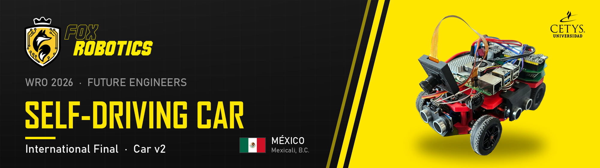</p>

# WRO 2026 — Future Engineers | FoxRobotics Self-Driving Car

> **Team:** FoxRobotics · **Members:** Erick Blanco · Jesse Banda · César Emiliano Ahumada · **Coach:** Daniel Millan
> **Country / Region:** México — Baja California · **Season:** 2026

<table>
  <tr>
    <td align="center"><b>📗 v2 — International Final (this document)</b><br>Current car, current code</td>
    <td align="center"><a href="docs/v1-national/README.md"><b>📘 v1 — Mexico National Final</b></a><br>Archived documentation, exactly as judged (1st place)</td>
  </tr>
</table>

This README documents **the car that competes at the WRO 2026 International Final (v2)**. After winning the Mexico national final with v1 we rebuilt almost every subsystem: a shorter chassis, a new two-board PCB, an encoder motor, four ToF sensors, a BNO085 IMU, a Raspberry Pi 5, and a completely new obstacle-round strategy (a planned route followed with odometry instead of reactive steering), developed with a software-in-the-loop **digital twin**. v1 is kept as a separate, unchanged document so the iteration is visible.

**Quick links:** [Videos](#videos) · [Rubric checklist](#how-this-document-follows-the-judging-rubric) · [Engineering Journal](ENGINEERING_JOURNAL.md) · [Engineering log (decisions, incidents)](docs/engineering-log.md) · [Testing workflow](docs/testing.md) · [Releases](docs/releases.md) · [Schematics (PDF)](electrical/export/) · [CAD](models/v2/) · [Firmware](src/ESP32/PurePursuitCarrera/) · [Raspberry Pi code](src/RASPI/cam/pure_pursuit/)

---

## Videos

| Obstacle Challenge — v2 (3 laps + parking) | Open Challenge — v2 (3 laps) |
|:---:|:---:|
| [](https://youtu.be/Qk4TaZrQ-Js) | [](https://youtu.be/NgGNFpsWpc8) |
| <https://youtu.be/Qk4TaZrQ-Js> | <https://youtu.be/NgGNFpsWpc8> |

| Real car vs digital twin on the same field |
|:---:|
| 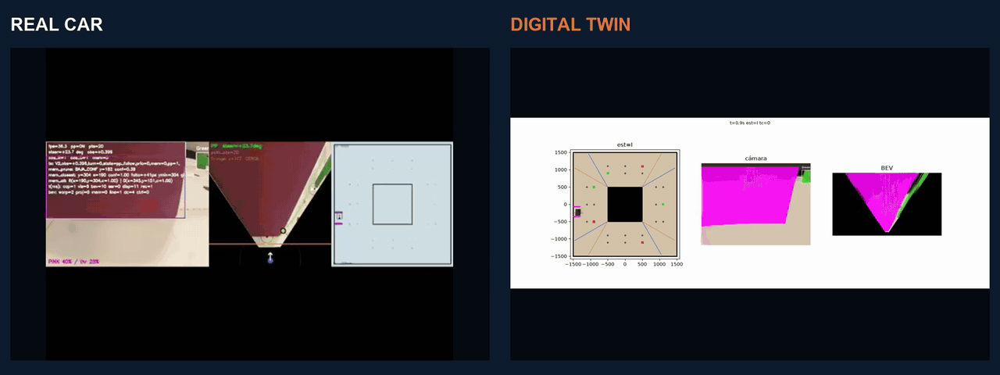 |
| <sub>Left: the real car's debug view (camera, bird's-eye view, map with the planned route). Right: the twin on the same field ([§3.9](#39-digital-twin--software-in-the-loop-simulator)).</sub> |

v1 at the national final (1st place): [Open Challenge](https://youtu.be/orP-BNSG-6s) · [Obstacle Challenge](https://youtu.be/VI6V6hTf_HE). Each driving video is at least 30 s long. Index: [`video/video.md`](video/video.md).

## The car in one minute

- **Two controllers.** A **Raspberry Pi 5** sees and plans (camera at ~40 fps, pillar map, localization, route). An **ESP32** drives (odometry, pure pursuit on the route, speed loop, every maneuver). They talk over UART at 460 800 baud ([§3.1](#31-two-controllers-one-link)).
- **Obstacle round = a planned route.** The Pi maps each pillar into one of the 6 possible seats of its straight, plans the whole lap with dynamic programming and uploads it; the ESP32 follows it with odometry, without stopping at corners ([§3.7](#37-obstacle-management--route-mode)).
- **Open round = ESP32 alone.** Heading hold on the BNO085 plus four ToF sensors: **12/12 corners in ~20–24 s** in both directions, 6/6 runs on 2026-11-21 ([§3.6](#36-open-challenge-esp32-only)).
- **Mechanics.** 176 × 125 mm, N30 30:1 motor with a 1.25 : 1 spur stage (top ~1.5 m/s), Ackermann steering with a measured turning radius of 123–134 mm ([§1.2](#12-drivetrain--gear-ratio-chosen-from-measured-speed), [§1.3](#13-steering--ackermann-rack-and-pinion)).
- **Built with a digital twin** that runs the real firmware and the real Pi code: **126/126** full simulated races without wall contact. On the real car: clean 12-corner route-mode races (runs 41 and 48) ([§3.9](#39-digital-twin--software-in-the-loop-simulator), [§3.10](#310-testing-tuning-and-validation)).
- **Honest status:** parallel parking has ended fully inside the lot on the real car once (run 104) but is not yet repeatable, and lap-1 mapping has one open case ([§3.10](#310-testing-tuning-and-validation), [§6](#6-next-steps)).

## Table of Contents

| | Section | Jump to |
|:---:|---|---|
| 📸 | **[0 · Vehicle Overview](#0-vehicle-overview)**<br>_Photos of the car from every side_ | |
| ⚙️ | **[1 · Mobility & Mechanical Design](#1-mobility-and-mechanical-design)**<br>_How it moves and turns_ | [Chassis](#11-chassis--shorter-car-battery-in-the-middle-pi-on-top) · [Drivetrain](#12-drivetrain--gear-ratio-chosen-from-measured-speed) · [Steering](#13-steering--ackermann-rack-and-pinion) · [Camera mount](#14-camera-mount) · [Assembly](#15-assembly-order-v2) · [Stability](#16-mechanical-stability) |
| 🔋 | **[2 · Power & Sensors](#2-power-and-sensor-architecture)**<br>_Electronics, PCB and what the car senses_ | [Power tree](#21-power-tree) · [Power budget](#22-power-budget) · [PCB](#23-pcb-revb--two-stacked-boards) · [Sensors](#24-sensors--selection-placement-and-calibration) · [Raspberry Pi 5](#25-main-computer--raspberry-pi-5) |
| 🧠 | **[3 · Software & Obstacle Strategy](#3-software-architecture-and-obstacle-strategy)**<br>_How it thinks and drives_ | [Two controllers](#31-two-controllers-one-link) · [Modules](#32-module-map) · [Data flow](#33-data-flow-and-timing-one-pi-cycle) · [State machine](#34-esp32-firmware-and-state-machine) · [Start](#35-start-procedure) · [Open round](#36-open-challenge-esp32-only) · [**Obstacle round**](#37-obstacle-management--route-mode) · [Edge cases](#38-edge-cases--what-can-go-wrong-on-the-field-and-what-the-car-does) · [Digital twin](#39-digital-twin--software-in-the-loop-simulator) · [MathWorks models and results](models/mathworks/README.md) · [Testing](#310-testing-tuning-and-validation) |
| 🧩 | **[4 · Engineering Decisions](#4-systems-thinking-and-engineering-decisions)**<br>_Why we built it this way_ | [Constraints](#41-the-challenge-our-goals-and-the-design-constraints) · [v1 → v2](#42-from-v1-to-v2--what-the-national-final-taught-us) · [Subsystems](#43-how-the-subsystems-constrain-each-other) · [Trade-offs](#44-trade-offs--we-chose-x-instead-of-y-because) · [Risks](#45-risks-failure-modes-and-mitigations) · [Timeline](#46-iteration-timeline) |
| 🛠️ | **[5 · Reproduce It](#5-reproducibility-and-github-quality)**<br>_Build, flash, calibrate and run your own_ | [Build](#51-build-the-car) · [ESP32 firmware](#52-esp32-firmware) · [Pi software](#53-raspberry-pi-5-software) · [Venue calibration](#54-calibration-at-a-new-venue--20-minutes) · [Run](#55-run) · [Twin on PC](#56-run-the-digital-twin-pc) · [Our results](#57-reproduce-our-results) · [Repo structure](#58-repository-structure) · [Versions](#59-versioning-releases-and-commit-history) |
| 🚀 | **[6 · Next Steps](#6-next-steps)** | |
| 💰 | **[7 · Cost Report](#7-cost-report)** | |
| 👥 | **[8 · The Team](#8-the-team)** | |
| 📄 | **[9 · License](#9-license)** | |

> ⏱️ **Short on time?** Watch the [videos](#videos), read [The car in one minute](#the-car-in-one-minute) and the **In short** line at the start of each section: that is the whole car in about 5 minutes. Collapsed blocks (▶) hold reference tables you only need when you look for a detail.

## How this document follows the judging rubric

<details>
<summary><b>Rubric checklist for judges</b> — every item the rubric asks for and the section that answers it (click to open)</summary>

Sections **1 to 5 follow the five criteria of the WRO 2026 Future Engineers documentation rubric, in the same order**. The tables below list every item the rubric asks for (the "what is evaluated" and the 6-point column) and the exact place where we answer it.

**Criterion 1 — Mobility and mechanical design → [§1](#1-mobility-and-mechanical-design)**

| The rubric asks for | Where we answer it |
|---|---|
| Chassis design choices and why | [§1.1](#11-chassis--shorter-car-battery-in-the-middle-pi-on-top): shorter chassis, motor parallel to the axle, battery in the center, Pi on top — each with its reason |
| Steering mechanism, justified | [§1.3](#13-steering--ackermann-rack-and-pinion): Ackermann rack and pinion; linkage simulated before printing; 47 mm joint spacing chosen from an Ackermann-% table |
| Drivetrain, justified | [§1.2](#12-drivetrain--gear-ratio-chosen-from-measured-speed): one motor, printed differential, four printed gear ratios compared |
| Torque / speed reasoning | [§1.2](#12-drivetrain--gear-ratio-chosen-from-measured-speed): speed per ratio, measured grip limit, torque check with a ≈5× margin |
| Mechanical stability | [§1.6](#16-mechanical-stability): rollover vs sliding, braking, straight-line behavior, rigid camera mount |
| Trade-offs and why each component | [§1.1](#11-chassis--shorter-car-battery-in-the-middle-pi-on-top), [§1.2](#12-drivetrain--gear-ratio-chosen-from-measured-speed) ("Why 1.25 : 1"), [§1.3](#13-steering--ackermann-rack-and-pinion), material choice in [§1.1](#11-chassis--shorter-car-battery-in-the-middle-pi-on-top) |
| Tests or iterations that changed performance | [§1.3](#13-steering--ackermann-rack-and-pinion) (turning radius measured on the mat), [§1.2](#12-drivetrain--gear-ratio-chosen-from-measured-speed) (dynamics measured on the mat), [§4.2](#42-from-v1-to-v2--what-the-national-final-taught-us) (v1 → v2) |
| Diagrams | CAD renders and turntable ([§1.1](#11-chassis--shorter-car-battery-in-the-middle-pi-on-top)), steering geometry tables ([§1.3](#13-steering--ackermann-rack-and-pinion)) |
| Reproducible | CAD + STEP + STL in [`models/v2/`](models/v2/), gear generator in [`Mecanica/Engranes/`](Mecanica/Engranes/), assembly order [§1.5](#15-assembly-order-v2), build steps [§5.1](#51-build-the-car) |

**Criterion 2 — Power and sensor architecture → [§2](#2-power-and-sensor-architecture)**

| The rubric asks for | Where we answer it |
|---|---|
| Power system architecture | [§2.1](#21-power-tree): power tree diagram, why two 5 V regulators and a separate 3.3 V rail |
| Current consumption reasoning / power budget | [§2.2](#22-power-budget): per-rail budget, battery current and capacity |
| Wiring diagrams | [§2.3](#23-pcb-revb--two-stacked-boards): schematics (PDF) of both boards, KiCad projects, ESP32 pin map |
| Sensor selection and trade-offs | [§2.4](#24-sensors--selection-placement-and-calibration): sensor table, ToF vs ultrasonic, BNO085 vs MPU-6050 |
| Placement justified by the field geometry | [§2.4](#24-sensors--selection-placement-and-calibration): placement column (wall height 100 mm, 1 m straight depth, camera coverage) |
| Calibration method | [§2.4](#24-sensors--selection-placement-and-calibration): ToF ROI and status rules, BNO085 sign/scale, camera lens shading, color, BEV; venue procedure [§5.4](#54-calibration-at-a-new-venue--20-minutes) |
| Failure points | [§2.3](#23-pcb-revb--two-stacked-boards) (board rotated 180° killed a Pi), [§2.4](#24-sensors--selection-placement-and-calibration) (ToF on the black wall), [§4.5](#45-risks-failure-modes-and-mitigations) (risk table) |
| Evidence of iteration | [§2.4](#24-sensors--selection-placement-and-calibration) (ToF findings → changes), [§2.5](#25-main-computer--raspberry-pi-5) (Pi 4 → Pi 5 profiling), [§4.2](#42-from-v1-to-v2--what-the-national-final-taught-us) |

**Criterion 3 — Software architecture and obstacle strategy → [§3](#3-software-architecture-and-obstacle-strategy)**

| The rubric asks for | Where we answer it |
|---|---|
| Code structure and modularity | [§3.2](#32-module-map): module map of the Pi and the ESP32 |
| State machine, with justification | [§3.4](#34-esp32-firmware-and-state-machine): state diagram + why each state exists |
| Flow diagram / data flow | [§3.3](#33-data-flow-and-timing-one-pi-cycle) (one Pi cycle), [§3.7](#37-obstacle-management--route-mode) (obstacle pipeline) |
| Lane following | [§3.4](#34-esp32-firmware-and-state-machine) (pure pursuit on the route), [§3.6](#36-open-challenge-esp32-only) (open round: heading hold + wall cascade) |
| Obstacle logic | [§3.7](#37-obstacle-management--route-mode): seats, lap-1 planning, route planner, localization, blind start, surprise pillar |
| Algorithm justification (PID, CV, IMU…) | [§3.7.4](#374-route-planner--dynamic-programming) ("Why DP"), [§3.6](#36-open-challenge-esp32-only) (PID values from track tests), [§2.4](#24-sensors--selection-placement-and-calibration) (CV by color ratios), [§3.1](#31-two-controllers-one-link) (why the follower runs on the ESP32) |
| Edge cases | [§3.8](#38-edge-cases--what-can-go-wrong-on-the-field-and-what-the-car-does): table of every edge case and what the car does |
| Testing / tuning process | [§3.9](#39-digital-twin--software-in-the-loop-simulator) (benchmark rule in the twin), [§3.10](#310-testing-tuning-and-validation) (workflow) |
| Metrics used to validate performance | [§3.10](#310-testing-tuning-and-validation): metrics per run, component results, open and obstacle results, validation matrix |
| Code documentation | Every parameter in [`config.py`](src/RASPI/cam/pure_pursuit/config.py) has its unit and the reason for its value; module docstrings; this section |

**Criterion 4 — Systems thinking and engineering decisions → [§4](#4-systems-thinking-and-engineering-decisions)**

| The rubric asks for | Where we answer it |
|---|---|
| Explicit constraints | [§4.1](#41-the-challenge-our-goals-and-the-design-constraints): constraints from the rules and from our own limits |
| How the subsystems work together | [§4.3](#43-how-the-subsystems-constrain-each-other): "if we change X, it affects Y" with real examples |
| Trade-offs, "we chose X instead of Y" with data | [§4.4](#44-trade-offs--we-chose-x-instead-of-y-because) |
| Iteration and testing cycles | [§4.2](#42-from-v1-to-v2--what-the-national-final-taught-us) (v1 → v2, each problem → one change), [§4.6](#46-iteration-timeline) (timeline), [Engineering Journal](ENGINEERING_JOURNAL.md) |
| Risk / failure analysis and mitigation | [§4.5](#45-risks-failure-modes-and-mitigations) |

**Criterion 5 — Reproducibility and GitHub quality → [§5](#5-reproducibility-and-github-quality)**

| The rubric asks for | Where we answer it |
|---|---|
| Can another team reproduce this robot? | [§5.1](#51-build-the-car)–[§5.6](#56-run-the-digital-twin-pc): build, firmware, Pi software, venue calibration, run, simulator — step by step |
| Reproduce the results we report | [§5.7](#57-reproduce-our-results): each number in this document → the command and the data that produce it |
| Repository structure and file organization | [§5.8](#58-repository-structure) |
| CAD, wiring and code included | [`models/v2/`](models/v2/), [`electrical/`](electrical/), [`src/`](src/) |
| Meaningful commit history | [§5.9](#59-versioning-releases-and-commit-history) |
| Testing workflow documented | [§3.10](#310-testing-tuning-and-validation), [`docs/testing.md`](docs/testing.md) |
| Versioning / release notes | [§5.9](#59-versioning-releases-and-commit-history), [`docs/releases.md`](docs/releases.md) |
| README ≥ 5000 characters | This document |

</details>

---

# 0. Vehicle Overview

<p align="center">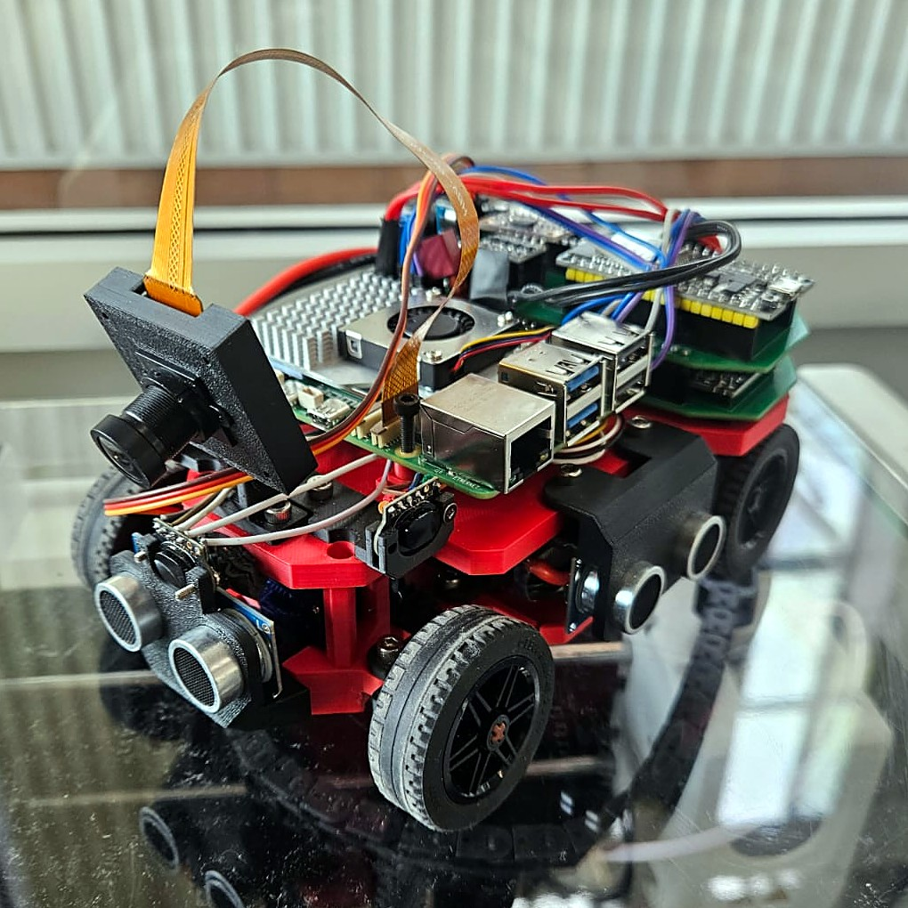<br><b>Isometric</b></p>

<table>
  <tr>
    <td align="center"><a href="v-photos/labels/front_labels.jpg">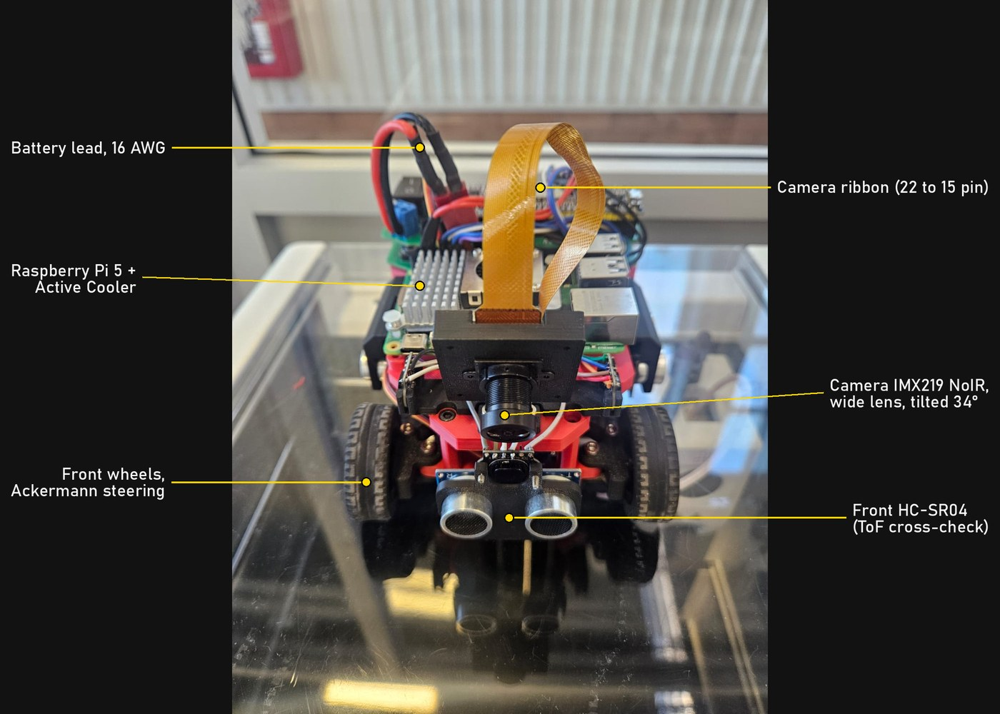</a><br><b>Front</b></td>
    <td align="center"><a href="v-photos/labels/rear_labels.jpg">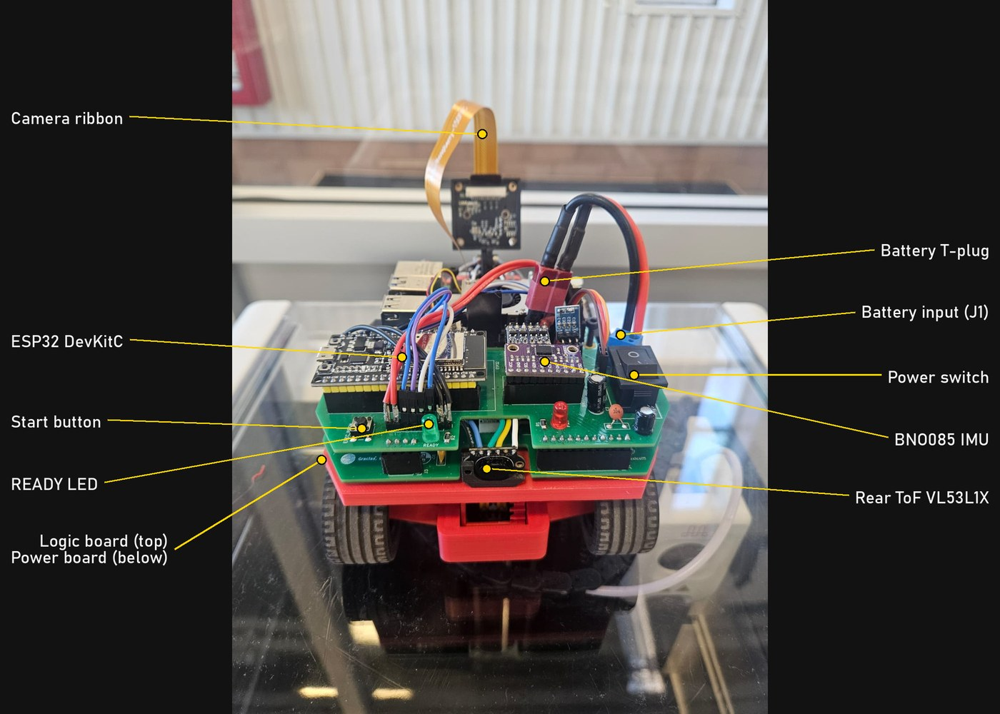</a><br><b>Rear</b></td>
  </tr>
  <tr>
    <td align="center"><a href="v-photos/labels/left_labels.jpg">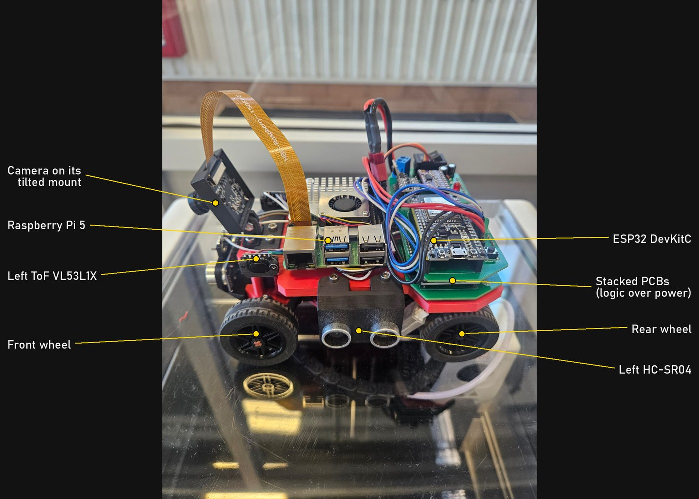</a><br><b>Left</b></td>
    <td align="center"><a href="v-photos/labels/right_labels.jpg">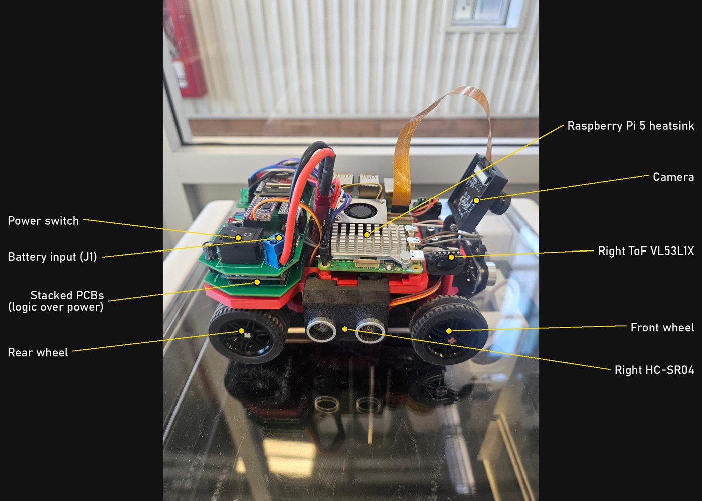</a><br><b>Right</b></td>
  </tr>
  <tr>
    <td align="center"><a href="v-photos/labels/top_labels.jpg">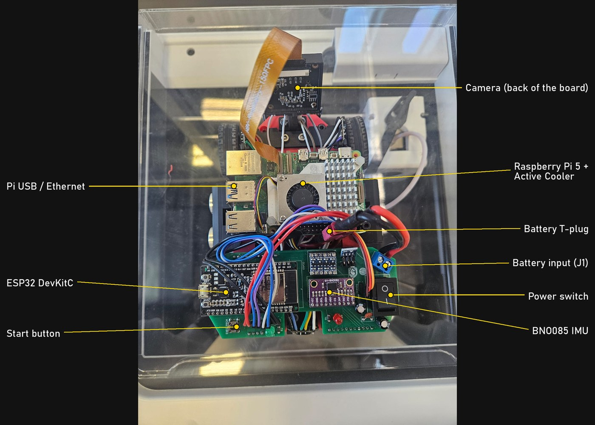</a><br><b>Top</b></td>
    <td align="center"><a href="v-photos/bottom.jpeg"></a><br><b>Bottom</b></td>
  </tr>
</table>

Each part is labelled on the photo; click a photo for full size. The unlabelled originals (the six views the rules ask for) are in [`v-photos/`](v-photos/), and [`docs/img/make_labels.py`](docs/img/make_labels.py) draws the labels.

The v1 photos are in `v-photos/v1/` for the [v1 document](docs/v1-national/README.md).

### Key specifications (v2)

| Parameter | Value |
|---|---|
| Dimensions | **176 × 125 mm** footprint (front overhang 41.2 mm, rear 21.8 mm, measured) · height **≈120 mm** including cables (104 mm to the top of the camera mount in CAD) |
| Mass | **557 g** (measured; the simulator uses 564 g) |
| Wheelbase / rear track | 113 mm / 110 mm |
| Drive | Rear-wheel drive, one motor, printed open differential |
| Drive motor | N30 30:1 metal gear motor with a 7 CPR Hall encoder (since 2026-11-17; the N20 50:1 before it is described in §1.2) |
| Final drive | Spur gears 1.25 : 1 (total 37.5 : 1) — top speed ~1.5 m/s measured on the mat; lap 1 capped at 1.0 m/s, laps 2–3 limited by the route's speed profile |
| Steering | SG90 servo, rack and pinion (module 1, 19 teeth), Ackermann linkage; min. turning radius **123 mm right / 134 mm left** (measured on the mat) |
| High-level computer | Raspberry Pi 5 (8 GB) — camera, vision, mapping, localization, route planning |
| Real-time controller | ESP32 DevKitC (dual core) — odometry, route following, speed loop, state machine, all actuators and sensors |
| Link | UART 460 800 baud, line protocol with XOR checksum |
| Camera | Raspberry Pi Camera v2 (IMX219) with NoIR wide-angle lens, 640 × 480 at ~40 fps, automatic exposure (a fixed per-venue exposure can be saved, §5.4) |
| Distance sensors | 4 × VL53L1X time-of-flight (front, left, right, rear) |
| IMU | BNO085, fused yaw over UART-RVC at 100 Hz |
| Motor driver | TB6612FNG (SparkFun ROB-14450 carrier) |
| Battery | 3S LiPo 11.1 V, 2200 mAh |
| Regulation | 2 × MINI560 5 V buck (one only for the Pi 5) + 3.3 V regulator for the sensors |
| PCB | Two stacked 2-layer boards, 117.5 × 50.6 mm each (KiCad, made by JLCPCB) |

### System block diagram

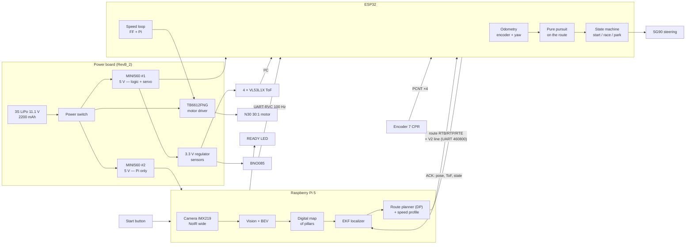

The **Raspberry Pi 5** answers *where should the car go*: it sees the pillars and lines, keeps a map of the field, estimates the car's pose and plans the route. The **ESP32** answers *how to drive there right now*: it integrates odometry at loop rate, steers along the route with pure pursuit, holds the speed with the encoder and runs every maneuver. The reason for this split, and why the route follower moved from the Pi to the ESP32 in v2, is in [§4.4](#44-trade-offs--we-chose-x-instead-of-y-because).

---

# 1. Mobility and Mechanical Design

> [!NOTE]
> **In short:** a 3D-printed car of 176 × 125 mm (27 % shorter than v1), one N30 motor geared 1.25 : 1 (top ~1.5 m/s), Ackermann steering with a measured turning radius of 123–134 mm, and the battery — 43 % of the mass — low in the center.

## 1.1 Chassis — shorter car, battery in the middle, Pi on top

Every structural part is 3D-printed in PLA (SUNLU) on a Bambu Lab A1 and designed in SolidWorks. The wheels and axles are LEGO parts: LEGO axles keep their dimensions far better than printed shafts, which flex and misalign under load.

v2 CAD is in [`models/v2/`](models/v2/): SolidWorks parts + assembly in [`cad/`](models/v2/cad/), one STEP per part in [`step/`](models/v2/step/) and printable STL in [`stl/`](models/v2/stl/), with the parts list in [`models/v2/README.md`](models/v2/README.md). Renders of the full assembly are in [`models/v2/renders/`](models/v2/renders/). The top-level `models/` folder is the v1 car.

<p align="center"></p>

| Isometric | Top | Bottom |
|:---:|:---:|:---:|
|  | 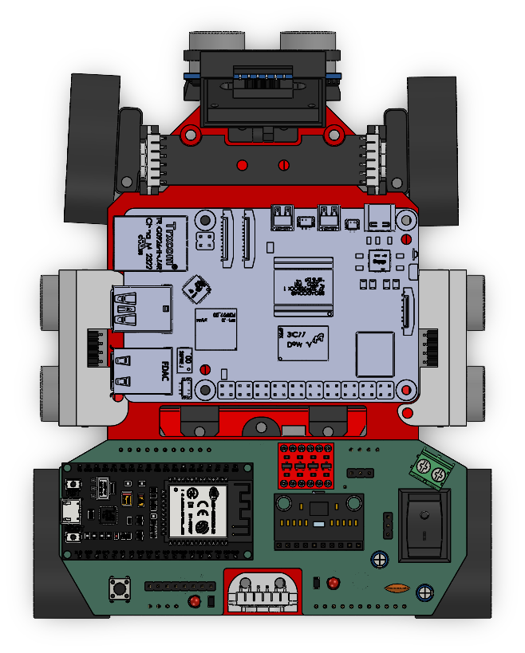 |  |

For v2 we rebuilt the chassis around two problems measured on v1:

1. **Length.** v1 was 210 mm long, ≈240 mm with an extension we added so it could drive out of the parking lot. Every dodge swept a lot of floor and the parking maneuver had little room.
2. **Heat.** The Raspberry Pi 4 sat enclosed in the middle of the chassis and reached 84 °C with thermal throttling, which lowered the vision frame rate.

| Change | How | Why |
|---|---|---|
| **Motor parallel to the rear axle** | The motor lies along the axle and drives the differential through a spur pair, instead of a perpendicular bevel pair | A motor perpendicular to the axle adds its whole length to the car; parallel, it adds almost nothing |
| **Battery in the center** | The 3S pack sits crosswise in a side-loading tunnel, where the Pi used to be | The heaviest part is low and centered, which balances the load front to rear; the side tunnel makes swaps fast |
| **Raspberry Pi 5 on top** | The Pi moves from the enclosed bay to the top of the car | Free air for cooling; camera cable and SD card stay reachable |
| **Stacked PCB in the middle** | Power board below, logic board above, on standoffs (§2.3) | Half the footprint of a single board |
| **Result** | **176 × 125 mm** (measured) — 27 % shorter than v1 | Smaller turning radius and a smaller parking lot to fit in |

**Why we kept the height.** The chassis height is about the same as v1 for stability in fast turns, and the camera height (≈95 mm) and a moderate downward tilt stay close to v1 so the bird's-eye-view geometry carries over (it is still re-calibrated on every mount, §2.4).

**Material choice.** PLA prints fast, does not warp and is stiff enough indoors. PETG (impact) and ABS (heat) offer properties we do not need on a flat indoor mat, while PLA let us reprint a part in under an hour when a test showed a problem.

## 1.2 Drivetrain — gear ratio chosen from measured speed

**Components:** N30 30:1 metal gear motor with a 7 CPR Hall encoder → spur pair **20 T → 25 T (1.25 : 1)** → printed open differential → LEGO rear axles → LEGO wheels Ø 42.7 mm (effective, measured by rolling 50 cm).

The involute gear profiles are generated by our own script ([`Mecanica/Engranes/gen_pinon.py`](Mecanica/Engranes/gen_pinon.py)) and exported as DXF for SolidWorks, with 0.10 mm of backlash for printing. We printed four ratios with the same center distance so we could swap them: 15/30 (2 : 1), 18/27 (1.5 : 1), 20/25 (1.25 : 1) and 23/22.

The drivetrain was settled in two steps: first the **spur ratio**, with the N20 50:1 motor the car was built with, then a **faster motor** (N30 30:1, 2026-11-17) on the same ratio.

**Step 1 — the ratio (N20 50:1, 460 rpm, 12 CPR).** Wheel speed at no load = 460 rpm / ratio; linear speed = rpm × π × 42.7 mm / 60.

| Spur ratio | Total reduction | Wheel rpm (no load) | Top speed (no load) | Wheel torque vs. 2 : 1 | Notes |
|---|---:|---:|---:|---:|---|
| 2 : 1 (v1 ratio) | 100 : 1 | 230 | 514 mm/s | 1.00 | Lap-time limited on the straights |
| 1.5 : 1 | 75 : 1 | 307 | 685 mm/s | 0.75 | Evaluated in the twin |
| **1.25 : 1 (v2)** | **62.5 : 1** | **368** | **822 mm/s** | **0.63** | **Measured: PWM 255 → ~800 mm/s (97 % of no-load)** |

We measured the car's dynamics on the competition mat (2026-10-24, battery 12.1 → 11.9 V, logs and method in [`docs/route-following-bench.md`](docs/route-following-bench.md)):

| Measurement (N20) | Result |
|---|---|
| Speed at PWM 150 / 255 | ~400 mm/s / ~800 mm/s |
| Lateral grip limit (start of sliding in a constant-radius arc) | **2.5–2.8 m/s²** |
| Coasting deceleration (motor off) | ≈ 2.7 m/s², constant |
| Short brake from PWM 150 | stops in 6–7 mm |
| Short brake from PWM 255 | wheels lock: the encoder sees 13–23 mm, the car slides 24–51 mm more |

**Why 1.25 : 1.** The lateral grip, not the motor, limits the speed in every corner and dodge: at the 2.6 m/s² limit, a 300 mm radius allows √(2.6 × 0.30) ≈ 0.88 m/s. So the useful extra speed is on the straights, where the 2 : 1 ratio capped us at 514 mm/s, and the speed profile (§3.7.6) brakes before each curve to the grip-limited speed. We did not go to 23/22: the N20 already ran near its no-load speed at 255 and braking from full speed already locked the wheels.

**Step 2 — the N30 30:1 motor (2026-11-17).** With the ratio fixed, the straights were still limited by the N20's ~0.8 m/s. We changed to an N30 30:1 gear motor with a 7 CPR encoder on the same pins, driver and gears, and measured it again on the mat with a bench sketch ([`N30Test`](src/ESP32/N30Test/); notes in [`medidas_20261117/NOTAS.md`](src/RASPI/cam/pure_pursuit/twin/calib/medidas_20261117/NOTAS.md)):

| | N20 50:1 (until 11-17) | **N30 30:1 (now)** |
|---|---:|---:|
| Encoder counts per mm (pushed 1 m along a tape) | 5.45 | **7.523** |
| Top speed on the mat (PWM 255) | ~0.8 m/s | **~1.5 m/s** (1.50 m/s at 11.9 V, 1.56 m/s on a full pack) |
| Speed per PWM, forward (fit 100–255) | 3.82 mm/s · (PWM − 45.5) | 6.51 mm/s · (PWM − 22.9) |
| Time constant of a speed step | 0.17 s | 0.28 s (63 % of the speed in 270–320 ms) |
| Coasting deceleration | 2.7 m/s² | 1.0 m/s² |
| Short brake from top speed | slides 24–51 mm past the encoder | locks above ~600 mm/s; from 1.5 m/s ~24 cm to stop, ~15 cm unseen by the encoder |

**Torque check.** From standstill at PWM 255 the N30 reaches 63 % of 1.5 m/s in ~0.28 s, an initial acceleration of ≈ 1.5 / 0.28 ≈ **5 m/s²**, about twice the 2.5–2.8 m/s² the tires can transmit. So the motor has more torque than the grip can use: accelerating out of the lot or out of a corner is limited by traction, not by the motor. Starting from rest needs only PWM 11 forward and 10 in reverse on the mat.

**What the faster motor changed.** The coasting and short-brake rows show the cost: at 1.5 m/s the car rolls ~1 m with the motor off, and a short brake locks the wheel and loses ~15 cm of odometry. So the ESP32 never brakes by shorting the motor at speed; it ramps the speed down through the speed loop, and the route's speed profile brakes at ≤ 3.0 m/s² before each curve (§3.7.6).

**Speed loop.** Without an encoder the speed of v1 changed with the battery voltage (a fresh pack made the maneuvers ~17 % stronger). In v2 the ESP32 converts the requested PWM into a target speed and closes a PI loop on the encoder speed (Kp 0.10 PWM per mm/s, Ki 0.60, integral clamped at ±80 PWM, encoder speed filtered with τ = 50 ms); the feed-forward uses the measured N30 model above. Up to PWM 155 (≈ 418 mm/s) a requested PWM keeps the speed it meant with the N20, so every maneuver tuned before the motor change drives the same; above 155 it rises linearly to the N30's top speed. Lap 1, while the map is still incomplete, is capped at 1.0 m/s; in laps 2–3 the route's speed profile sets the speed. In the simulator (N20 model), the time from start to the parking lot stayed flat (29.4 s) from 11.1 V to 12.2 V with the loop, against 29.25 → 26.10 s without it.

**Encoder.** 7 pulses per channel × 4 (quadrature) × 30 × 1.25 = 1050 counts per wheel revolution in theory = 7.83 counts/mm; we **measured 7.523 counts/mm** by pushing the car 1 m along a tape (the 4 % difference is the real rolling radius of the tire under load, ~44 mm). The ESP32 counts it with its **PCNT hardware counter** in ×4 quadrature with a 1 µs glitch filter: the first firmware used interrupts, which lost ~25–65 % of the pulses on the floor under motor load (see [§4.5](#45-risks-failure-modes-and-mitigations)).

## 1.3 Steering — Ackermann rack and pinion

Steering uses an SG90 servo that turns a module-1 pinion; the pinion drives a printed rack, and two tie rods move the steering knuckles. A rack pushes both tie rods symmetrically, so both wheels get the correct angle at every position, unlike a single servo arm.

### v1 problems and the redesign

We simulated the linkage in Python with the exact CAD dimensions (the model matched the CAD within ~1°) before reprinting anything.

**Problem 1 — v1 was anti-Ackermann.** In a turn the inner wheel must steer *more* than the outer one. Ideal (100 %) Ackermann is reached when cot(δ_outer) − cot(δ_inner) = T / L = 60 / 112.85 = 0.532 (T = kingpin track, L = wheelbase). In v1 the outer wheel steered *more* (39.5° inner, 42.8° outer), so one front wheel always dragged sideways. With the knuckles fixed, the only free parameters were the spacing of the rack joints and the tie-rod length, which must change together for the wheels to point straight with the rack centered: linkage = √((38.66 − spacing/2)² + 9.94²).

| Rack joint spacing | Tie rod | Ackermann at 30° | 40° | 45° | 50° | 55° |
|---|---|---|---|---|---|---|
| 28.5 mm (v1) | 26.0 mm | anti-Ackermann | | | | |
| 43.0 mm | 19.83 mm | 51 % | 62 % | 69 % | 76 % | 84 % |
| **47.0 mm (v2)** | **18.13 mm** | 76 % | **89 %** | **95 %** | **102 %** | 110 % |
| 50.0 mm | 16.89 mm | 99 % | 111 % | 117 % | 124 % | 131 % |

We chose **47 mm** because it is closest to 100 % between 40° and 50°, where the car actually turns in corners and while parking. At small angles the error is under 0.7°.

**Problem 2 — v1 could not turn tightly enough.** The steering angle depends almost only on how far the rack moves. We compared shorter knuckle arms, moving the rack, and a bigger pinion; only the bigger pinion needed no new chassis or knuckles.

| | v1 | **v2** |
|---|---|---|
| Pinion | module 1, 14 teeth | **module 1, 19 teeth** (servo moved 2.5 mm away from the rack) |
| Rack travel per servo degree | 0.122 mm/° | **0.166 mm/°** |
| Inner / outer wheel at full lock (CAD) | ~37° / ~32° | **53.1° / 37.0°** (~106 % Ackermann) |
| Wheelbase | ≈147 mm | **113 mm** |
| Turning radius at the rear-axle center | ~208 mm | **123 mm right / 134 mm left (measured on the mat)** |

### Measured on the real car

The CAD predicts the geometry; the mat decides. With the car assembled we ran constant-servo circles at PWM 150 on the competition mat, 3 repetitions each, and measured the radius at the rear-axle center from odometry (2026-10-22):

| Servo command | 1 (right stop) | 4 | 8 | 16 | 75 (center) | 140 | 144 | 148 | 152 | 156 (left stop) |
|---|---|---|---|---|---|---|---|---|---|---|
| Radius (mm) | **123** | 130 | 142 | 166 | ∞ | 153 | 140 | 136 | **134** | 136 |

<p align="center">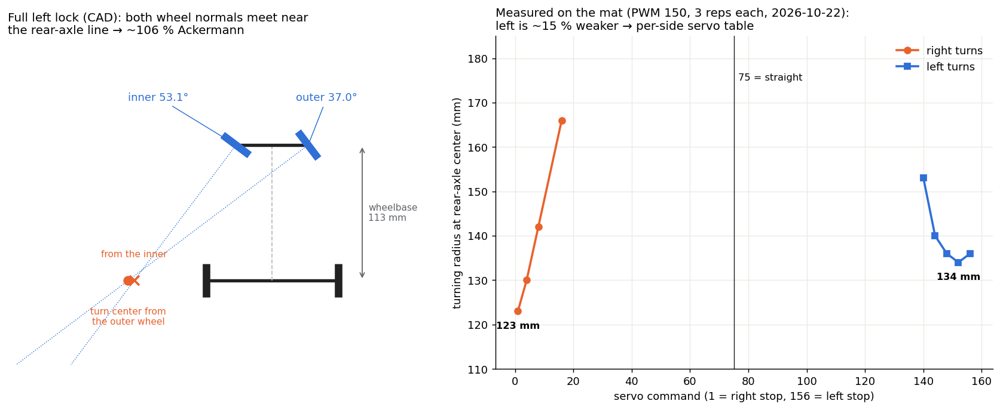</p>

What this taught us:
- **The usable servo range is 1–156** (mechanical stops), with **75 = straight** (straight runs at PWM 150 approached from both sides). At 160 the servo strains against the stop with no gain in radius.
- **Left turns are ~15 % weaker than right turns.** Moving the wheels by hand at full left lock showed the play is in the *outer* wheel's linkage. The servo backlash is ±1.5 servo units and the wheels follow the servo with a **0.10 s lag**.
- The servo → wheel relation is **not linear** near the stops. The firmware therefore converts the wheel angle requested by the controller into a servo command with a **measured piecewise table per side** (`rutaServo()` in the firmware), and the simulator uses the same table.

| Wheel angle (bicycle model) | 0° | 7.6–8.7° | 15.6–18.2° | 53° |
|---|---|---|---|---|
| Servo units from center — right | 0 | 13.5 | 28.5 | 72.5 |
| Servo units from center — left | 0 | 13.5 | 28.5 | 71.5 |

**Servo load.** The bigger pinion needs ~1.36× more servo torque for the same rack force, still fine for an SG90 on a ~0.56 kg car. The servo must not stay stalled against a stop: it heats up and loads the 5 V rail, which is why software limits are set at the measured stops.

## 1.4 Camera mount

The camera sits at the front on the centerline, tilted down. We measure its real pose from a calibration image of floor crosses (perspective-n-point fit of the homography, §2.4). After the camera was remounted on 2026-11-19 the fit gives **tilt 34.0°, height 93 mm, 169 mm ahead of the rear axle** (before: 24.8°, 95 mm, 152 mm), equivalent pinhole horizontal FOV 74°. With this pose the bottom image edge sees the floor 0.20 m ahead of the rear axle, the row at y = 100 px 0.51 m and the row at y = 20 px 1.18 m, so one frame covers the 1 m depth of a straight section. The mount must be rigid: a few millimeters of change move the bird's-eye-view calibration, so the calibration is re-done after any remount and re-checked after a crash.

## 1.5 Assembly order (v2)

1. **Chassis base** — reference part for everything else.
2. **Steering** — 19-tooth pinion on the servo (with the 2.5 mm spacer), servo into its pocket, rack, tie rods (trim in 0.05–0.1 mm steps until the wheels are straight), knuckles and front LEGO axles. Set the servo to 75 and check the car drives straight.
3. **Drivetrain** — gear motor into its holder parallel to the axle, 20 T pinion on the motor D-shaft, differential with the 25 T ring, rear LEGO axles with bushings and wheels.
4. **Sensors** — four ToF mounts (front, left, right, rear; ~50 mm above the floor, level), BNO085 near the center of rotation, camera mount.
5. **Electronics** — power board (RevB_2) on its standoffs, logic board (RevB_1) on top **in the keyed orientation** (see the warning in §2.3), battery into the center tunnel, Raspberry Pi 5 on top.
6. **Cables** — camera ribbon (22-to-15-pin), ToF and IMU leads, encoder, servo, motor.

<p align="center">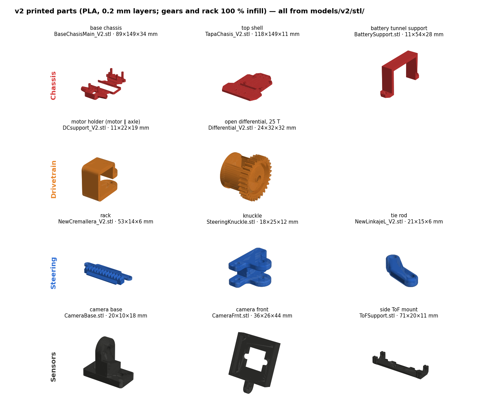</p>

All screws are **M3 × 10 mm**.

## 1.6 Mechanical stability

For this car, stability means four things: it must not tip in a turn, it must stop without sliding away from its odometry, it must drive straight with the servo centered, and the camera must not move relative to the chassis.

**It slides long before it can tip.** In a turn the car tips over when the lateral acceleration reaches g · (t/2) / h, where t is the track width and h the height of the center of mass. Our rear track is 110 mm. Even in the worst case, with all of the mass at the very top of the car (h ≈ 120 mm), tipping needs 9.81 × 55 / 120 ≈ **4.5 m/s²**. The tires start sliding at **2.5–2.8 m/s²** (measured, [§1.2](#12-drivetrain--gear-ratio-chosen-from-measured-speed)), so the car always slides before it can tip, and the real center of mass is much lower than the worst case: the battery, the motor and the power board sit at the bottom ([§1.1](#11-chassis--shorter-car-battery-in-the-middle-pi-on-top)). The speed profile keeps every corner and dodge under the grip limit ([§3.7.6](#376-speed-profile)), so in normal driving neither happens.

**Weight distribution.** The battery, the heaviest part, sits low and between the axles in the center tunnel, which balances the load front to rear and keeps the weight on the driven rear wheels. The Raspberry Pi 5 on top is a deliberate trade-off: it raises the center of mass slightly, but it gets free air for cooling, and the margin above shows that tipping is not a risk.

| Part | Mass | Share |
|---|---:|---:|
| Battery (3S LiPo 2200 mAh) | 237 g | 43 % |
| Raspberry Pi 5 + Active Cooler | 73 g | 13 % |
| PCB | 54 g | 10 % |
| Chassis, drivetrain, wheels, servo, sensors and camera | 193 g | 35 % |
| **Total (measured)** | **557 g** | |

The battery alone is 43 % of the mass, which is why its position matters most: placing it low and centered sets the balance of the whole car.

**Braking.** A short brake (motor terminals shorted) locks the wheels above ~600 mm/s; with the N30 at 1.5 m/s the car slides ~15 cm that the encoder never sees, which would corrupt the odometry the route follower depends on. So the ESP32 slows down through the speed loop, lap 1 is capped at 1.0 m/s, and the speed profile brakes at ≤ 3.0 m/s² before each curve ([§1.2](#12-drivetrain--gear-ratio-chosen-from-measured-speed), [§3.7.6](#376-speed-profile)). From ~500 mm/s a short brake stops the car in ~26 mm without sliding.

**Driving straight.** The servo center (75) was found by driving straight at PWM 150 from both sides. The steering has ±1.5 servo units of backlash and the left turn is ~15 % weaker because of play in the outer wheel's linkage ([§1.3](#13-steering--ackermann-rack-and-pinion)); the firmware compensates with a measured servo table per side instead of assuming a symmetric linkage.

**Rigid camera.** A few millimeters of camera movement shift the bird's-eye-view calibration, so the mount is rigid and the calibration is re-checked with a calibration image after any crash or remount ([§1.4](#14-camera-mount)).

---

# 2. Power and Sensor Architecture

> [!NOTE]
> **In short:** a 3S LiPo drives the motor directly and feeds two separate 5 V regulators — one only for the Pi, so servo spikes never reach it — on two stacked PCBs. The car senses with a camera (colors), four ToF sensors (walls), a BNO085 (heading) and an encoder (distance).

## 2.1 Power tree

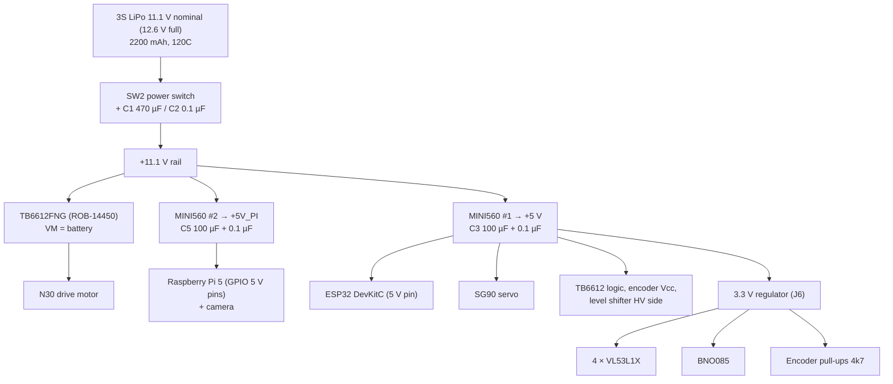

**Why two 5 V regulators.** The Raspberry Pi throttles its CPU when its supply sags, which directly lowers the vision frame rate. We saw this on v1 when the Pi 4 was fed through thin jumper wires (`throttled=0x50005`, CPU at 600 MHz). The servo draws current spikes of up to ~0.7 A. In v2, MINI560 #2 feeds **only** the Raspberry Pi 5, so servo and logic spikes on MINI560 #1 can never reach the Pi.

**Why a separate 3.3 V regulator for the sensors.** The ESP32 DevKit's on-board LDO also feeds the ESP32 itself. Four ToF sensors plus the BNO085 and the encoder pull-ups are kept on their own 3.3 V regulator (connector J6) so their current does not heat or load the ESP32's LDO.

**Why the motor runs from the battery.** The TB6612FNG takes battery voltage directly, so motor stall currents never pass through the 5 V regulators.

## 2.2 Power budget

Each rail is budgeted from the component datasheets: a typical value for normal racing and a design peak with every load at its worst case at the same time (servo stalled, all ToF ranging, Pi under full vision load). The regulators and the battery are sized against the design peak.

| Rail | Load | Typical | Design peak | Basis |
|---|---|---:|---:|---|
| **+5V_PI** (MINI560 #2, 5 A rated) | Raspberry Pi 5 under vision load (4 cores ~55 %) | 1.3 A | 2.2 A | Raspberry Pi 5 power figures; the loop uses ~2.2 cores |
| | Camera v2 | 0.25 A | 0.25 A | Module figure |
| | **Rail total** | **1.55 A** | **2.45 A** | 49 % of the 5 A peak rating |
| **+5 V** (MINI560 #1) | ESP32 (radio off in competition) | 0.08 A | 0.25 A | Datasheet |
| | SG90 servo | 0.25 A | 0.70 A | Running / stall |
| | TB6612 logic, encoder, level shifter | 0.02 A | 0.03 A | Datasheets |
| | 3.3 V regulator → 4 × VL53L1X + BNO085 | 0.09 A | 0.18 A | ~20 mA each ranging (40 mA peak) + 13 mA |
| | 3 × HC-SR04 (cross-check) | 0.045 A | 0.045 A | 15 mA each (datasheet) |
| | **Rail total** | **0.49 A** | **1.21 A** | 24 % of the 5 A peak rating |
| **Battery** | Drive motor via TB6612 | ~0.3 A cruising (no-load 0.1 A) | 1.6 A stall @ 12 V (vendor) | TB6612: 1.2 A continuous, 3.2 A peak per channel — a stall is above the continuous rating but under the peak, so it is only acceptable for short events; the anti-stall check in §3.4 notices a stopped wheel within 250 ms |

**Battery current.** With ~90 % buck efficiency, both 5 V rails at design peak draw 5 V × (2.45 + 1.21) A / 0.9 ≈ 20 W, i.e. ≈ 1.8 A from the 11.1 V pack, plus the motor. The 2200 mAh pack lasts well over 30 minutes at that worst case against a 3-minute round, so **capacity is not the constraint; voltage is.** The speed loop (§1.2) removes most of the voltage dependence, and we still check the pack before each round (good window 11.7–12.2 V).

**Pi supply check.** `vcgencmd get_throttled` must read `0x0` under full load. On the battery the Pi rail measured **5.07 V at idle, throttled `0x0`**.

## 2.3 PCB RevB — two stacked boards

v1 had one board shaped around the Raspberry Pi 4. v2 adds four ToF sensors (each with its own XSHUT line), the BNO085, the encoder, a second regulator and a power switch, on a chassis 27 % shorter. All of that does not fit on one footprint, so v2 uses **two 2-layer boards stacked on 11-pin and 4-pin headers**, each 117.5 × 50.6 mm, designed in KiCad 10 and made by JLCPCB (5 pcs per design, ~40 USD total with shipping).

| Board | Contents | Why on this board |
|---|---|---|
| **RevB_2 — power** (bottom) | Battery input, MINI560 #1 and #2 with their capacitors, TB6612FNG carrier, encoder connector with 4k7 pull-ups, 4 ToF connectors (I²C + XSHUT), 3 HC-SR04 connectors (TRIG + level-shifted ECHO) for the ToF cross-check | Keeps the switching regulators and the motor currents, with their heat and noise, away from the logic; heaviest board, so it sits low |
| **RevB_1 — logic** (top) | ESP32 DevKitC, power switch + bulk capacitors, level shifter, BNO085 header, servo header, 3.3 V regulator header, `TO_PI` connector (UART, start button, READY LED, 5 V for the Pi), PWR and READY LEDs | All connectors the team touches between runs are on top and reachable |

| | Logic board RevB_1 | Power board RevB_2 |
|---|---|---|
| Top render |  | 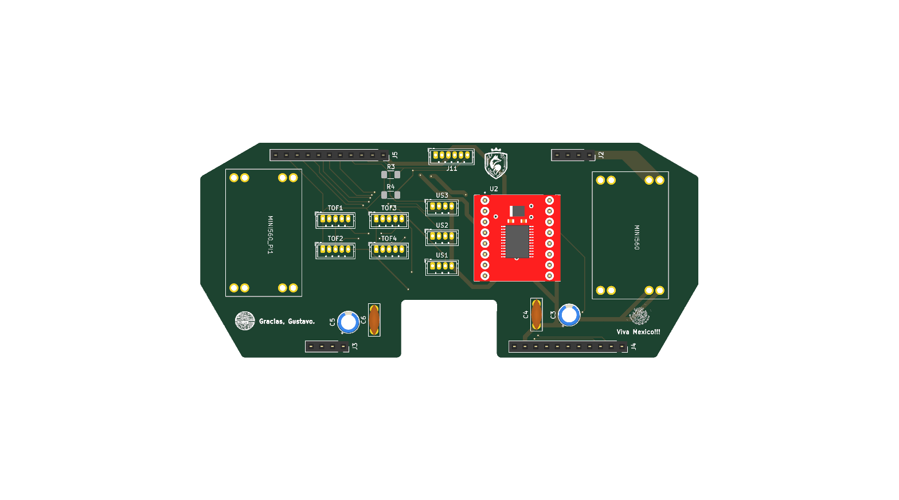 |
| Schematic (PDF) | [WRO_RevB_1_schematic.pdf](electrical/export/WRO_RevB_1_schematic.pdf) | [WRO_RevB_2_schematic.pdf](electrical/export/WRO_RevB_2_schematic.pdf) |
| KiCad project | [`electrical/WRO_RevB_1/`](electrical/WRO_RevB_1/) | [`electrical/WRO_RevB_2/`](electrical/WRO_RevB_2/) |
| Fabrication (Gerber + drill, ready for JLCPCB) | [WRO_RevB_1_gerbers.zip](electrical/export/fabrication/WRO_RevB_1/WRO_RevB_1_gerbers.zip) | [WRO_RevB_2_gerbers.zip](electrical/export/fabrication/WRO_RevB_2/WRO_RevB_2_gerbers.zip) |
| Board BOM / placement | [BOM](electrical/export/fabrication/WRO_RevB_1/WRO_RevB_1_bom.csv) · [positions](electrical/export/fabrication/WRO_RevB_1/WRO_RevB_1_positions.csv) | [BOM](electrical/export/fabrication/WRO_RevB_2/WRO_RevB_2_bom.csv) · [positions](electrical/export/fabrication/WRO_RevB_2/WRO_RevB_2_positions.csv) |

> ⚠️ **Assembly warning learned the hard way.** The two boards are almost symmetric and the stacking headers are not keyed. On 2026-11-06 we mounted the logic board rotated 180°: the battery pin landed on the Pi's 5 V net and **killed a Raspberry Pi 5** (PMIC failure, ~11 V on the 5 V rail). We now mark the orientation on both boards and measure `TO_PI` pins 7/8 = 5.0–5.2 V **without the Pi** before mounting it. Next revision: keyed headers, a PTC fuse and a 5 V TVS diode (SMBJ5.0A) on +5V_PI. Details in [§4.5](#45-risks-failure-modes-and-mitigations).

### Wiring / pin map (ESP32)

<p align="center"><a href="docs/img/wiring_diagram.png">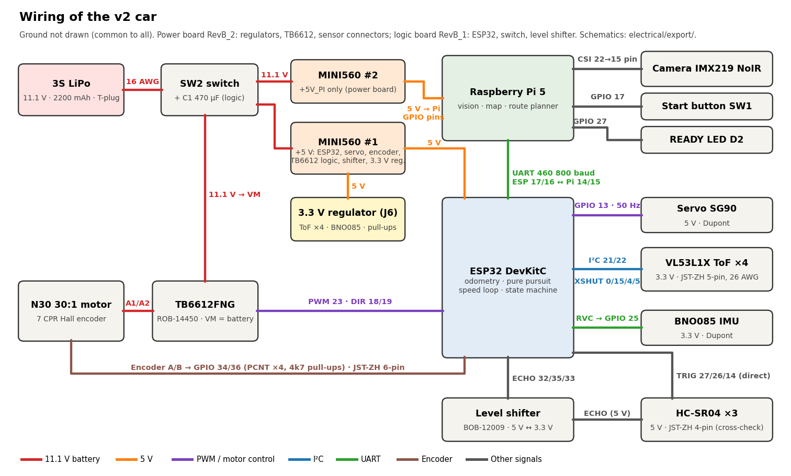</a></p>

*The whole car on one page: power (red 11.1 V, orange 5 V) and every signal with its GPIO. The exact pin-by-pin table is below; the schematics are in [`electrical/export/`](electrical/export/).*

<details>
<summary><b>ESP32 pin map</b> — 14 signals (click to open)</summary>

| Signal | ESP32 GPIO | Connected to | Notes |
|---|---|---|---|
| Motor PWM | 23 | TB6612 PWMA | |
| Motor direction | 18 (A1), 19 (A2) | TB6612 AIN1/AIN2 | Direction confirmed on the car, not from the schematic labels |
| Steering servo | 13 | SG90 signal | 50 Hz; command range 1–156, center 75 |
| Encoder A / B | 34 / 36 | N30 Hall encoder | Input-only pins → external 4k7 pull-ups to 3.3 V; PCNT ×4 |
| I²C SDA / SCL | 21 / 22 | 4 × VL53L1X | 4k7 pull-ups, addresses 0x30–0x33 assigned at boot |
| ToF XSHUT front / left / right / rear | 0 / 15 / 4 / 5 | VL53L1X XSHUT | Held low at boot, released one by one |
| BNO085 TX → ESP RX | 25 | BNO085 (UART-RVC) | 115200 baud, 100 Hz packets |
| UART to the Pi | 17 (RX) / 16 (TX) | Pi GPIO 14 / 15 (`/dev/ttyAMA0`) | 460 800 baud, `Serial2` started from core 0 |
| Start button | — (Pi GPIO 17) | SW1 `EXEC_PRGM` on the logic board → `TO_PI` pin 6 | Read by the Pi |
| READY LED | — (Pi GPIO 27) | D2 on the logic board → `TO_PI` pin 5 | Driven by the Pi |
| HC-SR04 left / right / front TRIG | 27 / 26 / 14 | HC-SR04 TRIG | 10 µs pulse, one sensor at a time |
| HC-SR04 left / right / front ECHO | 32 / 35 / 33 | HC-SR04 ECHO via the level shifter | 5 V → 3.3 V; read with a CHANGE interrupt |

</details>

### Cables and connectors

Every sensor plugs into the boards with a connector, so any part can be swapped between runs without a soldering iron. Connector footprints are in the board BOMs ([`fabrication/`](electrical/export/fabrication/)).

| Cable | Wire | Sensor / device end | Board end | Length |
|---|---|---|---|---|
| ToF ×4 (VIN, GND, SDA, SCL, XSHUT) | 26 AWG, crimped by us | Soldered directly to the sensor | JST-ZH 1.5 mm, 5 pins (TOF1–TOF4, power board) | ~20 cm |
| HC-SR04 ×3 (VCC, TRIG, ECHO, GND) | 26 AWG, crimped by us | Crimped | JST-ZH 1.5 mm, 4 pins (US1–US3, power board) | ~20 cm |
| Drive motor + encoder | Motor lead | — | JST-ZH 1.5 mm, 6 pins (J11, power board) | — |
| Battery | 16 AWG | T-plug (Deans) | Screw terminal J1 (logic board) → SW2 power switch | — |
| BNO085 | Dupont jumpers | Header on the breakout | 2.54 mm header (logic board) | — |
| Servo SG90 | Its own lead (Dupont) | — | 3-pin 2.54 mm header SERVO1 (logic board) | — |
| Camera | 22-to-15-pin ribbon | Camera module | Raspberry Pi 5 CAM0 | — |
| Between the boards | — | — | Stacking headers 11-pin and 4-pin (keyed only by marks, see the warning above) | — |

**Why 26 AWG and JST-ZH.** The sensors draw a few tens of mA, so thin wire is enough and keeps the harness light and flexible; the small latching JST-ZH plugs do not fall out from vibration like Dupont jumpers. The BNO085 and the servo still use Dupont jumpers; moving them to latching connectors is part of the next board revision. 16 AWG on the battery carries the motor stall current (1.6 A) plus both regulators with little voltage drop.

## 2.4 Sensors — selection, placement and calibration

### Sensor set and why

| Sensor | What it measures | Why this one | Placement (and the field geometry behind it) |
|---|---|---|---|
| **Camera** IMX219 + NoIR wide lens | Pillars (red, green), parking walls (magenta), orange and blue corner lines | Only sensor that sees color; the wide lens sees both pillar rows of a straight and the corner line in one frame | Front center, 93 mm high, 34° down (pose measured 2026-11-19): the floor from 0.2 m to ~1.2 m ahead of the rear axle — one straight section is 1 m deep |
| **VL53L1X ToF ×4** | Distance to walls and the parking-lot walls | Narrow optical cone with a software-set region of interest (no echoes like the ultrasonic, ERR-19); 4 sensors can range in parallel | ~50 mm high (the walls are 100 mm high), level. Front: wall ahead (corners, start fix). Left/right: walls of the straight (localization). Rear: parking and reversing |
| **BNO085** | Yaw (heading) | Sensor fusion on the chip with continuous bias calibration; no integration on our busy loop | Near the center of rotation, so centripetal acceleration stays out of the fused heading |
| **Encoder** 7 CPR | Distance and speed | Closed-loop speed and odometry | On the motor; read by hardware (PCNT) |
| **HC-SR04 ×3** (cross-check) | Distance to the walls (left, right, front) | Fails for different reasons than the ToF: sound does not care about the wall's color, light does not care about echoes. Used to check the ToF, not to drive (see below) | Same sides as the ToF; the side sensors 28.3 mm further out, the front one 6.2 mm further forward |

<p align="center">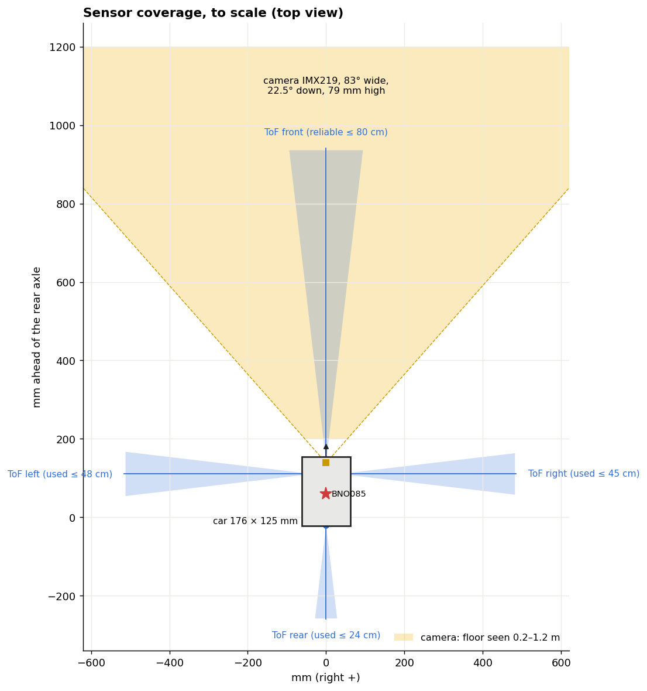</p>

*Mounts from the CAD ([`config.py`](src/RASPI/cam/pure_pursuit/config.py) `SENSOR_MOUNTS`); ranges are what the localizer accepts from each ToF.*

### VL53L1X — making a ToF see a black wall

The inner walls are black, which absorbs most of the 940 nm light. What we measured and changed:

| Finding (evidence) | Change |
|---|---|
| The default 16 × 16 region of interest sees the white **floor** at long range and reads short: static test at 60 / 80 cm → −50 / −190 mm. On the track the right sensor saturated at 460–500 mm beyond ~45 cm (runs 35–42) and dragged the pose toward that wall | Left/right/rear use **ROI 8 × 8** (static error −8 / −40 mm at 60 / 80 cm), commit `0e8f8898` |
| On the black wall many valid distances come with **range status 2** (signal fail) or 7 (wrap target fail) | Short-mode sensors accept status 2 up to 900 mm (`0e8d54b1`); the front (Long mode) accepts only status 0, because its status 2 reads ~+20 cm long |
| The front sensor reads ~+20 cm long beyond 60 cm and is only reliable ≤ 80 cm, and only if mounted level | The localizer uses the front sensor only within its reliable range; the start fix gives it no vote; the mount is rigid and level |
| A sensor can freeze (same value) or fail at boot | Firmware skips a sensor that failed init and reports it (`ltf=` field in the ACK); in the open-round firmware a reading stale for > 300 ms re-initializes that sensor through its XSHUT pin |

Timing: left/right/rear in **Short** mode with a 20 ms budget; front in **Long** mode with 33 ms. The ACK to the Pi reports the worst I²C time per sensor, so a slow sensor shows up in the log, not as a mystery in the driving.

<p align="center">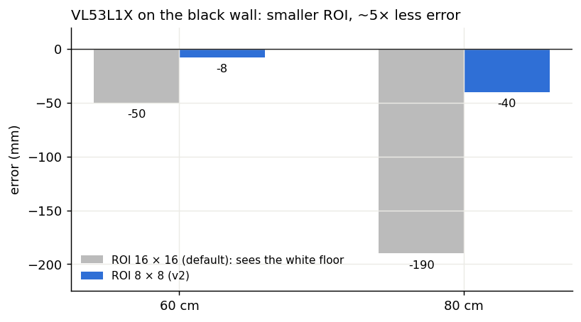</p>


### Ultrasonic cross-check — prepared, not used for racing

**The car races on the ToF sensors only.** The three HC-SR04 are mounted as a cross-check for the future, not as a driving input.

The idea behind them is that the ToF and the ultrasonic fail in opposite situations. The ToF measures light, so a black wall far away returns little signal and the reading goes long or short (table above). The HC-SR04 measures sound: the wall color does not matter, but its wide cone picks up pillars and multipath echoes (ERR-19 in v1). When both agree, the reading can be trusted. When they disagree, one of them is wrong and that reading should not move the pose.

What is ready:
- **Firmware:** a non-blocking read in `PurePursuit.ino`. One sensor fires every 30 ms, so one sensor's echo is not heard by the next. The echo is timed with a CHANGE interrupt instead of `pulseIn()`, which would block the loop for up to 25 ms. That gives ~11 Hz per sensor at ~10 µs of loop time per ping.
- **Logging and analysis:** both readings go into every ACK (`uL/uR/uF` next to `tL/tR/tF`). [`scripts/compara_tof_us.py`](scripts/compara_tof_us.py) reports, per sensor and distance band, the median ToF − ultrasonic difference and how often the two disagree.

What would come next, if the data supports it: a static test with both sensors against black and white walls at 30 / 60 / 80 / 120 cm. Then the EKF could drop a ToF reading that disagrees with the ultrasonic by more than the measured threshold, and the front ultrasonic could cover 80–200 cm, where the front ToF is unreliable. It is item 5 in [§6 Next Steps](#6-next-steps).

### BNO085

UART-RVC mode: the sensor streams a 19-byte packet with yaw, pitch, roll and acceleration every 10 ms on one wire (BNO TX → GPIO 25), with a checksum. No driver library, and the IMU stays off the I²C bus the four ToF sensors share. Calibration and checks:
- **Sign.** The yaw sign is −1 for our mounting (`BNO_YAW_SIGN`). A wrong sign mirrors the whole pose: it cost us a day of track runs on 2026-11-09 (the car "turned before the wall").
- **Scale.** Hand-rotate the car 1080° in the waiting state and compare (`BNO_ESCALA`); the bench result was 1.0.
- **Acceptance.** ≥ 99 % of packets at ~100 Hz with the motor running; heading unchanged with the motor running at standstill (magnetic interference check).

### Camera and color

| Step | What and why | Where |
|---|---|---|
| **Capture** | Picamera2: full sensor mode 1640 × 1232, scaled to **640 × 480 by the Pi 5's image processor**. Our first Pi 5 pipeline scaled on the CPU (GStreamer) and limited the loop to 20–23 fps at 245 % CPU; the ISP path delivers ~40 fps at 5 % CPU with the same framing (`924a084a`) | `vision.open_camera` |
| **Lens shading** | The NoIR lens has no IR filter, and the Pi 5's default lens-shading table turned the frame edges magenta (R/G 1.31–1.40 at the corners) — close to the pink parking walls and red pillars. We calibrated our own table from 5 raw photos of a white sheet with the official tuning tool: R/G and B/G = 1.00 ± 0.01 at the center and all corners | [`camera_tuning/`](src/RASPI/cam/camera_tuning/README.md) |
| **White balance** | Fixed gains `<1.10, 1.37>` (auto white balance drifts with the colored walls in view) | `vision.py` |
| **Exposure** | History: with auto exposure, inside the magenta parking lot the exposure rose 2.3×; leaving the lot the floor was burned for ~1 s, the orange line was seen late and the car hit the island (run 57), so from 2026-11-12 we used a **fixed** exposure measured per venue. Measured by day, that fixed value made the image too dark at night, so after the 2026-11-19 remount the car runs on **automatic exposure** again and the fixed profile is kept as an option (§5.4). Next: set the exposure from the floor brightness instead of the whole image (§6) | `pure_pursuit/mide_exposicion.py`, `camera_tuning/exposicion.json`, `c41e0a7a` |
| **Color classes** | Pillars are classified by hue **and** channel ratios, measured on our track (~950 lux): red H 170–177, S 144–158, G/R 0.38–0.44; pink wall H 139, G/R 0.67, B/R 1.19; orange tape G/R 0.76–0.78; green H 71, G/R 1.95. Ratios stay stable when the venue light changes; hue near red wraps around and shifts. Thresholds: red S ≥ 110, G/R ≤ 0.60, B/R ≤ 0.70 | `vision.py`, [`calibra_luz.py`](src/RASPI/cam/pure_pursuit/calibra_luz.py) |
| **Bird's-eye view (BEV)** | Homography from floor crosses at known positions (rear-axle frame) → 1 px = 2 mm on the floor. Recalibrated after the 2026-11-19 remount with 7 crosses at 250 / 400 / 650 mm from the rear axle: fit error 25 mm mean, 46 mm max (the previous mount: 17 / 36 mm); the residual pattern is lens barrel distortion. A perspective-n-point fit of the same homography gives the camera pose used by the twin (§1.4) | `bev.py`, `calibrate.py`, `bev_calib.npz` |

## 2.5 Main computer — Raspberry Pi 5

**Why we upgraded.** Profiling the race code on the Pi 4: the main thread used 97 % of a core and the loop ran at 14–18 fps; vision, not capture, was the cost (capture ~5 ms; color 17–22 ms; BEV + centerline 45–48 ms). With the enclosure it reached 84 °C and throttled.

| | Raspberry Pi 4 (v1) | Raspberry Pi 5 (v2) |
|---|---|---|
| Vision loop | 14–18 fps | ~40 fps (camera-limited) with ISP scaling |
| Full v2 pipeline per frame (vision + map + localizer) | 60 ms | **23.5 ms mean, 32 ms p95** |
| Route re-plan (dynamic programming) | ~190 ms median | **59–70 ms** (peak 223 ms), in a background thread |
| First plan at start | 2.6 s | 1.95 s (done before the READY LED, so it does not count in the run time) |

**What the port required:** UART on `/dev/ttyAMA0` (on the Pi 5 `serial0` is the debug connector); `rpi-lgpio` instead of `RPi.GPIO`; a 22-to-15-pin camera cable; `camera_auto_detect=0` + `dtoverlay=imx219,cam0`; system OpenCV from apt. Details in [§5](#5-reproducibility-and-github-quality).

**Cooling.** The replacement Pi 5 (8 GB, after the one lost in the incident above) ran without a fan at first and climbed to ~80 °C within minutes, with soft-throttle flags. With the official Active Cooler mounted it read **47.7 °C and `throttled=0x0`** after 25 min powered on and three consecutive rounds (2026-11-20, run 99); later checks the same day gave 46–49 °C, always `0x0`.

---

# 3. Software Architecture and Obstacle Strategy

> [!NOTE]
> **In short:** the Pi 5 sees the pillars, fills a map of 6 possible seats per straight and plans the whole lap with dynamic programming; the ESP32 follows that route with odometry and pure pursuit, without stopping at corners. The open round runs on the ESP32 alone. Everything is tried first in a digital twin that runs the real code.

This section covers the software of both controllers ([§3.1](#31-two-controllers-one-link)–[§3.6](#36-open-challenge-esp32-only)), the obstacle strategy ([§3.7](#37-obstacle-management--route-mode)), every edge case we handle ([§3.8](#38-edge-cases--what-can-go-wrong-on-the-field-and-what-the-car-does)), the digital twin we developed it with ([§3.9](#39-digital-twin--software-in-the-loop-simulator)) and how we test, tune and measure it ([§3.10](#310-testing-tuning-and-validation)).

## 3.1 Two controllers, one link

| | Raspberry Pi 5 — Python 3, OpenCV, NumPy | ESP32 — Arduino C++ (dual core) |
|---|---|---|
| Role | Perception and planning: *where should the car go?* | Real-time control: *how do we drive there now?* |
| Rate | One cycle per camera frame, ~40 Hz | Main loop at sensor rate; BNO085 at 100 Hz; UART RX in its own task on core 0 |
| Owns | Camera, start button, READY LED, recording | Servo, motor, encoder, 4 ToF, BNO085 |
| Key outputs | The route (list of points in mm), the allowed speed, the pose correction | Odometry pose, sensor readings and state, sent back in every ACK |
| If the other fails | — | Keeps following the last complete route it received; stops if it never got one |

**Why split this way.** Vision is heavy and its time per frame varies (20–35 ms); steering and speed control need a steady rate. Running both on one processor would make the control loop jittery. The split also lets each side be tested alone: the ESP32 can follow a route sent from a PC with no camera ([route-following bench](docs/route-following-bench.md)), and the Pi code can run on recorded video.

**Why the route follower runs on the ESP32 (new in v2).** In v1 the Pi computed the steering from the image and sent it every frame. The pose reached the Pi 4–6 frames late (the ACK travels the UART after the frame was captured), so the Pi steered for where the car *had been*. In v2 the Pi sends the **whole route** once, and the ESP32 steers against its own odometry at loop rate with no communication delay. The Pi only corrects the pose and changes the route when the map changes.

## 3.2 Module map

<details>
<summary><b>Module tables</b> — Raspberry Pi modules and ESP32 firmware blocks (click to open)</summary>

**Raspberry Pi** — [`src/RASPI/cam/pure_pursuit/`](src/RASPI/cam/pure_pursuit/)

| Module | Responsibility | Talks to |
|---|---|---|
| [`runtime_nuevo.py`](src/RASPI/cam/pure_pursuit/runtime_nuevo.py) | Entry point. Main loop: frame → perception → map → localization → route; serial link, start button, READY LED, HUD and recording | All modules |
| [`config.py`](src/RASPI/cam/pure_pursuit/config.py) + [`carrera.json`](src/RASPI/cam/pure_pursuit/carrera.json) | Every tunable parameter with its unit and why; `carrera.json` is the exact race configuration exported from the simulator | — |
| `../vision.py`, [`color_corr.py`](src/RASPI/cam/pure_pursuit/color_corr.py) | Camera capture (Picamera2), color correction, red/green pillar and magenta detection (lookup-table masks + ratio tests) | `runtime_nuevo` |
| [`bev.py`](src/RASPI/cam/pure_pursuit/bev.py) | Bird's-eye-view homography, image ↔ floor (mm) | vision, corner lines, map |
| [`corner_lines.py`](src/RASPI/cam/pure_pursuit/corner_lines.py) | Orange/blue corner lines, direction of travel | map, start fix |
| [`digital_map.py`](src/RASPI/cam/pure_pursuit/digital_map.py) | Map of the field: votes each pillar detection into one of the 6 possible pillar **seats** of each straight | route mode |
| [`localizer.py`](src/RASPI/cam/pure_pursuit/localizer.py) | EKF on (x, y, heading): odometry from the ESP32 + ToF distances against the known walls | route mode |
| [`start_fix.py`](src/RASPI/cam/pure_pursuit/start_fix.py), [`salida_cajon.py`](src/RASPI/cam/pure_pursuit/salida_cajon.py) | Blind start: where along the straight the parking lot is; which side to leave the lot | route mode, ESP32 |
| [`route_mode.py`](src/RASPI/cam/pure_pursuit/route_mode.py) | Which seats are known, when to re-plan, speed allowed, uploading the route | ESP32 |
| [`ring_route.py`](src/RASPI/cam/pure_pursuit/ring_route.py) | Route planner: dynamic programming over the lap + B-spline smoothing | route mode |
| [`wro_field.py`](src/RASPI/cam/pure_pursuit/wro_field.py) | Field geometry and pillar-placement rules from the rulebook | map, planner, twin |
| [`cam_web.py`](src/RASPI/cam/pure_pursuit/cam_web.py), [`bev_recorder.py`](src/RASPI/cam/pure_pursuit/bev_recorder.py) | Live camera/HUD in a browser; per-run recording of the video and the clean BEV | tools |

**ESP32** — [`src/ESP32/PurePursuit/PurePursuit.ino`](src/ESP32/PurePursuit/PurePursuit.ino) (development) → [`src/ESP32/PurePursuitCarrera/PurePursuitCarrera.ino`](src/ESP32/PurePursuitCarrera/PurePursuitCarrera.ino) (race build, exported with the race parameters by [`exportar_carrera.py`](src/RASPI/cam/pure_pursuit/twin/tools/exportar_carrera.py) so the car and the simulator run the same source)

| Block | Functions | Notes |
|---|---|---|
| Serial link | `parseRuta()`, V2 parser, checksum check, ACK builder | `Serial2` started from a task pinned to core 0 with a 4 KB buffer (§4.5) |
| Odometry | `actualizarOdometria()` | Encoder distance (PCNT) + BNO085 yaw → pose of the rear-axle center |
| Route follower | `rutaSteer()`, `rutaServo()` | Pure pursuit with 200 mm lookahead and 0.10 s lag prediction; measured wheel→servo table |
| Speed | `setMotor()`, `setMotorTope()` | Feed-forward + PI on encoder speed; speed cap per lap |
| State machine | `INICIO`, `SIGUIENDO`, `ESTACIONANDO`, … | §3.4 |
| Sensors | `initUnToF()`, `leerToF()`, BNO RVC parser | ROI, timing budget and status rules of §2.4 |

</details>

**Open Challenge firmware** — [`src/ESP32/RondaAbierta/RondaAbierta.ino`](src/ESP32/RondaAbierta/RondaAbierta.ino), ESP32 only (the Pi only sends `READY` when the start button is pressed): §3.6. This is the tested fallback; we are working on running the open round with the route-mode firmware too (§3.6).

## 3.3 Data flow and timing (one Pi cycle)

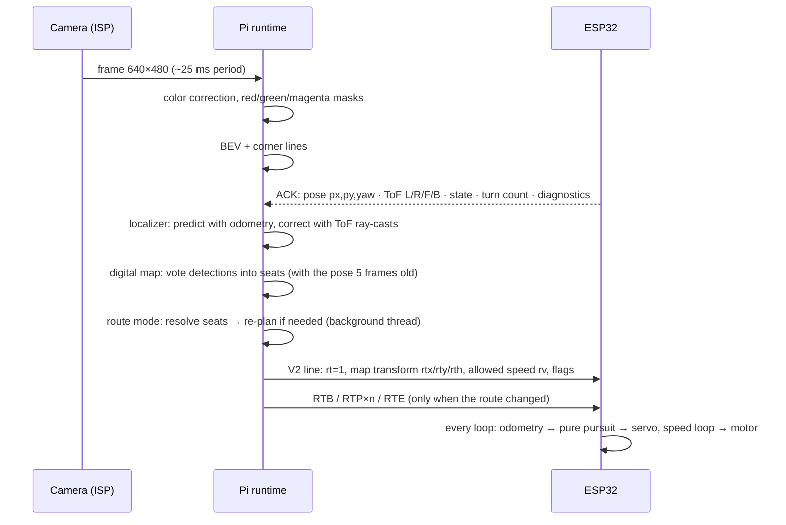

Measured on the Pi 5: **23.5 ms mean per cycle (p95 32 ms)**; a re-plan takes 59–70 ms in a background thread, so a new route never blocks a frame. The camera image is older than the latest ACK, so map votes use the pose from 5 frames earlier (`ROUTE_FIX_LINE_LAG_FRAMES`).

## 3.4 ESP32 firmware and state machine

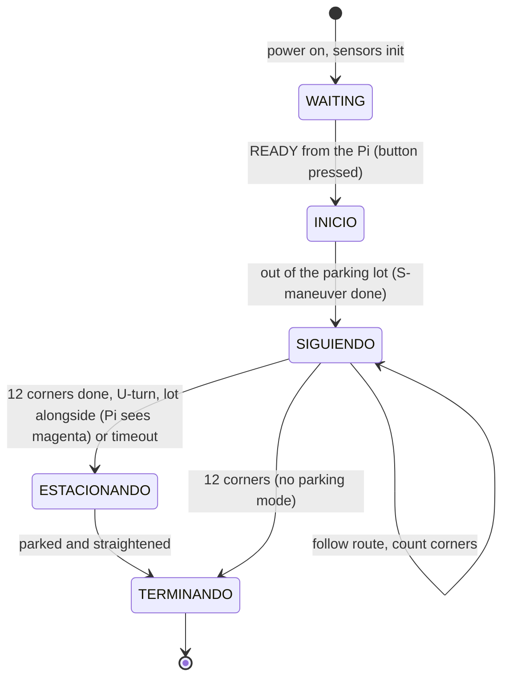

- **INICIO — leaving the lot.** The car starts parallel to the outer wall inside the lot. Before arming, the Pi looks at the first pillar ahead and tells the ESP32 which way to leave (`isal`: between the pillar and the outer wall needs only a short S; otherwise a wider S) and whether a pillar is close (`isen=1` → slower exit, 180 instead of 195 PWM). The S-maneuver is driven by encoder distance and yaw.
- **SIGUIENDO — racing.** Pure pursuit on the active route. Each loop: odometry → lookahead point 200 mm ahead along the route → wheel angle δ = atan(2·L·y / ℓ²) (L = 113 mm wheelbase, y = lateral offset of the lookahead point, ℓ = its distance) → measured servo table → servo. The pose is projected **0.10 s ahead** (the measured wheel lag) before choosing the lookahead point, which removed the overshoot at corner exits. A small "wall panic" term (`WALL_PANIC_GAIN`) pushes away from a wall that a side ToF sees too close, as a last-resort safety net. Speed = min(route profile from the Pi, base speed), through the speed loop. Corners are counted against the route geometry, so the stop happens inside the correct section.
- **ESTACIONANDO — parking.** After corner 12 the car continues to the next corner, does a **half turn** and comes back to the lot, so the lot is approached from the side that lets a reverse parallel park start in the open. The Pi confirms the lot is alongside (magenta seen); the ESP32 scans the lot walls with the side and rear ToF and the encoder, solves a reverse **arc–straight–arc** path for the measured lot position (`parkPlanT1Solve()`), drives it, then straightens with short forward/backward passes against the reference heading. An anti-stall rule raises the PWM in steps of 20 if the encoder sees less than 4 mm of progress in 250 ms (parking at low PWM on a fresh vs. tired battery).
- **Fallbacks.** If the Pi never saw the lot, a timeout triggers the parking scan anyway. If the Pi's lines stop arriving, the ESP32 keeps the last *complete* route (double buffer: a half-uploaded route is never used).

<details>
<summary><b>Link protocol</b> — message format and checksums (click to open)</summary>

**Link protocol (UART 460 800 baud, one line per message):**

```
Pi → ESP   V2,<flags...>,rt=1,rtx=<mm>,rty=<mm>,rth=<deg>,rv=<pwm>*HH     every frame
           RTB,<n>,<step_mm>*HH      start of a new route of n points (closed loop)
           RTP,<i>,x,y,x,y,...*HH    10 points per line, mm on the mat
           RTE,<n>*HH                end: becomes active only if all n points arrived
ESP → Pi   ACK,px=..,py=..,yaw=..,est=..,tc=..,tL=..,tR=..,tF=..,tB=..,rn=..,ue=..,lc=..,ltf=..,...
```

`*HH` is an XOR checksum: the ESP32 drops a corrupted line and counts it (`lc=`); if the ACK shows that the ESP32 does not have the full route (`rn` ≠ n), the Pi re-sends it. The ACK also carries UART error counters (`ue=`, by type), loop time and per-sensor I²C time, which is how we found the electrical problems in §4.5.

</details>

## 3.5 Start procedure

1. Power switch on → Pi boots, `wro-runtime` service starts, ESP32 initializes the sensors.
2. The Pi opens the camera, computes the first plan (~2 s) and checks the image (brightness/blackout). Only then the **READY LED** turns on.
3. The single **start button** (Pi GPIO 17) → the Pi sends `READY` ×3; the ESP32 answers and the run starts. No other interaction is needed or allowed.

## 3.6 Open Challenge (ESP32 only)

The Open Challenge has no pillars, so the camera adds risk without adding information. `RondaAbierta.ino` runs on the ESP32 alone:

- **Heading hold with an absolute reference.** Straight *n* is held at exactly *n* × 90° from the start heading (BNO085), so heading errors do not accumulate from corner to corner. The PID runs on every BNO packet (100 Hz). **Kp 1.0, Kd 0**: the v1 value Kd 0.8 caused a saturating oscillation ("dance") after every corner on the new car, and Kp 1.5 was also too high (tested on the track).
- **Wall following as a cascade.** The distance to the wall only shifts the heading target (±15°, rate-limited), with hysteresis, so a bad ToF reading cannot turn the car directly.
- **Corners.** Triggered by the front ToF plus the inner side seeing an opening. The turn ends 5° before 90° and the servo unwinds smoothly over the last 25°.
- **Robust ToF handling** (§2.4): black-wall statuses accepted at their real distance, a jump filter (a reading > 40 cm closer needs a second confirming reading — this removed mid-straight false corners), and a stale-sensor watchdog.

Result: **12/12 corners in 29.6–29.9 s** in both directions on our track (runs 133246 and 141103, 2026-10-19). At the national final v1 needed 57.5 s. On 2026-11-21 (runs 143–148, §3.10.3) the same firmware did 12/12 in **~20–24 s**, three runs per direction; it now waits for the Pi's `READY` (start button) and stops 0.3 s after the 12th corner instead of 1 s, which had carried it past the start section.

**Next step — open round with route mode.** `RondaAbierta.ino` is reactive: it decides each corner from what the ToF sees at that moment, so it has to drive the whole round at a speed that is safe for a corner it has not seen yet. In the Open Challenge the inner walls can be placed in different positions, but they do not move during the round. We are adapting the obstacle-round firmware (`PurePursuit.ino`, §3.7) so that lap 1 maps the walls with the ToF and the encoder (the position of each straight's inner wall and where each corner starts), and laps 2–3 follow a planned route with pure pursuit and the speed profile, knowing in advance where to turn and how fast each section can be driven. One code base for both rounds also means one set of parameters to calibrate at the venue. Until this beats 29.6 s reliably on our track, `RondaAbierta.ino` stays as the open-round firmware.

## 3.7 Obstacle Management — route mode

### 3.7.1 Idea

The obstacle field is not random in an arbitrary way: by the rules, each straight has **6 possible pillar seats** (two rows × three columns), and the parking lot lies in the start straight. So the field can be described by a small table: *which seat of which straight holds which color*. Once that table is known, a full lap is a fixed curve on the mat that can be planned in advance and followed with odometry. The camera's job reduces to **filling the table** and correcting the pose.

<p align="center">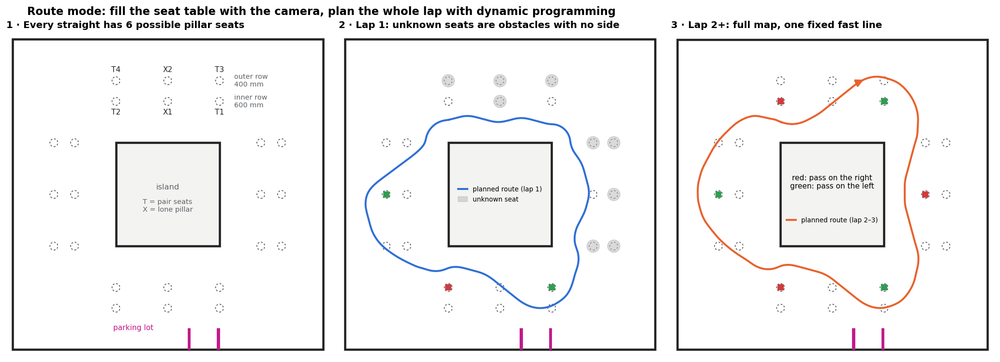</p>

*Drawn with the real planner ([`ring_route.plan`](src/RASPI/cam/pure_pursuit/ring_route.py)) for one legal field. Lap 1 keeps away from every seat that has not been seen yet; from lap 2 the full map gives one fixed line.*


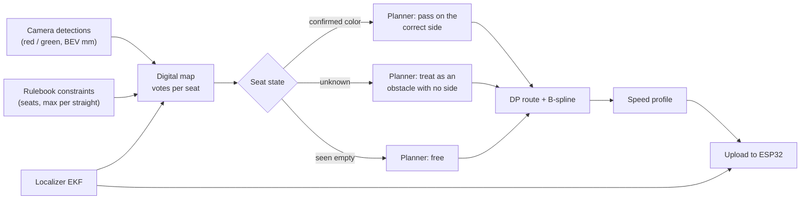

### 3.7.2 Mapping pillars into seats

<p align="center">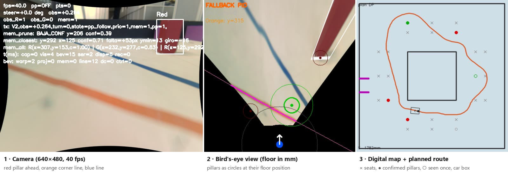</p>

*One frame of real run 142 (2026-11-21), as the Pi records it: what the camera sees, where those pillars land on the floor, and the map and route that result.*

Each pillar detection is projected to the floor (BEV, mm), moved to the mat frame with the localized pose, and **votes** for the nearest seat. A seat is confirmed when the votes agree and a detection has landed within 160 mm of it. Edge cases we hit and handled:


| Edge case | Handling | Evidence |
|---|---|---|
| A pillar seen **while the car is still turning** out of a corner lands ~400 mm off (heading lag × off-axis angle) | Votes > 20° off-axis taken while the car is > 25° from the straight's heading still count, but cannot confirm a seat or set its distance | ERR-30: real runs 48/50/52 replayed; run 52 now maps E/X2 correctly |
| The image is older than the pose | Votes use the pose from 5 frames earlier | Twin: the lot-position estimate from the orange line had the wrong length by ≈ 0.22 s × speed before this |
| Pink parking walls and orange tape look red | Ratio tests (G/R, B/R) per §2.4 | Pi 4 replays of 6 runs; Pi 5 thresholds measured on our track |
| Seat never visible (behind the camera at the start) | Rulebook constraints resolve it: a lone pillar (X) has no partner, never two in the same column, max two per straight, forbidden seats next to the lot | Twin lap-1 tests |

### 3.7.3 Lap 1 — planning with an incomplete map

In lap 1 most seats are unknown. A seat is **resolved** when the map confirms it, when the rules exclude it, or when it was within 550 mm and ±45° of the camera for 16 frames with nothing detected ("seen empty"; our measured detection rate in that zone is ~98 %). Until then:
- An unresolved seat is an obstacle **with no pass side**: the route never goes where a pillar might be, but passes close to it so that, if it turns out to need the other side, the change is only ~300 mm.
- With ≥ 2 votes of one color, the route already takes that color's side before confirmation (**provisional color**).
- Speed is lower near unresolved seats and the car only stops if it is looking at an unresolved seat (max 2 s).
- Each re-plan keeps the next 2 route stations in front of the car unchanged, so the steering never jumps.

From lap 2 the map is complete and the route is the same every lap, at full speed.

### 3.7.4 Route planner — dynamic programming

[`ring_route.py`](src/RASPI/cam/pure_pursuit/ring_route.py) describes the lap by **stations** every ~75 mm along the corridor, and at each station a lateral position *d* = distance to the island (100–900 mm, step 20 mm). In corners the stations become concentric arcs around the island's corner. Dynamic programming finds the optimal path through this grid:

- **Hard constraints:** clearance of the whole car footprint (rear axle +147.6 / −21.8 mm along, ±66 mm across) ≥ 70 mm (`ROUTE_HARD_CLEAR_MM`) to pillars, walls, island and parking walls; radius ≥ 170 mm; each segment ≤ 55° from the corridor direction; pass side by color (red right, green left).
- **Cost:** length + curvature² + a penalty when clearance < 140 mm; with `ROUTE_TIME_COST`, the cost is the *time* under the speed profile instead of the length.
- **Smoothing:** closed cubic B-spline, resampled every 80 mm for the upload.

*Why DP:* the lap is a closed corridor with a natural order (stations), so DP over (station, lateral position) is exact on its grid, cannot get stuck in a local minimum between two close pillars, and its run time is fixed and predictable (59–70 ms on the Pi 5), which matters for a planner that re-runs during the race. Before it we used a line built from the map with Bézier knees (`_build_line`) and an A* racing line ([`racing_line_astar.py`](src/RASPI/cam/pure_pursuit/racing_line_astar.py)); the `_build_line` had steps of up to 180 mm and 90° kinks, and with it the twin finished **1 of 21** races against **69 of 69** with the DP route (known map, same seeds).

*Why a 20 mm lateral grid:* a 10 mm grid removed a small bump in the corners and gained 0.3 s median, but each re-plan became ~5× more expensive; with the real Pi latency modeled it dropped from 40/48 to 29/48 clean races, so we kept 20 mm.

### 3.7.5 Localization — EKF

The localizer keeps (x, y, heading) of the rear axle on the mat. **Prediction:** odometry increments from the ACK (encoder + BNO085). **Correction:** each ToF reading against a ray-cast of the known map. A reading is used **only if the expected ray hits a wall or the island**; if it would hit a pillar or a parking wall it is ignored, because those positions are less certain. Process noise grows with distance driven (2 mm² per mm). A reading that jumps > 100 mm from the previous one is ignored once (echoes from a pillar to the wall behind it). Each ToF has a maximum range for correction (laterals 450–480 mm) from the static tests in §2.4.

### 3.7.6 Speed profile

The route's speed is computed from its curvature: v ≤ √(a_lat · R) with a_lat ≈ 2.77 m/s² (just above the measured 2.5–2.8 m/s² grip, tuned in the twin), braking ≤ 3.0 m/s², lower speed near pillars (< 193 mm) and near unseen seats, and a 0.12 s latency compensation. The ESP32 receives it as the allowed PWM (`rv`), which the speed loop turns into a target speed.

### 3.7.7 Blind start — the parking lot can be anywhere along the straight

At the national final the judges moved the parking lot along the start straight. The car knows the straight, its heading and its distance to the outer wall, **not** how far along it is. [`start_fix.py`](src/RASPI/cam/pure_pursuit/start_fix.py):

1. Assume the lot is as far back as possible (the car then believes it is behind its real position, so it turns late, never into the island).
2. Build a histogram over the unknown shift δ (5 mm bins) from every ToF reading that pillars cannot explain, weighted by the distance driven (so a stopped car does not vote 9 times).
3. When the orange corner line is seen, project it to the mat and use it as the strongest vote (`ROUTE_FIX_LINE`).
4. Fix when 90 % of the probability is within ±20 mm and agrees with the line within 60 mm; at the end of the straight force the best estimate.
5. Re-vote the camera detections stored before the fix with the corrected pose, re-plan, and switch the ESP32 to the new frame only when the full new route has arrived (no jump mid-dodge).

Twin result with the lot at a random position: **41/42 clean, median lot error 13 mm** (the old code that assumed a fixed lot: 7/42).

### 3.7.8 2026 extra task — the surprise pillar

**The rule** ([WRO 2026 Future Engineers Extra Task](https://wro-association.org/wp-content/uploads/WRO-2026-Future-Engineers-Extra-Task.pdf), published 2026-11-09). The attempt is optional and declared before the round. One pillar, never the first one on the route, is replaced by a pillar of the **opposite color** that is **50 mm or 150 mm tall** instead of 100 mm (same 50 × 50 mm base). The car must pass it on the side of its **original** color, i.e. the opposite of what it sees. Each correct pass earns 5 points, up to 15; a pass on the wrong side ends the attempt.

**Idea.** Color alone cannot solve this: the special pillar is a perfectly normal red or green pillar. The only thing that gives it away is its **height**, so the Pi measures each pillar's height in the image and swaps the driving color when the height is not 100 mm. Everything after that is unchanged: the digital map, the planner (§3.7.4) and the ESP32 receive the *driving* color, so the route, the protocol and the firmware stay the same. The detection keeps both colors (seen and driving) in the log.

<details>
<summary><b>How the height is measured, edge cases and twin results</b> (click to open)</summary>

**How the height is measured** ([`surprise.py`](src/RASPI/cam/pure_pursuit/surprise.py)):

| Option | Why we did not use it / why we did |
|---|---|
| Height/width ratio of the blob | Rejected. In 735 rendered views (3 heights × 7 distances × 5 car angles × 7 viewing directions), the ratio of the three classes **overlapped**: the square base looks wider when seen from a corner, and perspective changes the top. |
| Height in pixels alone | Rejected. A 50 mm pillar close to the camera looks taller than a 150 mm one far away. |
| **Pixel height compared with a normal 100 mm pillar at the same floor distance** | **Used.** The pillar's foot sits on the floor, so the bird's-eye-view homography (§2.4) gives its distance; the expected pixel height of a *normal* pillar at that distance comes from a calibration table (photos of one 100 mm pillar at several distances, [`calibrar_sorpresa.py`](src/RASPI/cam/pure_pursuit/calibrar_sorpresa.py)) or, before calibrating, from the camera geometry. In the same 735 views the measured/expected ratio separated cleanly: **0.50–0.61** (50 mm), **0.985–1.05** (100 mm), **1.51–1.54** (150 mm). |

Only the pillar's **foot** goes through the floor homography; the height is measured in the camera image, so the body of the pillar is never warped as if it lay on the floor.

**Edge cases.**
- **Confirmation.** A special pillar needs **3 consistent frames** and visible floor under its base (so the top of a pillar seen over a wall is not taken as a short pillar). A well-measured normal pillar is accepted at once, so the car does not react later than in a normal round.
- **Cropped pillars.** A pillar cut by the image edge is never re-classified from the partial view; the car keeps the class already confirmed, and the map keeps its position.
- **Memory.** The class is stored per seat (§3.7.2), so laps 2 and 3 reuse it. GO clears it.
- **No extrapolation.** Outside the distances covered by the calibration table no new special class is created.
- **Small pillar.** The 50 mm pillar has a smaller blob than the normal minimum area, so a smaller area is accepted only if it is consistent with 50 mm.

**Switching it on.** Off by default (`SURPRISE_RULE = False`), so a normal round runs exactly the normal code. For a declared attempt: `runtime_nuevo --surprise-rule`, or `"SURPRISE_RULE": true` in `carrera.json`. The runtime refuses to start the attempt without a calibrated camera.

**Results in the digital twin** (2026-11-10; the twin renders the special pillar at its real height and a judge scores the passes on the original color):

| Test | Result |
|---|---|
| Normal round with the feature present but off (24 fields × 2 noise seeds) | **48/48 identical** to the reference |
| Surprise pillar, 24 fields × 2 heights | **35/48 scored the full 15 points**, 1/48 scored 10 |
| Passes on the wrong side of the special pillar | **0** |
| Full race with parking, surprise mode on | 6/48 (normal-mode controls on the same fields: 4/24) |
| Unit tests | 390 passed (both colors and directions, three heights, distance, cropping, memory across laps and GO, judge) |

</details>

**Open before declaring the attempt.**
1. **Calibrate with real photos** of a normal pillar at several distances on the car (no real table yet), then check with real 50 mm and 150 mm pillars.
2. **Three regressions in the twin:** on two fields the car hits the parking walls only when surprise mode is on, and on one field (150 mm) it hits a normal pillar after 10 corners. In all three the special pillar itself was classified correctly; the cause is in the route or the parking, not in the classifier.
3. Decide per round, with these results, whether the 15 points are worth the risk to the main score.

Design notes and the full twin study: [`docs/notes/SURPRISE_RULE_2026.md`](docs/notes/SURPRISE_RULE_2026.md) (Spanish).

## 3.8 Edge cases — what can go wrong on the field, and what the car does

Each row is a situation we either met on the track or found in the twin. The last column points to where it is explained.

<details>
<summary><b>22 situations and what the car does in each</b> (click to open)</summary>

| Situation | What the car does | Where |
|---|---|---|
| The parking lot can be anywhere along the start straight | Assumes the farthest position (turns late, never into the island), votes the real shift from ToF readings and the orange line, re-plans when certain | [§3.7.7](#377-blind-start--the-parking-lot-can-be-anywhere-along-the-straight) |
| A pillar right in front of the lot exit | The Pi tells the ESP32 which side to leave on (`isal`) and to leave slower (`isen`) | [§3.4](#34-esp32-firmware-and-state-machine) |
| A pillar seen while the car is still turning out of a corner | Off-axis votes count but cannot confirm a seat or set its distance (they landed ~400 mm off) | [§3.7.2](#372-mapping-pillars-into-seats) |
| A seat the camera never sees | Resolved by the rulebook: a lone pillar has no partner, never two in one column, max two per straight, forbidden seats next to the lot | [§3.7.2](#372-mapping-pillars-into-seats) |
| Seats still unknown in lap 1 | Treated as obstacles with no pass side; lower speed nearby; the car stops at most 2 s if it is looking at one | [§3.7.3](#373-lap-1--planning-with-an-incomplete-map) |
| Pink parking walls or orange tape look red | Pillars are confirmed by channel ratios (G/R, B/R), not by hue alone | [§2.4](#24-sensors--selection-placement-and-calibration) (camera and color) |
| A pillar cut by the image edge, or seen over a wall | Never re-classified from a partial view; the class already confirmed is kept | [§3.7.8](#378-2026-extra-task--the-surprise-pillar) |
| Different light at the venue | Fixed white balance, ratio-based colors, a 20-minute calibration procedure | [§2.4](#24-sensors--selection-placement-and-calibration), [§5.4](#54-calibration-at-a-new-venue--20-minutes) |
| Dark or blacked-out camera image at the start | The READY LED only turns on after the image check passes | [§3.5](#35-start-procedure) |
| A ToF sees a pillar or a parking wall instead of the wall | The localizer only uses readings whose expected ray hits a wall or the island; a jump > 100 mm is ignored once | [§3.7.5](#375-localization--ekf) |
| A ToF far from the black wall reads short or long | ROI 8 × 8, status rules per mode, a maximum range per sensor for the localizer | [§2.4](#24-sensors--selection-placement-and-calibration) |
| A ToF freezes or fails at boot | Skipped and reported in every ACK (`ltf=`); in the open round a stale sensor is re-initialized through its XSHUT pin | [§2.4](#24-sensors--selection-placement-and-calibration) |
| A corrupted UART line | XOR checksum: the line is dropped and counted (`lc=`) | [§3.4](#34-esp32-firmware-and-state-machine) (link protocol) |
| A route arrives incomplete | Double buffer: a route is used only when all n points arrived; the Pi re-sends if `rn` ≠ n | [§3.4](#34-esp32-firmware-and-state-machine) |
| The Pi stops sending | The ESP32 keeps following the last complete route | [§3.1](#31-two-controllers-one-link), [§3.4](#34-esp32-firmware-and-state-machine) |
| The Pi never sees the lot at the end | A timeout starts the parking scan anyway | [§3.4](#34-esp32-firmware-and-state-machine) |
| A wheel stalls while parking at low PWM | Anti-stall: +20 PWM steps if the encoder sees < 4 mm in 250 ms | [§3.4](#34-esp32-firmware-and-state-machine) |
| Battery charge changes the motor speed | Speed loop on the encoder (FF + PI) | [§1.2](#12-drivetrain--gear-ratio-chosen-from-measured-speed) |
| A side wall gets too close | Last-resort "wall panic" term steers away | [§3.4](#34-esp32-firmware-and-state-machine) |
| The surprise pillar (2026 extra task) | Measured height vs a normal pillar at the same distance; 3 consistent frames before swapping the color | [§3.7.8](#378-2026-extra-task--the-surprise-pillar) |

</details>

## 3.9 Digital Twin — software-in-the-loop simulator

The twin helped us select the **1.25 : 1 transmission for the N20**, investigate the straight-line speed limit that led to the **N30 upgrade**, and compare changes to the **dynamic-programming route planner** over paired field and noise seeds before testing them on the car. The [simulation and verification summary](models/mathworks/README.md#the-engineering-decisions-behind-the-models) traces those decisions to the benchmark, bench measurements and race configuration.

### N30 obstacle round in 29.533 s

[](models/mathworks/evidence/n30_best_race.mp4)

Fastest clean finish in the current 288-case N30 reference bank, including three laps and parallel parking. Field seed **9**, sensor noise seed **2**, and modeled Raspberry Pi processing delay. The three laps took **22.807 s** in total. The preview runs at 2× and reconstructs the camera and bird’s-eye views from the logged poses. [Full-speed video](models/mathworks/evidence/n30_best_race.mp4) · [Run metrics and source revision](models/mathworks/evidence/n30_best_race.json) · [Reproduction steps](models/mathworks/README.md#n30-obstacle-round-replay)

### Why we used Simulink

The full-course twin runs the real Pi and ESP32 code. Simulink gives us an inspectable model for experiments on individual subsystems. We used it to vary braking and delay independently, check predicted braking distance against N30 measurements, and replay the twin’s chassis and sensors against the Python reference. Simscape let us model pack voltage and motor current under load. We then brought the voltage drop back into the race twin and held the course, controller and sensor noise fixed to test its effect.

[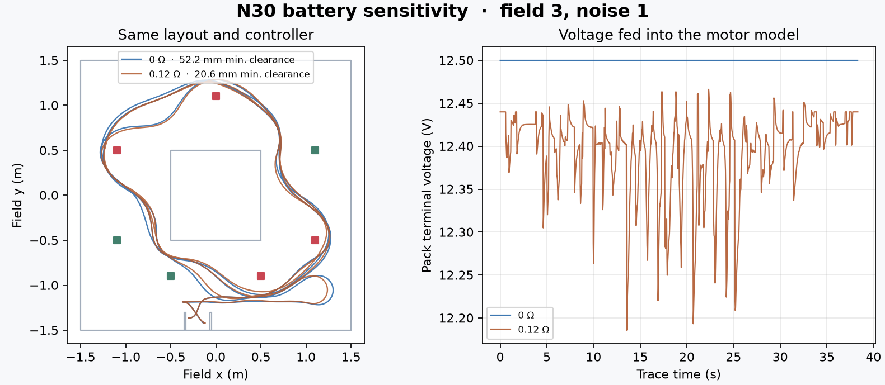](models/mathworks/README.md#battery-sag-coupled-to-the-software-in-the-loop-twin)

All eight paired races finished cleanly. In the illustrated case, the minimum pillar clearance shifted from **52 to 21 mm**. Other layouts gained clearance. The assumed pack resistance makes this a sensitivity test for race setups. [Simulink models, measured data and verification](models/mathworks/README.md) · [Eight paired results](models/mathworks/evidence/n30_battery_pairs.json)

### 3.9.1 Why we built it

With v1, every idea had to be tested on the real track: one run, one video, one log. Between the national and the international final we had ~11 weeks, a car that did not exist yet for the first month (new PCB, new chassis) and a new strategy to develop. So we built a **digital twin** that runs **the real code**, not a re-implementation of it:

| Part | In the twin | Real or modeled |
|---|---|---|
| ESP32 firmware | `PurePursuit.ino` compiled for the PC (Arduino API mocks, `zig c++`) into a shared library | **Real code** |
| Raspberry Pi software | `runtime_nuevo.py` and every module of §3.2, unmodified | **Real code** |
| UART link | Bytes and time at 460 800 baud, ESP32 RX buffer and the 128-byte hardware FIFO (lines that do not fit are lost) | Modeled from our measurements |
| Camera | Rendered from the **measured** camera pose (`CAMERA_*` in `config.py`, from the BEV calibration), flat colors, with camera vibration | Modeled |
| Vehicle | Bicycle model with the **measured** servo table, ±1.5 servo backlash, 0.10 s wheel lag, motor speed per PWM, braking/coasting and grip limit from §1.2 | Modeled from measurements |
| Sensors | ToF with per-sensor valid-status probabilities and the front Long-mode bias, BNO085 noise, encoder counts | Modeled from measurements |
| Field | Random pillar layouts following the rulebook (checked against the official randomizer), random parking-lot position, both directions | From the rules |

Code: [`src/RASPI/cam/pure_pursuit/twin/`](src/RASPI/cam/pure_pursuit/twin/) — entry point `python -m pure_pursuit.chassis_twin`, plan and history in [`docs/notes/twin_plan.md`](docs/notes/twin_plan.md) and [`docs/notes/HANDOFF.md`](docs/notes/HANDOFF.md).

The video of the real car next to the twin on the same field is at the [top of this document](#videos).

### 3.9.2 How we use it — the benchmark rule

A change is accepted only if it wins on the **standard bench**: the same 42 random fields × 5 noise seeds for the current version (base) and the candidate, compared **paired** (same field, same noise). The rule:

1. No new failure. A failure is any collision, a pillar passed on the wrong side, any touch of the outer wall, or a park outside the lot.
2. Then, lower median and mean time.
3. A second bench charges the real Pi 5 CPU time (frame ×4.28, re-plan ×5.8 vs. the PC) inside the simulated time, so changes that only work with a fast PC are rejected.

Tools: [`twin/tools/banco/`](src/RASPI/cam/pure_pursuit/twin/tools/banco/) (bench, paired summary, an evolution-strategy optimizer that tunes 8–10 parameters at a time). Every accepted configuration is exported to the car with [`exportar_carrera.py`](src/RASPI/cam/pure_pursuit/twin/tools/exportar_carrera.py), which writes `carrera.json` (Pi) and regenerates `PurePursuitCarrera.ino` (ESP32), so the car and the twin never drift apart.

### 3.9.3 What the twin gave us — and where it was wrong

| Result | Number |
|---|---|
| Old reactive control vs. route mode (known map) | 1/21 → **69/69** clean races |
| Lap 1 with an unknown map | **21/21** clean |
| Parking lot at a random position, blind start | **41/42** clean, median lot error 13 mm (fixed-lot code: 7/42) |
| Full race (start, 3 laps, U-turn, parallel park), final tuned configuration | **126/126** without wall contact; best 32.9 s, median 37.4 s |
| Same, charging the real Pi 5 latency | 40/48 (18/48 before the latency fixes: background planning, warm caches) |

The twin is a model, and the real car found what the model did not have. **Every hardware bug found on the car became a model in the twin**, so it cannot hide again:

| Found on the real car | Missing in the twin | Now modeled |
|---|---|---|
| Route never accepted (`rn=0`): UART FIFO overflow | Unlimited serial buffers | RX ring + 128-byte FIFO |
| Front ToF invalid 57–68 % of the time beyond 30 cm, +20 cm long | Perfect ToF | Per-sensor status probabilities, Long-mode bias |
| Pi loop at 22 fps instead of 40 | Assumed 40 fps | Measured frame period (then fixed on the car, §2.4) |
| Lateral ToF reading the floor | Perfect ToF | Range curve per sensor |
| Camera pose (tilt 24.8° vs the 45° first assumed) | Assumed camera | Measured pose from the BEV calibration |

## 3.10 Testing, Tuning and Validation

<p align="center"><a href="docs/img/results_overview.png">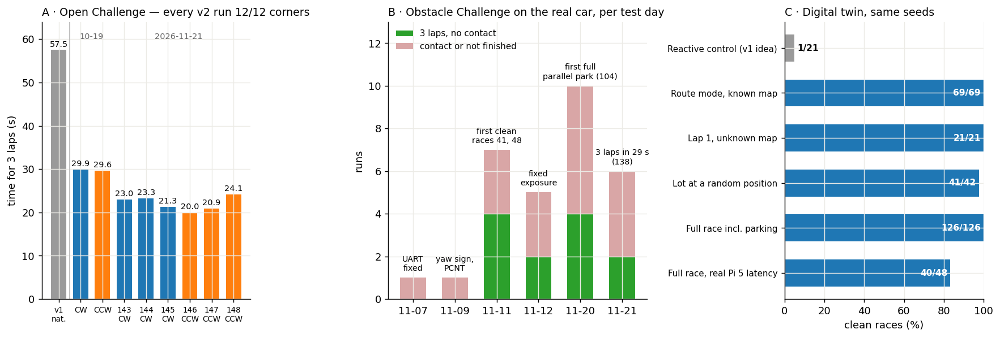</a></p>

*The tables of this section in one picture. **A:** every v2 open-round run finished 12/12 corners; 57.5 s is v1 at the national final. **B:** obstacle runs on the real car per test day, counted from the run history in §3.10.4 (green = 3 laps / 12 corners without touching anything; parking not counted). From 11-20 most runs tested new layouts, the lot at random positions and the parking, which is where the open issues of §3.10.5 come from. **C:** the twin, same seeds for every row (§3.9.3).*

### 3.10.1 Testing workflow

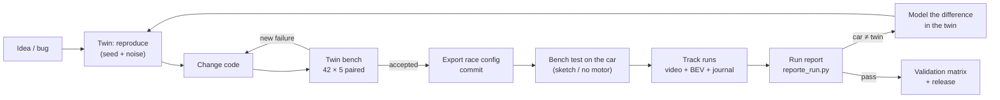

1. **Component tests** with small sketches before any full run: [`EncoderTest`](src/ESP32/EncoderTest/), [`TofTest4`](src/ESP32/TofTest4/), [`BnoRvcTest`](src/ESP32/BnoRvcTest/), [`TofBnoTest`](src/ESP32/TofBnoTest/), [`CalibFox`](src/ESP32/CalibFox/) (servo radius, encoder, ToF), [`PinScan`](src/ESP32/PinScan/) (UART wiring).
2. **Motion bench without the Pi:** [`SeguirRuta`](src/ESP32/SeguirRuta/) + [`scripts/ruta_bt.py`](scripts/ruta_bt.py): the PC sends a route over Bluetooth and the ESP32 follows it with odometry ([results](docs/route-following-bench.md)).
3. **Track runs:** every run records the camera/HUD video (`orillasNN.avi`), the clean BEV (`_bev.bin`) and the Pi journal with every message to and from the ESP32. Recording stops 5 s after the car stops. [`scripts/reporte_run.py`](scripts/reporte_run.py) turns the journal into a per-corner report.
4. **Acceptance:** a run passes only if it completes autonomously with no contact, every pillar on the correct side, and (obstacle round) a park inside the lot. Failed runs are kept: each one names the next thing to change. The full method is in [`docs/testing.md`](docs/testing.md).

**Metrics we track per run:** corners completed, collisions/contacts, pillars on the wrong side, lap and total time, parking-lot position error, final park position, Pi frame rate, ESP32 loop time, UART errors (`ue`, `lc`), route points accepted (`rn`).

### 3.10.2 Component and bench results

| Test | Result | Date |
|---|---|---|
| Encoder: push 1 m along a tape (PCNT ×4) | N20: 5.45 counts/mm, repeat 1008–1043 mm · **N30: 7.523 counts/mm** | 2026-11-09 / 11-17 |
| ToF static, ROI 16 vs ROI 8, black wall 60 / 80 cm | −50 / −190 mm → **−8 / −40 mm** | 2026-10-21 |
| UART Pi ↔ ESP32 at 460 800, bench | 583/583 ACK, 0 errors, route accepted | 2026-11-07 |
| Turning radius on the mat (servo 1 / 156) | 123 / 134 mm | 2026-10-22 |
| Route following, ESP32 only, open lap ×3 at PWM 255 | 28.7–29.1 s, mean deviation **12 mm** with wall correction | 2026-10-22 |
| Route following, ESP32 only, obstacle layout ×3 | 26.2–26.6 s, lateral error rms **7 mm**, all pillars correct | 2026-10-23 |
| Pi 5 pipeline | 23.5 ms/frame mean, re-plan 59–70 ms | 2026-11-06 |

<p align="center">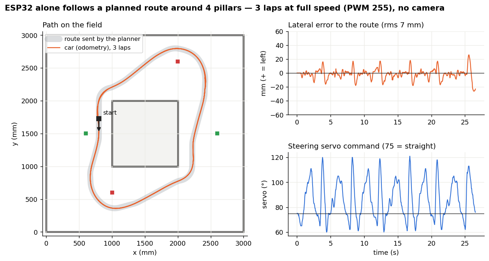</p>

*Run `ruta_obstaculos_20261023_152651` (data in [`logs_tof/`](logs_tof/)): the ESP32 alone follows the planner's route around 4 pillars for 3 laps at PWM 255; lateral error rms 7 mm.*

### 3.10.3 Open Challenge (v2)

| Run | Direction | Corners | Time | Interventions | Firmware | Status |
|---|---|---|---|---|---|---|
| 133246 | CW (right) | 12/12 | 29.9 s | 0 | `RondaAbierta.ino` | Validated |
| 141103 | CCW (left) | 12/12 | 29.6 s | 0 | `RondaAbierta.ino` | Validated |
| 143 | CW (right) | 12/12 | ~23.0 s | 0 | `RondaAbierta.ino`, end straight 1.0 s | Stopped past the start section → end straight cut to 0.3 s |
| 144 | CW (right) | 12/12 | ~23.3 s | 0 | `RondaAbierta.ino`, end straight 0.3 s | Validated |
| 145 | CW (right) | 12/12 | ~21.3 s | 0 | `RondaAbierta.ino`, end straight 0.3 s | Validated |
| 146 | CCW (left) | 12/12 | ~20.0 s | 0 | `RondaAbierta.ino`, end straight 0.3 s | Validated |
| 147 | CCW (left) | 12/12 | ~20.9 s | 0 | `RondaAbierta.ino`, end straight 0.3 s | Validated |
| 148 | CCW (left) | 12/12 | ~24.1 s | 0 | `RondaAbierta.ino`, end straight 0.3 s | Validated |

Runs 143–148 (2026-11-21): started with the Pi button (the Pi sends `READY` over the UART, the ESP32 answers `ACK:READY` and drives on its own; nothing else from the Pi is used). Times are measured on the Pi's recorded video, from the first to the last frame with motion (the video is ~6.5 fps, so ±0.3 s). All six runs used the same inner-wall position; runs with other positions are still to do.

### 3.10.4 Obstacle Challenge (v2, real car, route mode)

<details>
<summary><b>Run-by-run history, 2026-11-07 → 11-21</b> — every problem found on the track and its fix (click to open)</summary>

| Date | Runs | What happened | Cause → fix | Status |
|---|---|---|---|---|
| 11-07 | first test | Car did not move | Pi→ESP UART not arriving; then FIFO overflow (`rn=0`) → `Serial2` on core 0, 4 KB buffer (`1360188`) | Fixed |
| 11-09 | track tests | Car turned before the walls | BNO085 yaw sign lost when merging branches → pose mirrored; ISR encoder losing counts → PCNT | Fixed |
| 11-11 | 35–36 | Completed with weaving (8 % more distance than the twin) | Pi at 22 fps (CPU scaling) → Picamera2 ISP, 40 fps (`924a084a`) | Fixed |
| 11-11 | 37–38 | Lost V2 lines while the motor ran (`ue`≈400/s) | Bad UART cable → replaced, `ue`=0 | Fixed |
| 11-11 | **41** | **Clean race, 12 corners**, speed loop on | — | Pass |
| 11-11 | **48** | **Clean race, 12 corners**; parking sequence started but the car did not end fully inside the lot | Parking still being tuned (see §3.10.5) | Race: pass · Park: open |
| 11-11 | 50, 52 | Lone green (E/X2) mapped at the start of its straight | ERR-30: off-axis votes while turning (`23af434a`) | Fixed offline |
| 11-11 | 51 | Hit 2nd green after the lot | ERR-31: lot fix without orange-line votes | Open |
| 11-12 | 57, 59, 60 | Hit the island after the lot | Auto-exposure burn + line votes rejected while still turning → fixed exposure (`c41e0a7a`), turn limit 3°→10° (`9cb39aa0`) | Fixed |
| 11-12 | 62, 64 | Completed; lot error +196/+201 mm vs ~+230 real; near-miss at E/X in lap 1 | E/X1 ↔ E/X2 flip in lap 1 | Open |
| 11-20 | **98** | Seed 23 layout, CCW: **3 laps in ~31 s, no pillar touched, no wrong side**; after the U-turn the parking anchor was behind the real car, it reversed too late and touched the wall | Lot localization in the return leg | Race: pass · Park: open |
| 11-20 | **99** | Same layout repeated: identical timing (laps 31 s, park 14 s), no pillar touched; ended 19° from parallel (run 98: 27°) after 11 steering reversals inside the lot | Same as run 98 | Race: pass · Park: open |
| 11-20 | 100–102 | Same layout at noon: hit the island ~4 s after the start, all three | Lot fix matched the orange tape to the wrong corner: the right tape gave +166..+192 mm, just outside the ±150 mm vote window, so the vote jumped to a tape 1.4 m away (−565 mm). Window 150 → 300 mm and lot position clamped to the legal range (`82dadba2`) | Fixed |
| 11-20 | **103** | Lot fix correct (+0 mm); **3 laps, 12 corners in ~30 s**; grazed the red pillar in section 2 (lap 1) | The red is not visible from the lot straight; it is confirmed after the corner and the route shifts ~590 mm sideways at PWM ~200 | Open |
| 11-20 | **104** | Lot fix correct (−33 mm); 3 laps in ~31 s and **parked fully inside and parallel** (first full parallel park of the v2 car); hit the same red pillar | Route passes the outer-row red with ~81 mm clearance, but the lateral pose was ~200 mm toward the inside (side ToF reads short beyond ~45 cm, §3.10.5). Lap-1 corner slowdown near a pillar added (`80d25e59`) but did not trigger because of the pose error | Open |
| 11-21 | 129 | Lot fix +132 mm off after setting a 14-frame camera lag | The 14 frames came from a replay error (the vote's frame in the recording is 16 frames later than assumed); real camera→pose lag is ~0 → lag 0 (`40db744a`) | Fixed |
| 11-21 | 130–131 | Lot fix with the blue tape: CW 4.4 cm, CCW 2.9 cm from the measured lot | ERR-31: CCW exits saw no usable orange line → vote also on the blue tape (`ca734e1e`) and CCW exit odometry offset −86 mm (`2764bc12`) | Fixed |
| 11-21 | 132 | Turned too much at corner 1 and touched the island | Seen once in 6 runs; not reproduced | Open |
| 11-21 | 135, 137 | Hit (135) / grazed (137) the red pillar of S/T1 | ERR-32: the planner map dropped the red half a second before corner 1 and planned over it → map frozen once the lot is fixed (`ae97f4d3`) | Fixed |
| 11-21 | **138** | CCW: **3 laps in 29 s, no pillar touched, no wrong side** (OBS-06); parking not finished | — | Race: pass · Park: open |
| 11-21 | 140 | CW: U-turn before parking hit the back wall | ERR-33: the U started ~25 cm from the wall because the car moved away first even with little straight left → U right away when < 650 mm remain (`e2ddbcbc`) | Fixed |
| 11-21 | **142** | CW: 3 laps clean, U-turn OK (17–26 cm from the wall); parallel park jammed ~24° off | Entry reverse swing of ~48° is too much | Open |

</details>

**Formal validation matrix for the release** (to be filled with the final firmware; each row = one full round with a random layout and a random lot position):

| Run | Direction | Lot position | Score | Time | Collisions | Wrong side | Park | Battery V | Commit | Status |
|---|---|---|---:|---:|---:|---:|---|---:|---|---|
| OBS-01 | CW | random layout, lot 1151 mm (run 106) | 54 / 62 | ≈42 s (laps 30.2 s) | 0 (passed the red after corner 10 at 5 mm in lap 3, not moved) | 0 | Partial (14° off, partly inside; oscillates while settling) | 12.4 | `80d25e59` | Park partial |
| OBS-02 | CW | random layout, lot 1177 mm (run 107) | 54 / 62 | ≈39 s (laps 29.8 s) | 0 (closest 69 mm, after corner 6) | 0 | Partial (19° off, partly inside) | ≈12.3 | `80d25e59` | Park partial |
| OBS-03 | CW | random layout, lot 1140 mm (run 111) | 44 / 62 | ≈44 s | 1 (lone green in the middle of a straight, lap 2: mapped one column off) | 0 | Partial (16° off, partly inside) | — | `80d25e59` | Collision + park partial |
| OBS-04 | CCW | seed 23, lot 1653 mm from SE corner | 47 / 62 | 45 s (laps 31 s) | 0 | 0 | Fail (touched wall) | 11.72 | `8b26bfd9` | Park fail |
| OBS-05 | CCW | seed 23, lot 1653 mm from SE corner | 47 / 62 | 45 s (laps 31 s) | 0 | 0 | Fail (19° off, not inside) | 11.68 | `8b26bfd9` | Park fail |
| OBS-06 | CCW | random layout, lot ≈1170 mm (run 138) | 47 / 62 | laps 29 s | 0 | 0 | Fail (log ends during the U-turn, not inside) | — | `9f6a3ec8` | Park fail |

### 3.10.5 Known limitations

- **Lap-1 mapping of the lone pillar right after a corner** (E/X1 vs E/X2) can flip until the car is straight; planned fix: keep both seats as obstacles until confirmed head-on.
- **Lot position after the start.** Fixed on 2026-11-21 (ERR-31): the start fix now also votes on the blue tape, 3–4 cm along the straight in both directions. Across the lane it still reads ~4 cm too wide in every run (129–131); not yet corrected.
- **Lateral position on the real car** is 100–250 mm off: the side ToF read short beyond ~45 cm (right sensor −110 mm at 57 cm, −214 mm at 72 cm) and the localizer trusts them up to 45–48 cm. In straights the ToF corridor width reads 900–950 mm instead of 1000 (run 104). The route passes outer-row pillars with ~80 mm clearance, so this error is enough to touch them (runs 103–104). Planned fix: calibrate both side ToF, check the corridor width live, and add the wall seen by the camera as a second lateral reference.
- **Parking is not yet repeatable.** The v2 car ended fully inside and parallel for the first time in run 104 (2026-11-20). Runs 98–99 on the same layout ended 19–27° off because the lot anchor after the U-turn was behind the real car. We are still tuning the arc–straight–arc maneuver (§3.4) so it parks every time and as fast as possible.
- **Consistency of the full round.** Clean 3-lap rounds with a correct map exist (runs 41, 48), but not every run yet completes all 3 laps with every pillar mapped correctly; the open mapping case is the one above. On 2026-11-21 lap 1 steered visibly less smooth than laps 2–3 (about twice as many steering reversals per metre); cause not yet confirmed. The validation matrix above will be filled once this is consistent.
- **Color depends on the camera exposure.** After the 2026-11-19 remount (automatic exposure) the red pillars appeared at hue 5–7 instead of 170–179 and the old red band missed them; the ratio-based classifier that fixes it is validated offline and still has to be tested on the car (§6).
- **Front ToF** is reliable only to ~80 cm on the black wall; it is never used for the lot fix.
- **Surprise pillar (§3.7.8)** is validated only in the twin: it still needs a calibration table from real photos and three twin regressions (parking and one pillar) fixed before we declare the attempt.
- **Twin parking** is the least realistic part of the simulator; parking constants are confirmed on the car.


---

# 4. Systems Thinking and Engineering Decisions

> [!NOTE]
> **In short:** every v2 change answers a problem we measured on v1 ([§4.2](#42-from-v1-to-v2--what-the-national-final-taught-us)), and every choice in [§4.4](#44-trade-offs--we-chose-x-instead-of-y-because) comes with the number that decided it.

This section starts from the constraints ([§4.1](#41-the-challenge-our-goals-and-the-design-constraints)) and what v1 taught us ([§4.2](#42-from-v1-to-v2--what-the-national-final-taught-us)), then shows how the subsystems constrain each other ([§4.3](#43-how-the-subsystems-constrain-each-other)), the decisions we took with the data behind them ([§4.4](#44-trade-offs--we-chose-x-instead-of-y-because)), the risks we found and how we handle them ([§4.5](#45-risks-failure-modes-and-mitigations)) and the timeline of iterations ([§4.6](#46-iteration-timeline)).

## 4.1 The challenge, our goals and the design constraints

The car must drive **three laps** autonomously around a 3 × 3 m field whose inner walls move between rounds (**Open Challenge**), and, in the **Obstacle Challenge**, also pass red pillars on the right and green pillars on the left, start from a parking lot and park in it at the end. Score ranks first; time only breaks ties. In 2026 the Obstacle Challenge also has an optional **extra task**: one pillar changes color and height, and the car must obey its original color (§3.7.8).

**Our goal for the international final:** keep the reliability that won the national final, and remove the limits that made v1 slow and fragile (§4.2). Concretely:

| Goal | Target | Why |
|---|---|---|
| Finish both challenges in every round | 0 collisions, 12/12 corners, park inside the lot | Points rank first |
| Faster obstacle round | One continuous route instead of stop-and-turn corners | v1 stopped at every corner; a lap took ~25–30 s |
| Robust to the venue | Any start position of the parking lot, any lighting | At the national final the judges moved the parking lot along the straight; the venue light shifted our colors |
| Reproducible | Measured parameters, one release per event, a simulator that runs the real code | So any change can be tested before it reaches the car |

### Design constraints (from the rules and from our own limits)

| Constraint | Value | Consequence for the design |
|---|---|---|
| Max vehicle size | 300 × 200 × 300 mm | We built much smaller (176 × 125 mm) to have room to dodge and park |
| Parking-lot length | 1.5 × car length | A shorter car also gets a shorter lot, so shorter alone is not enough: the turning radius must shrink too (§1.3) |
| Drive | Wheels physically connected, one drive motor; steering by turning the wheels | Single motor + differential + Ackermann steering |
| Start procedure | One switch to power on, one button to start | Start button on the Pi, READY LED (§3.5) |
| Wireless | No radio may be on during a round (rule 11.10) | The race firmwares never start Wi-Fi or Bluetooth (the open-round Bluetooth log compiles only with `BT_LOG 1`, bench only); the Pi's radios are switched off before the round ([§5.5](#55-run)) |
| Compute | Real-time vision + planning on board | Raspberry Pi 5 for perception and planning, ESP32 for real-time control |
| Time | ~11 weeks between the national and the international final | We rebuilt and tested in parallel using a simulator (§3.9) |

## 4.2 From v1 to v2 — what the national final taught us

The [v1 documentation](docs/v1-national/README.md) describes the national-final car in full. It finished every round we needed, but the logs and videos of ~1200 test runs showed where it was limited. Each problem below became one change in v2.

| # | What we saw with v1 (evidence) | Root cause | v2 change | Section |
|---|---|---|---|---|
| 1 | The obstacle round was slow: the car **stopped before every corner** and did a forward arc or a reverse pivot | v1 steered reactively from the camera; it never knew where it was on the field, so it could not plan a corner through the pillars | **Route mode**: the Pi builds a map of the pillars, plans a full lap as a curve in millimeters and the ESP32 follows it with odometry | [§3.7](#37-obstacle-management--route-mode) |
| 2 | Maneuvers changed with the battery charge: a fresh pack over-rotated the dodges (ERR-11) | Open-loop motor (no encoder) | Gear motor **with encoder** + speed loop on the ESP32 | [§1.2](#12-drivetrain--gear-ratio-chosen-from-measured-speed), [§3.4](#34-esp32-firmware-and-state-machine) |
| 3 | Heading drifted: 6.5 % low over 12 corners and −7.5° after each corner maneuver (ERR-23) | MPU-6050 rate integrated on a busy loop | **BNO085** with on-chip fusion (100 Hz) | [§2.4](#24-sensors--selection-placement-and-calibration) |
| 4 | Phantom walls from the front ultrasonic in ~20 % of straight frames (ERR-19) | Wide acoustic lobe, multipath | **4 × VL53L1X ToF** with a narrow, software-set field of view as the distance sensors; the 3 HC-SR04 stay mounted only as a cross-check (§2.4) | [§2.4](#24-sensors--selection-placement-and-calibration) |
| 5 | The car was long (≈240 mm with the parking-exit extension) and turned wide (R ≈ 208 mm) | Motor perpendicular to the axle, Pi in the middle, anti-Ackermann linkage | **Shorter chassis (176 mm)**, motor parallel to the axle, Ackermann linkage, bigger pinion → **R ≈ 123–134 mm measured** | [§1](#1-mobility-and-mechanical-design) |
| 6 | The Pi 4 ran at 14–18 fps and hit 84 °C with thermal throttling | Vision is compute-bound; the Pi was enclosed | **Raspberry Pi 5** on top of the car; hardware image scaling → ~40 fps | [§2.5](#25-main-computer--raspberry-pi-5) |
| 7 | Hand-wired harness and a single-floor board shaped around the Pi 4 | No room for new sensors | **Two-board stacked PCB (RevB)**: power board + logic board | [§2.3](#23-pcb-revb--two-stacked-boards) |
| 8 | Every change had to be tested on the real track, one run at a time | No simulator | **Digital twin** that compiles the real firmware and runs the real Pi code | [§3.9](#39-digital-twin--software-in-the-loop-simulator) |
| 9 | Documentation scored 26/30 | Missing power budget, v2 wiring, quantitative test evidence | This document: rubric map, measured tables, validation matrices, release notes | — |

**What we kept, on purpose:** the two-controller split (Pi for perception and planning, ESP32 for real-time control), the LEGO wheels and axles, the 3S LiPo, the rack-and-pinion steering concept and the bird's-eye-view (BEV) camera geometry. They worked, and changing them would have cost time without solving a problem we had measured.

## 4.3 How the subsystems constrain each other

| If we change… | …it affects | Example from this season |
|---|---|---|
| Gear ratio (mobility) | Top speed → speed profile → planner time cost → how close to pillars the route can pass at speed | 2 : 1 → 1.25 : 1 made the car grip-limited in corners, so the speed profile (a_lat) became the key tuning knob |
| Camera frame rate (compute) | Every "N frames" constant, votes per pillar, latency of the pose used for mapping | Moving from 14 to 40 fps required re-scaling frame counts into seconds; at 22 fps (bad pipeline) the real car weaved |
| ToF field of view (sensors) | Localizer accuracy → map position of pillars → route clearance | ROI 16 read the floor; the pose was pulled 100–250 mm toward one wall and the car grazed a pillar |
| PCB layout (power) | Pi supply → throttling → frame rate → mapping | The second regulator isolates the Pi from servo spikes |
| Firmware/UART (software) | Whether the route arrives at all | One FIFO overflow = route never accepted = car follows nothing |
| Chassis length (mechanics) | Turning radius, parking-lot length (1.5 × car), clearance the planner must keep | 240 → 176 mm and 208 → 123–134 mm radius |

## 4.4 Trade-offs — "we chose X instead of Y because…"

| Decision | Instead of | Because (data) |
|---|---|---|
| Plan a full **route** and follow it with odometry | Reactive steering from the image (v1) | Twin: 1/21 → 69/69 clean races; real car: clean 12-corner races (41, 48) without stopping at corners |
| Route follower on the **ESP32** | Steering computed on the Pi | The pose reached the Pi 4–6 frames late; on the ESP32 the follower runs at loop rate on current odometry |
| **ToF as the distance sensor**, HC-SR04 only as a cross-check | Ultrasonics as the main sensor (v1), or ToF alone | Ultrasonic phantoms in ~20 % of straight frames (ERR-19) rule them out as the main sensor; with ROI 8 and status rules the ToF read the black wall within −8/−40 mm at 60/80 cm. But the ToF's weak spot (dark walls, far away) is exactly where sound works, so we keep the ultrasonics to check it instead of trusting one physics |
| **BNO085** fused yaw over UART-RVC | MPU-6050 integration; BNO over I²C | MPU heading 6.5 % low, −7.5° per corner; RVC keeps the IMU off the busy ToF I²C bus and needs no library |
| **Encoder read by PCNT hardware** | Interrupts | Interrupts lost 25–65 % of counts under motor load on the floor; PCNT: 1 m push → 1008–1043 mm |
| **1.25 : 1** gearing, then the **N30 30:1** motor | 2 : 1 (v1) or 1.5 : 1; keeping the N20 50:1 | Corners are grip-limited (2.5–2.8 m/s²); speed is only useful on straights: 514 → ~800 mm/s with the N20, ~1.5 m/s with the N30 |
| **Braking with the speed loop**, not a motor short | Short brake (motor terminals shorted) | With the N30 a short brake above ~600 mm/s locks the wheel: from 1.5 m/s it stops in ~24 cm, ~15 cm of which the encoder never sees. Ramping the speed down keeps the odometry trustworthy |
| **Dynamic programming** planner on a 20 mm grid | Bézier line from the map; A*; 10 mm grid | `_build_line` kinks (1/21); 10 mm grid 5× slower re-plan, 29/48 vs 40/48 with real latency |
| **Fixed camera exposure** per venue (2026-11-12 → 11-19) | Auto exposure | Auto exposure burned the floor for ~1 s after leaving the magenta lot → orange line missed → crash (run 57) — then reverted: a value measured by day was too dark at night. Lesson: the exposure must follow the floor, not be frozen (§6) |
| **Picamera2 with ISP scaling** | GStreamer scaling on the CPU | 245 % CPU and 22 fps → 5 % CPU and 40 fps, same image |
| **Raspberry Pi 5** | Optimize the Pi 4 | Capture was only ~5 ms of a 65 ms frame; vision itself was the cost; Pi 4 throttled at 84 °C |
| **Two stacked PCBs** | One bigger board | The 176 mm chassis has no room for one board; power and motor noise stay on the lower board |
| **Open round on the ESP32 alone** | Use the camera too | No pillars to see; heading hold + ToF gave 12/12 in ~30 s, with fewer failure points |
| **Simulator running the real code** | Testing only on the track | Hundreds of full races per change; every accepted change passed 210+ paired races before reaching the car |

## 4.5 Risks, failure modes and mitigations

| Failure mode | How we found it | Impact | Mitigation | Status |
|---|---|---|---|---|
| Logic board stacked rotated 180° | Pi 5 died (2026-11-06) | Lost a Pi 5 (replaced) | Orientation marks; measure the Pi rail **without the Pi** first; next rev: keyed headers + PTC + TVS | Mitigated |
| Pi does not boot on battery | 1000 µF on the Pi's 5 V output (design: 100 µF) tripped the MINI560 start-up protection | No start | Back to 100 µF; add 470–1000 µF ≥ 25 V at the regulator input next rev | Fixed |
| UART FIFO overflow | `rn=0`, `UART_FIFO_OVF` in the log | Route never accepted | `Serial2` on core 0, 4 KB buffer; checksum + re-send; error counters in every ACK | Fixed |
| Bad UART cable | `ue`≈400/s only with the motor on | Lost commands | Cable replaced; `ue` watched in every run | Fixed |
| Encoder counts lost | 1 m push read 326–411 mm | Pose wrong | PCNT hardware counter | Fixed |
| Yaw sign wrong after a merge | Car turned before the walls | Mirrored pose | Sign checked in the bench checklist; constants audited after merges | Fixed |
| ToF reads the floor / black wall | Static tests, lateral pose bias | Pose bias 100–250 mm | ROI 8, status rules, per-sensor max range in the EKF | Fixed |
| Camera exposure burn after the lot | Video of runs 57/59/60 | Late orange line → crash | Fixed exposure per venue (2026-11-12); back to auto after the 11-19 remount because the fixed value was too dark at night; floor-referenced exposure planned (§6) | Mitigated |
| Pi overheating | ~80 °C, throttle flags (no fan) | Lower frame rate | Official Active Cooler | Solved: 46–49 °C, `throttled=0x0` after 3 rounds |
| Venue lighting changes colors | National final: pink read as red | Wrong pillar color | Ratio tests + `calibra_luz.py` at the venue | Mitigated |
| USB powering the car without the battery | Motor weak, 636 vs 2000 counts/s | Misleading bench results | Bench tests only with the battery connected | Procedure |

## 4.6 Iteration timeline

| Date | Milestone |
|---|---|
| 2026-09-19 | **1st place, Mexico national final** with v1 ([`v1.0-nacional`](docs/releases.md)) |
| 2026-09-21 → 10-04 | Profiling, component decisions, components ordered; v2 chassis designed; digital twin started |
| 2026-10-06 | Pi 5: same pipeline at 40 fps on recorded video |
| 2026-10-13 | Route mode in the twin: 69/69 known map, 21/21 lap 1 |
| 2026-10-14 → 10-19 | New car runs: open round 12/12 in ~30 s; encoder and ToF characterized |
| 2026-10-17 | PCB RevB ordered |
| 2026-10-22 → 10-24 | Route-following bench at full speed; car dynamics measured |
| 2026-11-04 → 11-07 | PCB assembled; first full-system tests; UART and power problems found and fixed |
| 2026-11-11 | First clean route-mode races on the real car (runs 41, 48) |
| 2026-11-12 | Fixed exposure, lot-fix robustness |
| 2026-11-17 | Drive motor N20 50:1 → **N30 30:1** (top speed ~0.8 → ~1.5 m/s), encoder and dynamics re-measured on the mat (§1.2) |
| 2026-11-16 | Documentation for the international final; v2 CAD published (parts, STEP, STL, renders); HC-SR04 cross-check of the ToF added to the firmware (sensors mounted on the car, not yet wired) |
| 2026-11-19 | Camera remounted: BEV recalibrated, automatic exposure; red pillars found outside the red hue band → color study over 11 recorded runs (§6) |
| 2026-11-20 | Documentation reorganized in the order of the judging rubric |
| next | See [§6 Next Steps](#6-next-steps) |

The dated, phase-by-phase story is in the [Engineering Journal](ENGINEERING_JOURNAL.md); every decision (DEC-xx) and incident (ERR-xx) with its evidence is in the [engineering log](docs/engineering-log.md).

---

# 5. Reproducibility and GitHub Quality

> [!NOTE]
> **In short:** print the parts, order the two PCBs, flash the ESP32, install the Pi software, calibrate at the venue in ~20 minutes and run. Every number in this document has the command and the data that reproduce it ([§5.7](#57-reproduce-our-results)).

Everything needed to rebuild the car and re-run our results is in this repository: CAD and STL, gear profiles, KiCad projects and schematics, both firmwares, the Pi software, the simulator, the bench logs and the scripts that turn a run into the tables of this document. The raw recordings of the real track runs (video, bird's-eye recordings and journals, about 2 GB) are too large for git and stay on the team's computers; the videos of the rounds are on YouTube ([`video/video.md`](video/video.md)). [§5.1](#51-build-the-car)–[§5.6](#56-run-the-digital-twin-pc) rebuild and run the car; [§5.7](#57-reproduce-our-results) reproduces the numbers in this document; [§5.8](#58-repository-structure) and [§5.9](#59-versioning-releases-and-commit-history) describe the repository and its history.

## 5.1 Build the car

1. **Print the parts** — STL in [`models/v2/stl/`](models/v2/stl/) (parts list and quantities in [`models/v2/README.md`](models/v2/README.md)); gear profiles in [`Mecanica/Engranes/`](Mecanica/Engranes/). PLA, 0.2 mm layers; gears and rack at 100 % infill.
2. **Order the PCBs** — upload [`WRO_RevB_1_gerbers.zip`](electrical/export/fabrication/WRO_RevB_1/WRO_RevB_1_gerbers.zip) (logic) and [`WRO_RevB_2_gerbers.zip`](electrical/export/fabrication/WRO_RevB_2/WRO_RevB_2_gerbers.zip) (power) as they are: 2 layers, 1.6 mm, 117.5 × 50.6 mm. The parts to solder on each board are in its BOM CSV next to the zip ([`electrical/export/fabrication/`](electrical/export/fabrication/)). Schematics in PDF: [`electrical/export/`](electrical/export/). KiCad projects, to modify the boards: [`electrical/WRO_RevB_1/`](electrical/WRO_RevB_1/), [`electrical/WRO_RevB_2/`](electrical/WRO_RevB_2/).
3. **Assemble** following [§1.5](#15-assembly-order-v2). **Before mounting the Pi:** with the boards stacked in the marked orientation and the battery connected, measure 5.0–5.2 V on `TO_PI` pins 7/8, 5 V on the servo header and 3.3 V on the sensor header.
4. **Components** — see the [cost report](#7-cost-report) for the full list.

## 5.2 ESP32 firmware

Arduino IDE 2 or `arduino-cli`, board **ESP32 Dev Module** (`esp32:esp32:esp32`). Versions we build with: **ESP32 Arduino core 3.3.4** (3.x is required for `driver/pulse_cnt.h`) and **VL53L1X by Pololu 1.3.1** — the only library; the BNO085 is read without one (UART-RVC). Upload with the car battery **off** (the motor start can drop the USB connection).

```bash
arduino-cli core install esp32:esp32@3.3.4
arduino-cli lib install "VL53L1X@1.3.1"

# Obstacle Challenge (race build, generated from PurePursuit.ino + the race parameters)
arduino-cli compile --fqbn esp32:esp32:esp32 src/ESP32/PurePursuitCarrera
arduino-cli upload  --fqbn esp32:esp32:esp32 -p <PORT> src/ESP32/PurePursuitCarrera

# Open Challenge (ESP32 only)
arduino-cli compile --fqbn esp32:esp32:esp32 src/ESP32/RondaAbierta
arduino-cli upload  --fqbn esp32:esp32:esp32 -p <PORT> src/ESP32/RondaAbierta
```

To regenerate the race build after changing `PurePursuit.ino` or the tuned parameters:

```bash
cd src/RASPI/cam
PYTHONPATH=. python pure_pursuit/twin/tools/exportar_carrera.py ruta_perfil pure_pursuit/twin/tools/carrera_bench.json --pi-baud 460800
# writes pure_pursuit/carrera.json + src/ESP32/PurePursuitCarrera/PurePursuitCarrera.ino
```

## 5.3 Raspberry Pi 5 software

Raspberry Pi OS (Debian 13 "trixie", 64-bit).

```bash
git clone https://github.com/Nakashima26/WRO_FE_2026_FoxRobotics.git FoxRobotics
cd FoxRobotics
sudo apt install python3-opencv python3-numpy python3-serial python3-picamera2 \
                 python3-rpi-lgpio gstreamer1.0-libcamera gstreamer1.0-plugins-good
python3 -m venv --system-site-packages .venv && source .venv/bin/activate
pip install -r requirements.txt          # skips the apt packages on the Pi
```

`/boot/firmware/config.txt`: `enable_uart=1`, `camera_auto_detect=0`, `dtoverlay=imx219,cam0` (the port the ribbon is on). The ESP32 is on `/dev/ttyAMA0`. The camera tuning file (lens shading) is loaded from [`src/RASPI/cam/camera_tuning/`](src/RASPI/cam/camera_tuning/README.md).

**Autostart:** `sudo ./scripts/install_autostart_pi.sh` installs [`deploy/systemd/wro-runtime.service`](deploy/systemd/wro-runtime.service) plus the Pi 5 drop-in in `deploy/systemd/wro-runtime.service.d/`. Logs: `journalctl -u wro-runtime.service -b 0`. To restart the service use `stop`, wait 4 s, `start` (a direct `restart` can leave the camera busy). Always shut down with `sudo poweroff`: cutting power corrupted libraries on the SD card once.

## 5.4 Calibration at a new venue (≈ 20 minutes)

All from `src/RASPI/cam/`. Full guide: [`pure_pursuit/INSTRUCCIONES.md`](src/RASPI/cam/pure_pursuit/INSTRUCCIONES.md) and [`docs/notes/CALIBRACION.md`](docs/notes/CALIBRACION.md).

| Step | Command | What it sets |
|---|---|---|
| 1. Exposure (optional) | Default: automatic. `python -m pure_pursuit.mide_exposicion --guardar` saves a fixed exposure for the venue light → `camera_tuning/exposicion.json` | Exposure; delete the file to go back to automatic |
| 2. Colors | `python -m pure_pursuit.calibra_luz` (or the browser view `python -m pure_pursuit.cam_web`) | Floor reference, red/green/magenta/orange ratios |
| 3. BEV (only if the camera mount moved) | `python -m pure_pursuit.calibrate` | Homography from floor crosses → `bev_calib.npz` |
| 4. Servo center | Drive straight at PWM 150 from both sides | `centroServo` (75 on our car) |
| 5. Sensor check | First ACKs after the button: all four ToF valid, `ue=0`, `rn` = route length | Wiring and UART |

## 5.5 Run

**Before a round — radios off (rule 11.10).** The ESP32 race firmwares never start a radio (in `RondaAbierta.ino` the Bluetooth log exists only with `BT_LOG 1` for the bench). On the Pi, Wi-Fi and Bluetooth are used only to collect data during testing (logs, videos, deploys), never to drive, so before the car goes to the field both are switched off: `sudo rfkill block wifi bluetooth` (the state survives a reboot; `rfkill list` shows *Soft blocked: yes* for both). After the competition: `sudo rfkill unblock all` from a keyboard or an Ethernet cable.

Power on → wait for the READY LED → press the button. Manual run with a debug window:

```bash
cd src/RASPI/cam
python -m pure_pursuit.runtime_nuevo --serial-port /dev/ttyAMA0 --record-orillas    # with debug window
python -m pure_pursuit.runtime_nuevo --serial-port /dev/ttyAMA0 --no-window --record-orillas --record-output ~/FoxRobotics/videos_orillas   # as the service runs it
```

`carrera.json` (the race configuration exported from the twin) is loaded automatically on top of `config.py`; `--sin-carrera` disables it. Each run is recorded to `videos_orillas/` (video + clean BEV + journal). Summary: `python scripts/reporte_run.py --pi`.

## 5.6 Run the digital twin (PC)

```bash
# once (Python 3.11+); on macOS/Linux use .venv-sim/bin/ instead of .venv-sim/Scripts/
python -m venv .venv-sim
.venv-sim/Scripts/pip install -r src/RASPI/cam/requirements-sim.txt ziglang

cd src/RASPI/cam
export PYTHONUTF8=1                       # Windows consoles: the logs print non-ASCII characters
export TWIN_PI_UART_US_PER_BYTE=21.7      # 460 800 baud, as on the car (the default models 115 200)
export FOX_CXX="python -m ziglang c++"    # Windows: use zig even if another c++ (e.g. MinGW) is on the PATH

# watch one race in the viewer (camera, BEV and map with the planned route)
python -m pure_pursuit.chassis_twin --preset ruta_perfil --park-pos random --seed 1

# headless: print the metrics only, or save the viewer as a GIF
python -m pure_pursuit.chassis_twin --preset ruta_perfil --park-pos random --seed 1 --no-show
python -m pure_pursuit.chassis_twin --preset ruta_perfil --park-pos random --seed 1 --save-gif race.gif
```

The first build of the firmware library takes ~3 minutes; it is cached per firmware hash. Each run ends with a `[TWIN] stop=… metrics={…}` line (finished, collisions, lap times, park result). The race configuration tuned on the bench passes extra `--pi KEY=VALUE` overrides; the full command lines of each bench are in [`docs/notes/HANDOFF_PERFIL.md`](docs/notes/HANDOFF_PERFIL.md).

## 5.7 Reproduce our results

Every number in this document comes from a run, a log or a script. The scripts, the twin and the bench logs are in this repository; the raw recordings of the real track runs are not (see above), but the same scripts work on any run the car records. This table shows how to get each one again. Commands run from `src/RASPI/cam/` unless they start with `scripts/`, which run from the repository root.

| Result | Reported in | How to reproduce it | Data in the repository |
|---|---|---|---|
| Full simulated race (finish, collisions, lap times, park) | [§3.9](#39-digital-twin--software-in-the-loop-simulator) | `python -m pure_pursuit.chassis_twin --preset ruta_perfil --park-pos random --seed 1 --no-show` (set-up in [§5.6](#56-run-the-digital-twin-pc)); the last line prints `[TWIN] stop=… metrics={…}` | Firmware and Pi code of the commit you check out |
| Paired benchmark (42 fields × 5 noise levels, base vs candidate) | [§3.9](#39-digital-twin--software-in-the-loop-simulator) | `pure_pursuit/twin/tools/banco/bench.sh <repo> <name> <preset_base> <preset_cand>`, then `python pure_pursuit/twin/tools/banco/vsref.py runs/<name>/base_n1… runs/<name>/cand_n1…`; the exact command line of each accepted change is in [`docs/notes/HANDOFF_PERFIL.md`](docs/notes/HANDOFF_PERFIL.md) | Seeds 1–41 + 3170839, fixed in `bench.sh` |
| Race build used on the car | [§5.2](#52-esp32-firmware) | `python pure_pursuit/twin/tools/exportar_carrera.py ruta_perfil pure_pursuit/twin/tools/carrera_bench.json --pi-baud 460800` regenerates `carrera.json` and `PurePursuitCarrera.ino`; `git diff` must show no change | [`carrera.json`](src/RASPI/cam/pure_pursuit/carrera.json), [`PurePursuitCarrera.ino`](src/ESP32/PurePursuitCarrera/PurePursuitCarrera.ino) |
| Per-corner report of a real run (corners, states, gaps, sensors) | [§3.10](#310-testing-tuning-and-validation) | `python scripts/reporte_run.py <run>_journal.txt` | Journal that the car saves with every run (`videos_orillas/` on the Pi); the recordings of our runs are not in the repository (about 2 GB) |
| Turning radius, braking, grip, speed per PWM | [§1.2](#12-drivetrain--gear-ratio-chosen-from-measured-speed), [§1.3](#13-steering--ackermann-rack-and-pinion) | Raw ESP32 logs, one CSV per test (servo command, PWM and battery voltage in the file name); method in [`docs/route-following-bench.md`](docs/route-following-bench.md) | [`logs_tof/`](logs_tof/) (`arco_*`, `freno*`, `grip_*`, `rev_*`) |
| Encoder counts per mm, ToF static error, calibration laps | [§2.4](#24-sensors--selection-placement-and-calibration), [§3.10](#310-testing-tuning-and-validation) | Sketches [`CalibFox`](src/ESP32/CalibFox/), [`EncoderTest`](src/ESP32/EncoderTest/), [`TofTest4`](src/ESP32/TofTest4/) | [`logs_tof/calib_*`](logs_tof/), `ronda_*` |
| Bird's-eye-view calibration and camera pose | [§1.4](#14-camera-mount), [§2.4](#24-sensors--selection-placement-and-calibration) | `python -m pure_pursuit.calibrate` (crosses on the floor), `python pure_pursuit/twin/tools/calib/calib_camara.py` (pose from the homography) | [`bev_calib.npz`](src/RASPI/cam/pure_pursuit/bev_calib.npz), calibration images in [`pure_pursuit/twin/calib/`](src/RASPI/cam/pure_pursuit/twin/calib/) |
| Figures in this document (route, strategy, steering, sensors, parts, wiring, results) and the labelled photos | §0, §1.3, §1.5, §2.3, §2.4, §3.7, §3.10 | `python docs/img/make_figures.py` and `python docs/img/make_labels.py` from the repository root (the strategy figure runs the real planner) | Logs in [`logs_tof/`](logs_tof/), STL in [`models/v2/stl/`](models/v2/stl/), mounts in `config.py` |

**Software versions we use.** Raspberry Pi OS (Debian 13 "trixie", 64-bit) with the apt OpenCV, NumPy and Picamera2; Python 3.11+ on the PC (we run 3.14); ESP32 Arduino core 3.3.4 with the Pololu VL53L1X library 1.3.1; KiCad 10; SolidWorks for the CAD (STEP and STL exported for anyone without it). Python dependencies: [`requirements.txt`](requirements.txt) (car) and [`src/RASPI/cam/requirements-sim.txt`](src/RASPI/cam/requirements-sim.txt) (simulator).

## 5.8 Repository structure

<details>
<summary><b>Folder tree</b> (click to open)</summary>

```
WRO_FE_2026_FoxRobotics/
├── README.md                    ← this document (v2, international final)
├── ENGINEERING_JOURNAL.md       ← dated build log, phase by phase
├── docs/
│   ├── v1-national/README.md    ← v1 documentation, as judged at the national final
│   ├── engineering-log.md       ← decisions (DEC-xx), incidents (ERR-xx), milestones
│   ├── testing.md               ← testing workflow and checklists
│   ├── releases.md              ← one release per event (v1.0-nacional, v2.0-internacional)
│   ├── route-following-bench.md ← ESP32 route-following bench and measured dynamics
│   └── notes/                   ← internal working notes in Spanish (hand-offs, plans, to-dos), kept as written
├── src/
│   ├── ESP32/
│   │   ├── PurePursuit/             ← main firmware (development)
│   │   ├── PurePursuitCarrera/      ← race build of the obstacle round (generated)
│   │   ├── RondaAbierta/            ← Open Challenge firmware (ESP32 only)
│   │   ├── SeguirRuta/              ← route-following bench firmware
│   │   ├── CalibFox/                ← calibration sketch (servo, encoder, ToF)
│   │   ├── *Test/, PinScan/, TofId/ ← component bring-up sketches
│   │   └── _archive/, Controller_PI/← v1 firmware, kept for history
│   └── RASPI/cam/
│       ├── vision.py                ← camera capture + pillar detection
│       ├── camera_tuning/           ← Pi 5 lens-shading table, exposure
│       └── pure_pursuit/            ← Pi race software (§3.2)
│           ├── runtime_nuevo.py, config.py, carrera.json
│           ├── digital_map.py, localizer.py, route_mode.py, ring_route.py, start_fix.py, …
│           └── twin/                ← digital twin (simulator, benches, tests)
├── electrical/
│   ├── WRO_RevB_1/, WRO_RevB_2/     ← v2 KiCad projects (logic, power)
│   ├── export/                      ← schematics PDF/SVG + 3D renders
│   └── WRO_RevA/                    ← v1 board
├── Mecanica/Engranes/               ← involute gear generator + DXF profiles
├── models/                          ← v1 CAD/STL/renders; v2 in models/v2/ (cad, step, stl, renders)
├── schemes/                         ← index of the schematics (v2 → electrical/export/, v1 images)
├── logs_tof/                        ← raw ESP32 logs behind the measured tables (encoder, servo arcs, braking, grip, ToF, calibration laps)
├── scripts/                         ← run report, ToF vs ultrasonic comparison, Bluetooth route bench, lap analysis
├── remote/                          ← live camera view from the Pi in a browser (bench only, never during a run)
├── deploy/systemd/                  ← Pi autostart service (wro-runtime)
├── .github/workflows/deploy-pi.yml  ← every push to main is pulled on the Pi and the service restarted (stop + 4 s + start)
├── v-photos/  (current car; v1/ = national car)   t-photos/   video/
└── requirements.txt
```

</details>

## 5.9 Versioning, releases and commit history

**One release per event.** Each competition is a git tag on the exact code that ran, with release notes in [`docs/releases.md`](docs/releases.md) (hardware, software, known issues). `v1.0-nacional` (`d5cc66d`) is the code that won the national final; `v2.0-internacional` will be placed on the commit raced at the international final, once the validation matrix in [§3.10](#310-testing-tuning-and-validation) passes. To get the code of a release: `git checkout <tag>`.

**Branches.** `main` is the code on the car: every push to `main` is pulled on the Raspberry Pi. New work (a parking change, a vision change, a simulator change) is done on its own branch and merged into `main` only after it passes the twin benchmark ([§3.9](#39-digital-twin--software-in-the-loop-simulator)) and, for hardware-facing changes, a run on the car.

**Commit history.** More than 940 commits by three authors since the start of the season. Commit messages are written in Spanish, the team's working language, and describe **the change and the evidence behind it**: the run number, the twin result or the measurement. Two examples from the history:

> *Parking: PARK_UTURN_ALEJAR_CM 40 → 45. After the U-turn the car ended 13–17 cm from the wall (target 23) and hit the lot's wooden wall on the way back (seeds 31, 45, 19). Twin: 88 → 91 OK, park failures 8 → 5, no new failures; 43 gives 91, 47 gives 89, 50 gives 88.* (`2c587024`, translated)

> *Camera remounted 2026-11-19: BEV recalibrated (7 crosses at 250/400/650 mm from the rear axle) and automatic exposure.* (`3fdc89d9`, translated)

So the history is also an engineering record: `git log -- <file>` shows why each value in [`config.py`](src/RASPI/cam/pure_pursuit/config.py) or the firmware has the value it has. Dated decisions (DEC-xx), incidents (ERR-xx) and milestones are in the [engineering log](docs/engineering-log.md); the phase-by-phase story is in the [Engineering Journal](ENGINEERING_JOURNAL.md).

---

# 6. Next Steps

What is still open, in the order we will work on it, and how we will know it is done. Each item comes from a measured problem described earlier in this document.

| # | Next step | Why (evidence) | Plan | Done when |
|---|---|---|---|---|
| 1 | **Parking fully inside the lot** | Parallel parking is worth 15 points; the v2 car ended fully inside and parallel once (run 104) but not repeatably ([§3.10](#310-testing-tuning-and-validation)) | Tune the arc–straight–arc maneuver in the twin (the U-turn distance and the settle passes were the last changes), then confirm the constants on the car | 5 consecutive parks fully inside the lot on the car |
| 2 | **Consistent 3-lap rounds** | One open lap-1 mapping case: the lone pillar after a corner (E/X1 ↔ E/X2) (the lot position, ERR-31, was fixed on 2026-11-21); lap 1 steers less smoothly than laps 2–3 | Keep both seats as obstacles until the pillar is seen head-on; find the cause of the lap-1 steering reversals | The obstacle validation matrix OBS-01…06 passes with random layouts and lot positions |
| 3 | **Colors that do not depend on the light** | After the camera remount (2026-11-19) the red pillars looked orange-red (hue 5–7) instead of magenta-red (175–179), outside the old red band; the cause is the camera exposure, not the room light (the floor color was identical) | Classify red by channel ratios inside a wide hue band; correct white balance against the floor; set the exposure from the floor brightness; a 30-second color calibration at the venue. First step validated offline on 11 recorded runs × 6 simulated lights: frames with a red pillar 131 → 181, none of the old detections lost, no orange tape taken as red | The same detections on the car under the workshop light and a much darker and brighter light |
| 4 | **Validation matrices and the release** | Formal evidence for the final code | Fill the open (3 CW + 3 CCW) and obstacle (OBS-01…06) matrices with the final firmware, then tag `v2.0-internacional` | Matrices filled and tagged |
| 5 | **Ultrasonic cross-check of the ToF** | The ToF's weak spot (far black wall) is where sound works ([§2.4](#24-sensors--selection-placement-and-calibration)) | Static test on black and white walls, then let the EKF drop a ToF reading that disagrees | Measured disagreement threshold and a twin bench with no new failures |
| 6 | **Open round in route mode** | `RondaAbierta.ino` drives every corner at a speed safe for an unseen corner ([§3.6](#36-open-challenge-esp32-only)) | Lap 1 maps the inner walls with the ToF and the encoder; laps 2–3 follow a planned route | Beats 29.6 s reliably on our track |
| 7 | **Surprise pillar (2026 extra task)** | Validated only in the twin ([§3.7.8](#378-2026-extra-task--the-surprise-pillar)) | Calibration table from real photos of a normal pillar; fix the three twin regressions | The twin regressions pass and real 50 / 150 mm pillars are classified correctly |
| 8 | **PCB RevC** | A rotated board killed a Pi 5; a large output capacitor stopped the Pi from booting ([§4.5](#45-risks-failure-modes-and-mitigations)) | Keyed stacking headers, PTC fuse and 5 V TVS diode on the Pi rail, input capacitor ≥ 25 V, latching JST-ZH connectors for the BNO085 and the servo (Dupont today) | Board ordered and the power-up checklist passes |

---

# 7. Cost Report

Prices in USD, as paid (including shipping where it applied).

| Item | Qty | Unit | Total | Notes |
|---|---:|---:|---:|---|
| Raspberry Pi 5 (8 GB) | 1 | 140 | 140 | Replacement for the 16 GB board lost on 2026-11-06 (16 GB bundle with cooler: 410) |
| ESP32 DevKitC | 1 | 8 | 8 | |
| Raspberry Pi Camera v2 NoIR + wide lens, 22-to-15-pin cable | 1 | 10 | 10 | Cable included with the camera |
| VL53L1X ToF | 4 | 6.75 | 27 | 500 MXN total |
| BNO085 | 1 | 27 | 27 | 500 MXN |
| N30 30:1 gear motor with 7 CPR encoder | 1 | 6 | 6 | AliExpress; we bought 2 (12 USD), one is a spare. Replaced the N20 50:1 (20 USD, RobotShop) on 2026-11-17 |
| HC-SR04 ultrasonic (ToF cross-check) | 3 | — | — | Reused from the v1 car |
| SG90 servo | 1 | 6 | 6 | |
| TB6612FNG carrier (SparkFun ROB-14450) | 1 | 5 | 5 | |
| MINI560 5 V buck | 2 | 6 | 12 | |
| 3.3 V regulator, level shifter, LEDs, switch, capacitors, headers | — | — | 13 | Regulator 1, level shifter 3, LEDs 1, switch 2, capacitors 1, headers 5 |
| PCB RevB (2 designs × 5 pcs, JLCPCB) | 1 | 40 | 40 | Including shipping |
| 3S LiPo 2200 mAh | 1 | 13 | 13 | |
| LEGO wheels, tires, axles, bushings | — | — | 12 | |
| PLA filament (~200 g) | — | — | 5 | |
| Screws (all M3 × 10 mm), nuts, standoffs | — | — | 2 | |
| **Total** | | | **326** | Parts in the car; spare boards, test prints and the lost Pi 5 not included |

---

# 8. The Team

<p align="center">
  
</p>

| Member | Main responsibilities |
|---|---|
| **Erick Blanco** | Mechanical design (SolidWorks), ESP32 firmware, sensor selection and design, testing on the track |
| **Jesse Banda** | Raspberry Pi software: digital twin / simulator, path planning, speed profile, parking maneuvers |
| **César Emiliano Ahumada** | PCB design (KiCad), electrical testing |
| **Daniel Millan** (coach) | Guidance and logistics. Following the WRO rules, the coach did not build or program the car. |

We are a team from Baja California, México. FoxRobotics placed **1st at the WRO 2026 Mexico national final** (2026-09-19) in Future Engineers.

---

# 9. License

Released under the [MIT License](LICENSE) — code and documentation. This repository is public as required by the WRO Future Engineers rules and will remain public for at least 12 months after the competition.

*WRO Future Engineers 2026 — FoxRobotics — México*
