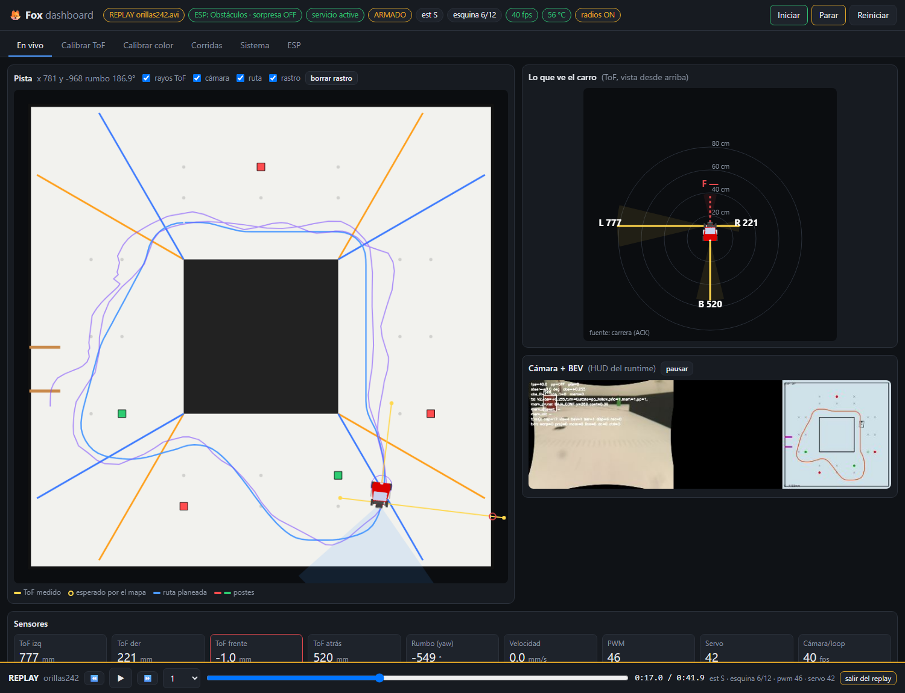
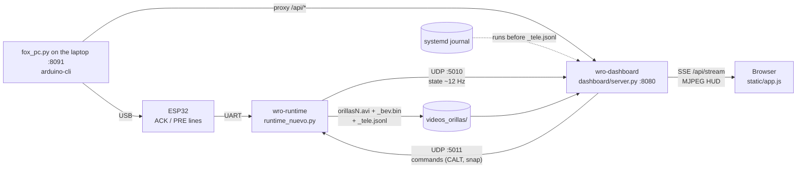
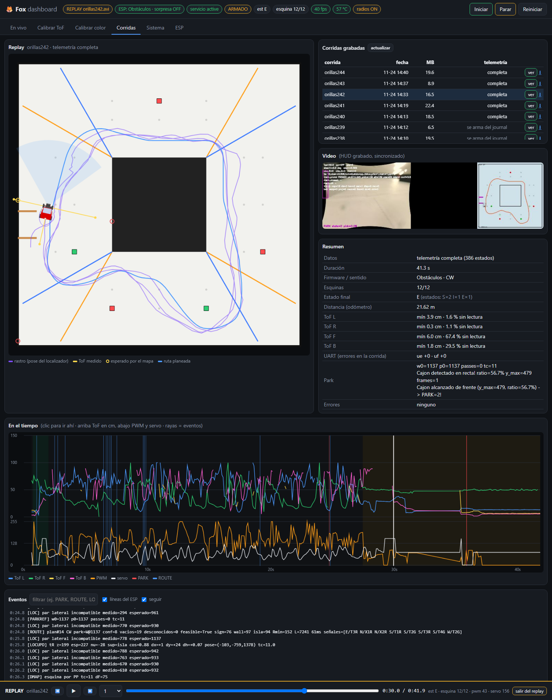
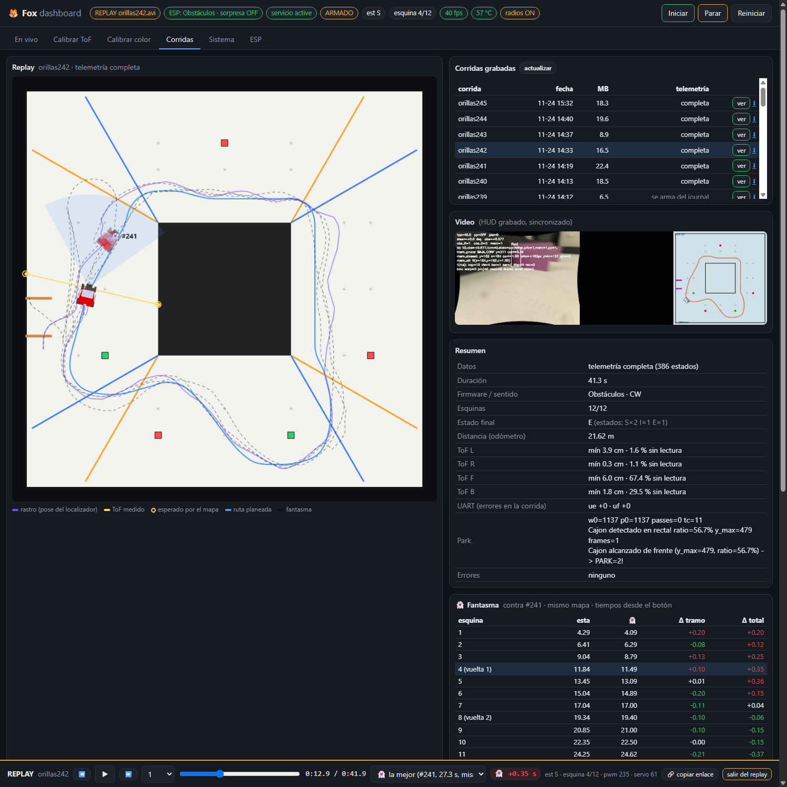

# Fox Dashboard — live telemetry, calibration and run replay

A web page served by the car's own Raspberry Pi. From a laptop or phone next to the track it shows what the car believes in real time: pose, planned route, pillars, every ToF ray, camera and BEV. It calibrates the ToF sensors and the colors at a new venue, flashes the ESP32, and **replays any recorded run** with the map, the video and the event log in sync.

It was built during the 2026 international preparation. Before it, every question about a run ("where did it think it was?", "why did it re-plan there?") meant reading thousands of journal lines over SSH. Now we open the run and drag a slider.

<p align="center"><a href="img/dashboard_live.png"></a></p>

*Live tab while replaying run `orillas242` at 17 s (corner 6 of 12). Blue = planned route, purple = trail of the localizer pose, yellow = what each ToF measures, ring = what the map says it should measure. Right: the same readings from the car's point of view, and the recorded HUD (camera + BEV).*

## Contents

- [Design rules](#design-rules)
- [Architecture](#architecture)
- [How to connect](#how-to-connect)
- [Tabs](#tabs)
- [Run recording and replay](#run-recording-and-replay)
- [From your PC: flash the ESP32 over USB](#from-your-pc-flash-the-esp32-over-usb)
- [HTTP API](#http-api)
- [Files](#files)

## Design rules

1. **The race never depends on it.** The runtime sends one UDP datagram per state to `127.0.0.1` and never waits for an answer. If the dashboard is stopped, crashed or never installed, the datagrams are lost and the car drives exactly the same. Any error while building the state is printed once and ignored.
2. **Offline.** Python standard library + OpenCV on the server, plain JavaScript and canvas on the page, no CDNs. It works on the Pi's own hotspot or an Ethernet cable at the venue, with no Internet.
3. **One picture of the state.** Live and replay use the same state object and the same drawing code. What you see in a replay is what the page showed during the run.
4. **Rule 11.10.** During an official round the radios are off. The dashboard then works over an Ethernet cable, and **Modo ronda** turns Wi-Fi and Bluetooth off from the page.

## Architecture



| Piece | File | Role |
|---|---|---|
| Telemetry sender | [`pure_pursuit/telemetry.py`](../src/RASPI/cam/pure_pursuit/telemetry.py) | Non-blocking UDP out (state) and in (commands). Parses `ACK:V2,…` and `PRE …` from the ESP32 into fields. |
| State | `RuntimeNuevo._tele_state()` in [`runtime_nuevo.py`](../src/RASPI/cam/pure_pursuit/runtime_nuevo.py) | Builds the state: last ACK/PRE, localizer pose and covariance, planned route, confirmed pillars, parking box, timing, camera color gains. |
| Run log | [`pure_pursuit/run_log.py`](../src/RASPI/cam/pure_pursuit/run_log.py) | While the video records, writes every state plus the important log lines to `orillasN_tele.jsonl`. |
| Server | [`dashboard/server.py`](../src/RASPI/cam/pure_pursuit/dashboard/server.py) | HTTP + Server-Sent Events, service control, calibration files, runs. |
| Runs | [`dashboard/runs.py`](../src/RASPI/cam/pure_pursuit/dashboard/runs.py) | Lists runs, loads a timeline, rebuilds old runs from the journal, serves video frames, ghost splits and paths. |
| Page | [`dashboard/static/`](../src/RASPI/cam/pure_pursuit/dashboard/static/) | `index.html`, `app.js`, `style.css`. |
| PC helper | [`scripts/fox_pc.py`](../scripts/fox_pc.py) | Serves the page from the laptop's repo, proxies data to the Pi, flashes the ESP32 with arduino-cli. |

The car is drawn with the top view of the 3D model used by the digital twin ([`twin/assets/car_top.json`](../src/RASPI/cam/pure_pursuit/twin/assets/car_top.json), generated from the CAD by [`twin/tools/car_top.py`](../src/RASPI/cam/pure_pursuit/twin/tools/car_top.py)), so the map shows the real footprint against pillars and walls.

## How to connect

| Where | How | URL |
|---|---|---|
| Home / lab | The usual Wi-Fi or Tailscale | `http://<pi-ip>:8080` |
| At the venue (no known Wi-Fi) | The Pi raises its own **FoxCar** hotspot | `http://10.42.0.1:8080` |
| During the round (radios off, rule 11.10) | **Ethernet** cable from the laptop to the Pi | `http://10.43.0.1:8080` |

- The hotspot has low priority. If the Pi can see a known Wi-Fi network it joins that network instead, so the hotspot doesn't start.
- To force the hotspot: `sudo nmcli con up fox-ap`. This drops any SSH session that came in over Wi-Fi.
- Installation, once per Pi:

  ```
  bash scripts/instalar_dashboard_pi.sh [password]
  ```

  It installs `wro-dashboard.service`, the sudoers rules and the `fox-ap` and `fox-eth` network profiles.

The header is always visible: link state, firmware on the ESP32 and its build time, surprise rule, service state, armed or waiting, ESP state and corner count, frame rate, Pi temperature and radios.

## Tabs

### En vivo (live)

- **Map**: localizer pose with its 2σ ellipse, planned route, trail, confirmed pillars, parking box, the camera's field of view.
- **ToF rays**: yellow is what each sensor measures. The ring is what the map predicts from the current pose. A red ring means they disagree by more than 6 cm, usually a pose error or an object that is not on the map.
- **Radar**: the four ToF from the car's point of view, raw and corrected.
- **HUD**: the runtime's camera + BEV image.
- **Sensors**: each reading with a short history (ToF, yaw, speed, servo, PWM, frame rate, UART errors).
- **Before running**: checklist — service and telemetry alive, ESP32 answering, every ToF with a reading and initialized at boot (`i=1111`; `1101` on the open firmware, which has no rear ToF), camera loop rate, Pi temperature, no under-voltage or throttling, disk space for recording, venue calibration loaded, floor color correction, radios off for the round.
- **Localization**: start box solved or not, σ of the pose, ToF readings used / rejected, pillars, odometer, timing per stage.

With the **open-round firmware** the map changes: it draws the island with each side at the corridor width measured in lap 1 (60 cm sides in orange, unmeasured sides dashed), and the car at a pose estimated on each straight from the inner ToF (distance to the island) and the front ToF (distance to the end wall). The estimate is filtered: the front ToF is only used under 1.2 m, the car never goes backwards along a straight, and the lateral position is smoothed.

### Calibrar ToF

The lateral ToF read short at long range, and the error changes with the wall paint and the light ([README §2.4](../README.md#24-sensors--selection-placement-and-calibration)). The ESP32 corrects every reading with a table *raw → real* at 100…800 mm (piecewise linear). This tab measures that table at the venue:

1. Service running, car **not started**.
2. Place the car parallel to a wall of the track.
3. Type the real distance and press **Capturar**. It takes the median of about 2 s of raw readings and warns if the spread is over 15 mm (car moving or not parallel). Capture 3 or more distances.
4. Press **Enviar L/R al ESP**. The page interpolates the 8 table points from your captures and sends `CALT`. The ESP32 checks the table (strictly increasing, each point within ±25 % of the real distance) and stores it in NVS, so it survives a restart and a re-flash.
5. **Volver a la de fábrica** deletes the stored table and goes back to the one in the firmware.

### Calibrar color

1. Press **Tomar foto**. The photo already has the floor-referenced color correction applied.
2. Drag boxes over the floor, the red pillars and the green pillars.
3. Press **Analizar** to get proposed HSV bands from the pixels in the boxes.
4. Press **Vista previa** to compare the current mask against the proposed one, region by region (% detected per color and box).
5. Press **Guardar**, then restart the service. **Deshacer** goes back through the last 10 saved versions.

### Corridas (run replay)

<p align="center"><a href="img/dashboard_runs.png"></a></p>

*Run `orillas242` at 30 s. Left: the replay map (route at that moment, full trail). Right: the run list, the recorded HUD frame for that instant, and the summary. Bottom: ToF, PWM and servo over the whole run with the ESP state as background bands (S = following, I = parking-lot exit, E = parking) and a mark at every re-plan, and the event list centered on the current time.*

- **ver** loads a run. The bottom bar plays, pauses, jumps ±5 s and changes speed (¼× to 4×). Keyboard: space plays/pauses, ←/→ step one state, Shift+←/→ ten.
- While the replay is on, **every tab draws the recorded state**: En vivo shows the map, radar, sensors and HUD of that instant. **salir del replay** goes back to live.
- Click the chart or an event to jump there. The event filter takes any text (`plan#`, `PARK`, `LOCUPD`…).
- **Summary**: duration, firmware and direction, corners, final ESP state, odometer distance, minimum reading and % of time without a reading per ToF, UART errors during the run, parking messages, errors.
- **🔗 copiar enlace** copies a link to the current moment (`http://<pi>:8080/?run=orillas242.avi&t=30.0&tab=runs`) using the Pi's Tailscale address, so it works for a teammate even when you opened the page through `fox_pc.py` on `localhost`. Opening the link loads that run at that second.
- ⬇ downloads the `.avi`.

#### 👻 Ghost

<p align="center"><a href="img/dashboard_ghost.png"></a></p>

*Run `orillas242` 13 s after the button, racing the ghost of `orillas241` (same direction and same signs). The ghost is the translucent car with its dashed path. It is 0.35 s ahead at corner 4, and 242 wins that back on lap 2.*

The **👻** selector in the bottom bar overlays another recorded run on the replay map, like the ghost in a racing game. Both runs are aligned at the start button (first armed state).
- **la mejor** (default) picks the fastest finished run with the same direction, and among those only runs with the same confirmed signs when there are any. You can also pick any run from the list. Each entry is marked *mismo mapa* or *otro sentido*.
- The bottom bar shows the delta at the last corner both runs counted: green when this run is ahead, red when it is behind.
- The **Fantasma** card has one row per corner (the ESP's `tc`): time from the button for this run and for the ghost, the **Δ tramo** for that corner-to-corner segment, and the running **Δ total**. This is the quickest way to see where a run loses time.
- It costs the Pi nothing: the Pi sends the ghost's splits and pose path (~10 poses per second, a few KB) once, cached by file time. The browser does all the drawing.

### ESP

- Which firmware the car has (`fw=open` / `fw=obs` in the `PRE` line), when it was compiled, and the surprise rule the runtime loaded.
- **Sorpresa ON/OFF**: edits `SURPRISE_RULE` in the Pi's `carrera.json` (validated, atomic write) and restarts the service.
- Flashing, only when the page is opened from `fox_pc.py` on a laptop ([below](#from-your-pc-flash-the-esp32-over-usb)).

### Sistema

- Pi state: commit, service, temperature, under-voltage and throttling flags, load, disk, IPs, radios, calibration file.
- **Modo ronda** turns Wi-Fi and Bluetooth off (rule 11.10). If you are connected over Wi-Fi you lose the page: come back over Ethernet.
- Run downloads, the runtime log (filtered to the important tags or by text), and the saved calibration.

## Run recording and replay

Each run is recorded to `videos_orillas/` from the start button until the car has been still for 5 s:

| File | Content |
|---|---|
| `orillasN.avi` | Camera + BEV HUD (MJPEG) |
| `orillasN_bev.bin` | Clean BEV of every frame (for offline vision tests) |
| `orillasN_tele.jsonl` | The run's telemetry, one JSON per line |

`_tele.jsonl` (written by [`run_log.py`](../src/RASPI/cam/pure_pursuit/run_log.py)):

```text
{"hdr": 1, "t": <epoch>, "video": "orillas242.avi", "surprise": false, "route_follow": true}
{"t": <epoch>, "s": {<the same state the live page receives>}, "ev": [[t, "[ROUTE] plan#3 …"], …], "esp": [[t, "<ESP line>"], …]}
…
```

- `s` is the exact state sent to the live page (~10–12 per second). The planned route is only stored when it changes, so a 40 s run is about 0.5 MB.
- `ev` are the runtime's own important prints (`[ROUTE]`, `[PARK…]`, `[LOCUPD]`, `[REC]`, `[INICIO]`, warnings and errors), copied from stdout as they are printed.
- `esp` are the ESP32 lines that are not `ACK`/`PRE` (corner logs of the open firmware, parking messages).
- The file is flushed every ~2 s, so a run cut by stopping the service keeps almost everything.

**Runs recorded before this file existed** are rebuilt from the systemd journal the first time they are opened: the ESP32 `ACK` lines give the sensors and odometry, `[LOCUPD]` lines anchor the odometry to the field, `[ROUTE]` lines give the parking box and the pillars. That pose is approximate and there is no planned route. The result is cached as `_tele.jsonl` with `"src": "journal"`.

**Video sync:** the frame shown for time *t* is `(t − start) / (end − start) × frames`, with *start* at the first record and *end* at the last state. The server decodes that one frame with OpenCV and sends it as a JPEG, one at a time, so playback never queues frames.

## From your PC: flash the ESP32 over USB

Double-click `scripts/dashboard_pc.bat` (or run `python scripts/fox_pc.py`). It opens `http://localhost:8091`.

- It finds the Pi by itself (cable 10.43.0.1, hotspot 10.42.0.1, Tailscale) or takes `--pi IP`.
- The page comes from the PC's repo; all data (`/api/*`) comes from the Pi.
- The **ESP** tab flashes with arduino-cli, without opening the Arduino IDE:
  1. Connect the ESP32 to the PC by USB. The port with a CP210x/CH340 chip is picked automatically.
  2. Press **Flashear Open**, **Obstáculos** or **Obstáculos + sorpresa**. It uses the code in the PC's repo, as it is.
     - If the sketch changed since its last compile: compile (~40 s) + upload (~10 s).
     - If it didn't change (for example, switching between open and obstacles): it only uploads the saved binary (~12 s). The binaries are kept in `%TEMP%\fox_build\<open|obs>`, keyed by a hash of the sketch files.
     - **compilar de nuevo** forces a compile, for example after updating a library outside the sketch.
  3. When it finishes it restarts `wro-runtime` on the Pi. With **Obstáculos** it also sets `SURPRISE_RULE` in the Pi's `carrera.json`.

## HTTP API

All on the Pi, port 8080. `fox_pc.py` adds the `/local/*` routes on the laptop and forwards everything else.

| Method | Path | What |
|---|---|---|
| GET | `/api/stream` | Server-Sent Events: `{tele, sys}` several times per second |
| GET | `/api/state` | The same, once |
| GET | `/api/hud.mjpg?fps=` | Live HUD as MJPEG |
| GET | `/api/field?parking=&w0=` | Field geometry: walls, lines, seats, parking box, sensor mounts, car outline |
| GET | `/api/logs?n=&f=` | Runtime log, filtered |
| GET | `/api/pre?since=` · `/api/esp_rx` | Recent `PRE` readings · ESP answers (`CALQ`/`CALT`) |
| GET / POST | `/api/calib` · `/api/calib/undo` | Venue calibration file |
| POST | `/api/snap` · `/api/color/analyze` · `/api/color/preview` | Color calibration |
| POST | `/api/esp` | Line to the ESP32 (only `CALQ`/`CALT`, only before the start button) |
| GET / POST | `/api/surprise` | Surprise rule in `carrera.json` |
| POST | `/api/service` · `/api/radio` | start/stop/restart `wro-runtime` · radios on/off |
| GET | `/api/runs` | Recorded runs and whether they have telemetry |
| GET | `/api/runs/ghosts` | Per-corner split times, direction and confirmed signs of every run with telemetry (ghost picker) |
| GET | `/api/runs/<name>/ghost` | One run's splits plus a light pose path `[t, x, y, heading, tc]` from the start button |
| GET | `/api/runs/<name>/timeline` | Full run: header, states, events, summary, video info |
| GET | `/api/runs/<name>/frame?i=` | One video frame as JPEG |
| GET | `/api/runs/<name>/acks?f=&t0=&t1=&paso=&cambio=` | Full-rate ESP ACKs from the journal as TSV (t relative to [INICIO]); `cambio=pkf,pns` emits a row only when those fields change |
| GET | `/api/runs/<name>/log?q=<regex>&t0=&t1=&c=&n=` | Matching journal lines of the run, trimmed to `c` chars (default `[PARK` and route plans) |
| GET | `/api/runs/<name>` | Download the `.avi` |
| GET / POST | `/local/flash/status` · `/local/flash` · `/local/flash/job` | (laptop only) ports, flash, progress |

## Files

- `~/wro_calib.json` holds the venue calibration (colors, blue tape, camera gains, ToF records). It keeps a history of 10 versions for **Deshacer**. `calib_file.apply()` loads it when the runtime starts; with no file, the runtime uses the repo values.
- The runtime sends telemetry over UDP to `127.0.0.1:5010` and receives commands on `5011` (`FOX_TELE_PORT`, `FOX_CMD_PORT`). Commands are `snap` and `esp` (`CALQ`/`CALT` only, and only before the start button). Turn telemetry off with `DASHBOARD_TELEMETRY = False`; turn the run log off with `REC_TELE = False`.
- Screenshots in this page were taken with headless Chrome from a replay link with `&still=1`, which loads one moment of a run without opening the live stream:

  ```
  chrome --headless=new --window-size=1500,1150 --virtual-time-budget=12000 --screenshot=out.png "http://<pi>:8080/?still=1&run=orillas242.avi&t=17&tab=live"
  ```
