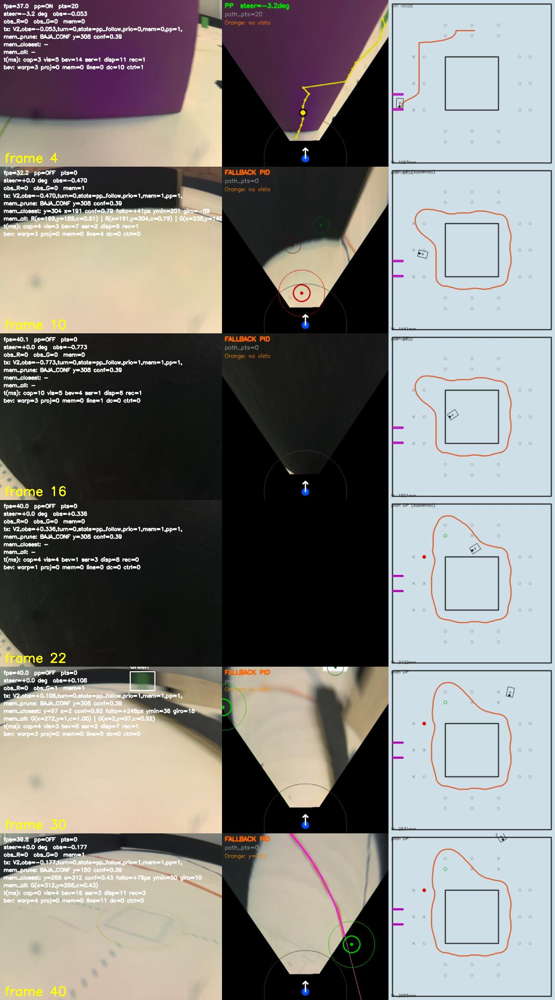

# orillas65 — primera corrida con el motor N30 (2026-11-17 14:04)

Seed **990001** (CW, salida en W hacia N, cajón en W). Firmware
`PurePursuitCarrera` de `e994bba0` (N30: 7.523 cuentas/mm, `MOTOR_K` 6.51/22.9,
`vMando()` con `LAZO_V_255` = 1575). Pi en `31edf3a` (código de carrera idéntico a main).

**Resultado: no completó.** La salida del cajón (INICIO) fue mucho más rápida
de lo afinado, el carro se pegó/empujó contra algo con la llanta patinando, la
odometría se disparó y la pose quedó fuera de la pista. Sin esquinas contadas
(`tc=0`). El ESP dejó de mandar ACK a los 8.7 s (14:04:51.28); la Pi siguió
transmitiendo hasta 14:06:08.

## Causa principal: la salida del cajón y la ruta no pasan por `MOTOR_MAX`

En el commit `a3647f69` dije que con `MOTOR_MAX = 155` la carrera no
cambiaba. **Estaba mal.** `setMotor()` recorta a 155, pero:

- `inicioMotor()` usa `setMotorTope(v, 255)` (sin recortar a `MOTOR_MAX`), con
  `INICIO_PWM` 195, `INICIO_PWM_SENAL` 180 e `INICIO_RECTO_PWM` 255.
- En modo RUTA, con `velocidadMotor >= MOTOR_MAX` se usa
  `setMotorTope(rutaVel, 255)`: la Pi mandó **`rv=180`** (266 TX) y `rv=130` (294 TX).

Con `vMando()` todo lo que está arriba de 155 vale mucho más que con el N20:

| PWM pedido | Dónde | N20 (antes) | N30 con `vMando` (esta corrida) |
|---|---|---|---|
| 130 | ruta (`rv`) | 323 mm/s | 323 mm/s (igual) |
| 180 | `INICIO_PWM_SENAL`, ruta `rv=180` | 515 mm/s | **708 mm/s** (+37 %) |
| 195 | `INICIO_PWM` | 571 mm/s | **882 mm/s** (+54 %) |
| 255 | `INICIO_RECTO_PWM` | 800 → 700 (tope) | **1575 mm/s** (+125 %) |

## El rojo sí lo vio

Cuadros 5–8 del video: `obs_R=1`, el rojo de W X1 (−900, 0) entra por la derecha
y la memoria lo tiene con conf 1.00; en el cuadro 12 la memoria lo marca
`PASADO` (`y=347>345`). La Pi mandó `isen=1` (señal cerca de la salida → el ESP
usa `INICIO_PWM_SENAL` 180 → 708 mm/s). La visión no fue el problema.

## Sensor de frente muerto toda la corrida

**`tF = -1` en los 598 ACK** (y por eso `dF = 200` fijo). El ToF frontal no dio
ni una lectura: en los cuadros 11–16 la cámara tiene la pared negra encima y el
ToF no la ve. Revisar el cable / XSHUT del ToF frontal (pin 0) — pudo moverse al
cambiar el motor. Los laterales sí leen (`tL`, `tR`).

## Odometría

Bien hasta ~44.2 s (od ~1000). De 44.16 a 45.82 el carro está contra la pared
(cámara negra, `tR` 75–100 mm, rumbo fijo en −57° con el servo al tope): el
encoder contó **~900 mm que el carro no avanzó** (llanta patinando). Por eso la
pose del mapa se va a la isla y luego fuera de la pista.

## Qué hizo (ACK)

| Hora | Estado | od (mm) | yaw | srv | Lo que pasa |
|---|---|---|---|---|---|
| 42.57 | S → I | 0 | 0 | 75 → 1 | READY, arranca INICIO |
| 42.68–43.62 | I | 0 → 526 | 0 → −86 | 1 | primer arco de la S a ~660–700 mm/s (encoder) |
| 43.62–44.16 | I | 526 → 992 | −86 → −106 → −69 | 75 → 156 | contra-arco a ~860 mm/s |
| 44.16–45.82 | I | 992 → 1894 | **−56 a −57 fijo** | **156 (tope)** | **dR = 3–5 cm**, el rumbo no cambia con el servo al tope: pegado/empujando, la llanta sigue contando (~500 mm/s) |
| 45.82–46.82 | I → S | 1894 → 2605 | −57 → +5 | 156 → 75 | se suelta y sale de INICIO con **od 2605** |
| 46.82–49.37 | S | 2605 → 3579 | +5 → +94 | 84–104 | sigue la ruta girando a la izquierda ~90° |
| 49.6–51.28 | S | 3796 → 4089 | ~87 | 110–112 | casi quieto (od sube 200 mm en 1.7 s), último ACK |

La pose del mapa (panel derecho del HUD) cae dentro de la isla en el frame 16 y
fuera de la pista en el 30–40: la odometría contó el patinaje como avance.

Sin errores de UART (`ue=0`). `vel=` del ACK siempre es 0 (conocido).

## Qué hay que cambiar

1. **Que el PWM de mando signifique lo mismo que con el N20 en TODOS los estados**
   hasta decidir a propósito dónde se va más rápido. Lo más simple:
   `LAZO_V_255 = 800` (la recta del N20; `vMando` queda igual que antes en todo
   el rango). Después se sube la velocidad estado por estado, no con una escala global.
2. Si se quiere `LAZO_V_255` = 1575 como dato del motor, el estirado no debe
   aplicarse a `inicioMotor()` ni a `rutaVel`: o se recortan esos PWM a
   `LAZO_CODO_PWM`, o se bajan `INICIO_*_PWM` y los `rv` de la Pi a su
   equivalente (180 → ~163, 195 → ~168, 255 → ~187 con 1575).
3. Arreglar el ToF frontal (`tF=-1` toda la corrida) antes de volver a correr.
4. Probar la salida del cajón sola (`INICIO`) antes de una vuelta completa.

## Archivos

- `ack_orillas65.csv` — los 598 ACK (estado, odometría, pose, encoder, servo, ToF, `rv` que mandó la Pi).
- `journal_orillas65_1404.log` — journal de `wro-runtime` 14:04:42–14:04:51 (sin `MEMDBG`/`RECUP`).
- `frames_orillas65.jpg`, `contact_orillas65.jpg` — cuadros del `orillas65.avi` (93 cuadros grabados).
- Video completo en la Pi: `~/FoxRobotics/videos_orillas/orillas65.avi` (+ `_bev.bin`).
