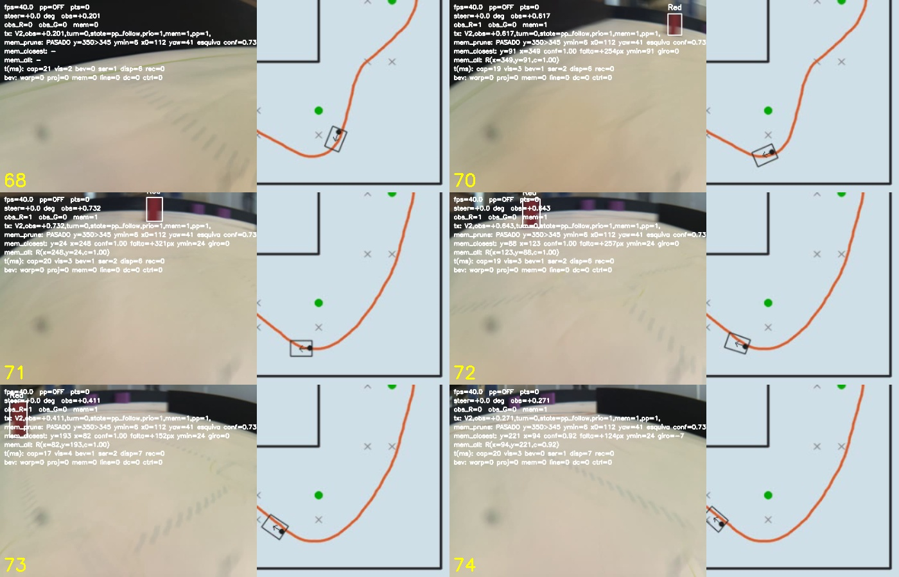
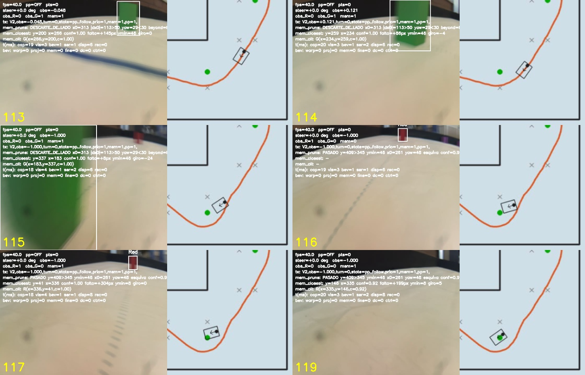
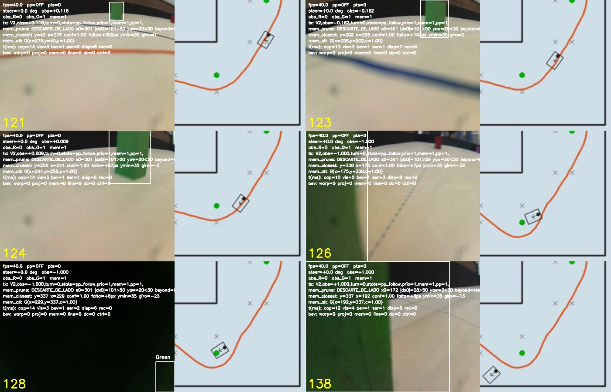

# orillas66 — N30 con la carrera de Jesse (2026-11-17 14:34)

Seed **990001** (CW). ESP y Pi en `af8097e4` (`LAZO_V_255` 1575, `LAZO_V_MAX_L1` 850,
rectas de vueltas 2-3 hasta 1575 mm/s, `carrera.json` con 74 valores). ToF frontal ya
funcionando.

**Resultado:** las 12 esquinas (`tc=12` a las 14:35:26.04), pero tocó el verde S T4
(500, −1100) a la entrada de la recta S en la vuelta 2 y lo movió. En la vuelta 3 chocó
de frente con ese mismo verde, que ya estaba fuera de lugar. Visión bien: el verde
está en memoria con conf 1.00 desde el cuadro 113.

## Tramos (odometría del ESP)

| hasta tc | s | mm/s promedio |
|---|---|---|
| 1–4 (vuelta 1) | 2.3 / 2.7 / 2.7 / 1.8 | 610–790 |
| 5–8 (vuelta 2) | 1.8 / 1.9 / 1.3 / 2.4 | 980 / **1084** / 1022 / 724 |
| 9–12 (vuelta 3) | 2.0 / 2.1 / 1.6 / **4.1** | 870 / 1020 / 980 / 467 |

## Qué pasó en la esquina SE (salida a la recta S)

| | vuelta 1 (07.0) | vuelta 2 (13.84) | vuelta 3 (21.96) |
|---|---|---|---|
| velocidad 0.4 s antes | ~850 mm/s | **~1300 mm/s** | ~1100 mm/s |
| `rv` que pidió la Pi 0.5 s antes | — | 1180–1540 mm/s | — |
| verde | a la derecha, `tR` 55 mm (justo) | **a la izquierda**, `tL` 25–48 mm 0.6 s | de frente, `tF` 4–9 mm, od parada 0.4 s |

Vuelta 2, en detalle:

- Hasta las 13.4 la Pi pide 1182–1540 mm/s (`rv` 221–252). El freno del perfil solo
  llega a 1066 mm/s a las 13.5; la caída a 174 mm/s (`rv` 91) a las 13.6 viene del
  esquive (`obs` −1.0), no del perfil.
- El carro baja de 1309 a 1090 mm/s en 0.2 s (~1.1 m/s²): **solo rueda suelto**, como
  se midió con el N30 (~1.0 m/s²). Llega a la curva demasiado rápido y la corta por
  dentro. El verde le queda a la izquierda (cuadro 115) cuando debería quedarle a la
  derecha.
- La Pi manda `obs` −1.0 y el servo se va a la izquierda (124) para pasarlo por el lado
  correcto. Con el verde a 3–5 cm de ese costado, lo empuja.

Por qué el perfil no frenó para el verde: `ROUTE_L23_SIGN_MM` = 150. La ruta pasa a más
de 150 mm del centro del verde, así que la zona lenta de la señal nunca se activó, y la
curva sola (a_lat 2800) permite ~900 mm/s.

## Cambio (carrera.json, solo vueltas 2-3)

| Clave | Antes | Ahora | Efecto |
|---|---|---|---|
| `ROUTE_L23_MAX_PWM` | (458 = 1575 mm/s) | **333** | techo en recta ~1100 mm/s |
| `ROUTE_L23_A_BRAKE_MM_S2` | 900 | **700** | empieza a frenar antes (el N30 suelto solo da ~1000) |
| `ROUTE_L23_SIGN_MM` | 150 | **300** | la zona lenta alcanza señales a 150–300 mm de la ruta |
| `ROUTE_L23_SIGN_NEAR_MM` | 130 | **200** | piso `ROUTE_L23_MIN_PWM` 190 (~550 mm/s) a menos de 200 mm |

Vuelta 1, salida y parking no cambian. Pendiente: que el lazo del ESP frene de verdad
(rampa de freno en vez de solo cortar PWM) para poder volver a subir la velocidad, y que
el gemelo no frene más fuerte que el carro.

## Archivos

- `ack_orillas66.csv` — todos los ACK, con el último `rv` que mandó la Pi.
- `journal_orillas66_vuelta2_esquina_se.log` — journal 14:35:12.8–14.8 (sin `MEMDBG`/`RECUP`).
- `frames_lap*_esquina_se.jpg` — cámara y mapa (cuadrante SE) del `orillas66.avi`.
- Video completo en la Pi: `~/FoxRobotics/videos_orillas/orillas66.avi`.

## orillas67 (15:02, con el tope de ~1100 mm/s)

Murió en el mismo lugar: vuelta 2, esquina SE (`tc=6`), mismo verde. Entró a ~1090 mm/s
(el tope funcionó), la Pi pidió 700–900 hasta 0.3 s antes y el carro solo rodó suelto.
Cuadro 124 sobre la ruta, 126 ya por dentro de la curva con el verde a la izquierda,
128 cámara negra = verde pegado al lente (`tF` 62 → 0). Luego empujando el pilar con
`tF` 6–60 hasta quedar parado (od 13563).

Cambio: `ROUTE_L23_MAX_PWM` 333 → **268** (~850 mm/s, igual que el tope de la vuelta 1,
que pasa esa esquina en las dos corridas). Las vueltas 2-3 quedan a velocidad de vuelta 1
hasta que el ESP frene activo: hoy `lazoVelocidad()` solo baja el PWM (~1 m/s² de
frenado) y la ruta a >1 m/s corta la curva hacia la isla.

## Causa real: el verde S/T4 se mapea en la fila interior (S/T2)

En orillas66, 67 y 68 el mapa de la vuelta 1 registra `[DMAP] S/T2 Green` (fila interior,
600 mm de la pared). El verde real está en **S/T4** (fila exterior, 400 mm). Lo ve de
lejos, desde la recta E antes de la esquina SE, y la fila (200 mm de diferencia) es justo
lo que la pose y la BEV confunden. La ruta de las vueltas 2-3 pasa el "verde en T2" por
su izquierda, o sea por fuera, a ~300-400 mm de la pared: exactamente donde está el
verde de verdad. La corrección `S/T2 -> S/T4` llega en la vuelta 2, ya en la esquina,
tarde para la ruta. El tope de velocidad no era la causa principal.

Arreglo (`carrera.json`): `ROUTE_CONF_GHOST_TC` 4 → **13** y `ROUTE_CONF_GHOST_TOL_MM`
150 → **250**. Una señal confirmada también esquiva la otra fila de su columna con el
mismo color en todas las vueltas, no solo en la 1. Con el mismo color en las dos filas la
ruta pasa por el lado bueno de las dos, así que vale para la fila que sea.
