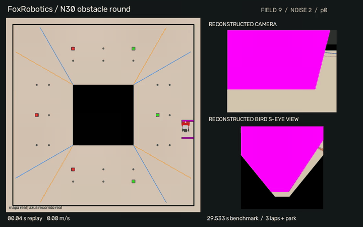
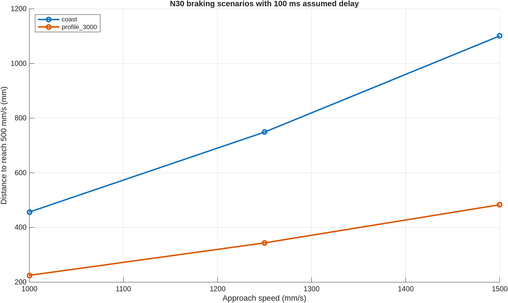
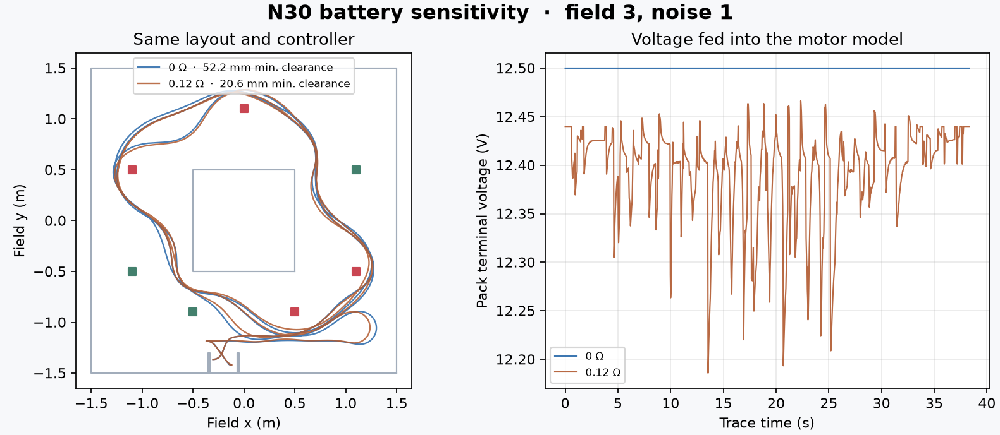

# FoxRobotics simulation and MathWorks modeling

The full-course twin runs the competition software. Simulink gives us a block-level view of braking distance, chassis dynamics and sensor geometry so we can vary inputs and check each model against a reference. Simscape adds an electrical model of the motor and battery. We used its voltage equation in the race twin to test whether a candidate trajectory keeps enough clearance when motor supply drops under load. [Braking model](evidence/fox_n30_braking.slx) · [Plant replay model](evidence/fox_twin_replay.slx) · [Electrical model source](run_n30_electrical.m)

## N30 obstacle-round replay

[](evidence/n30_best_race.mp4)

The fastest clean finish in the 288-case `p0` N30 reference bank took **29.533 s** in simulated race time. Field seed **9** and sensor-noise seed **2** completed three laps (8.811, 7.410 and 6.586 s) and finished parking with zero contacts and zero wrong-side pillar passes. The GIF plays at 2×. The full-speed video reconstructs the camera and bird’s-eye images from the race trace. [Full-speed video](evidence/n30_best_race.mp4) · [Run metrics and field layout](evidence/n30_best_race.json)

To reproduce the metrics from the [benchmark source revision](https://github.com/Nakashima26/WRO_FE_2026_FoxRobotics/tree/d771e9129ccaedd97af892a2ec5c29baf5602881), use a Python environment with NumPy and OpenCV and run from `src/RASPI/cam`:

```sh
export TWIN_VBAT=12.5 TWIN_COST_FIRST=1.95 TWIN_COST_FIJO=1
export TWIN_PI_EXTRA='{"ROUTE_FIX_LINE_LAG_FRAMES":5}' TWIN_FW_OVER='{}'
bash pure_pursuit/twin/tools/latencia/uno.sh p0 4.28 5.8 2 9
```

The benchmark writes the `STOP` metrics to `runs/latencia.noindex/p0/n2/s9.out` and the pose trace to `runs/latencia.noindex/p0/n2/s9/trace.csv`.

## The engineering decisions behind the models

The WRO obstacle round requires a car that can pass pillars on the correct side, complete three laps and park. The Raspberry Pi builds a map from camera observations and plans a route. The ESP32 follows the route using odometry, a Hall encoder, an IMU and ToF measurements. The original Python/C++ twin runs the Pi software and compiled ESP32 firmware together, with simulated sensors and randomized fields. [Vehicle architecture](../../README.md#31-two-controllers-one-link) · [Twin and validation method](../../README.md#39-digital-twin--software-in-the-loop-simulator)

| Decision | Evidence from the original twin and the car |
| --- | --- |
| Select the N20 transmission | We evaluated 1.5 : 1 and 1.25 : 1 configurations in the twin. The selected 1.25 : 1 gearing gave the N20 more speed on straights while the route profile limited speed in curves. On the mat the car reached about 0.8 m/s at full PWM. |
| Upgrade to the N30 | The N20's measured straight-line speed capped further gains. We kept the 1.25 : 1 gears and tested the N30, measuring about 1.5 m/s on the mat and recalibrating the motor and encoder. High-speed short braking revealed a new odometry error from wheel lock. |
| Adopt and refine dynamic programming (DP) | Early known-map runs finished 1 of 21 with the earlier route builder and 69 of 69 with the DP route. These are historical test totals. For subsequent changes we used paired comparisons across 42 layouts × 5 noise seeds, or 210 matched scenarios per variant. We screened for new failures before comparing run times and exported accepted configurations to the Pi and ESP32. |

[Drivetrain measurements](../../README.md#12-drivetrain--gear-ratio-chosen-from-measured-speed) · [DP planner](../../README.md#374-route-planner--dynamic-programming) · [Paired benchmark and deployment](../../README.md#392-how-we-use-it--the-benchmark-rule)

We subsequently used Simulink to model braking distances independently and check whether the twin's vehicle dynamics, encoder and range geometry were reproduced step by step. The block model makes it possible to change braking and delay inputs and inspect their effect on curve-entry distance. The drivetrain selection and DP development above took place in the original twin and on the car.

## Models and results

- [N30 braking model](evidence/fox_n30_braking.slx) · [MATLAB generator](run_braking_study.m) · [bench comparison](evidence/bench_comparison.csv) · [curve-entry sweep](evidence/curve_entry_sweep.csv).
- [Twin plant replay model](evidence/fox_twin_replay.slx) · [MATLAB generator](run_twin_replay.m) · [sample-by-sample reference exporter](export_twin_case.py). Build the MEX with the generator before running this model on a new platform.



## Design question

How far before a corner should FoxRobotics begin reducing speed, and what happens to encoder odometry if the N30 wheels lock? The Raspberry Pi generates a speed profile from the mapped route. The ESP32 tracks that profile using the encoder. A short brake can stop the wheel before the chassis stops, so the controller can underestimate distance traveled.

We selected Simulink for a focused longitudinal model that exposes speed and displacement as separate states. It is a companion to the full-car software-in-the-loop twin. This study uses a constant deceleration input, a speed integrator limited at the target speed, and a distance integrator. The runner uses the model for both the bench comparison and a braking-distance sweep. It also checks every simulation against the constant-deceleration equation. The delay term assumes speed remains constant during the specified delay.

## Data and reference calculations

[Bench notes](../../src/RASPI/cam/pure_pursuit/twin/calib/medidas_20261117/NOTAS.md) record tests on the N30 at 11.88 V. [Input CSV](n30_measurements.csv) transcribes the five forward stop observations. The N30 observations are summaries. Encoder stop distance is used only where the test supports it. The tape measurement at high-speed short braking is approximate.

| Bench case | Role | Recorded distance | Analytical model |
| --- | --- | ---: | ---: |
| Coast from 1409 mm/s | Fit constant deceleration of 1051.5 mm/s² | 944 mm encoder | 944 mm by construction |
| Coast from 803 mm/s | Separate observation reserved from that fit | 329 mm encoder | 306.6 mm (22.4 mm low, 6.8%) |
| Short brake from 500 mm/s | Check against the existing low-speed twin parameter of 5000 mm/s² | 26 mm encoder | 25 mm |
| Short brake from 1066 mm/s | Wheel lock observed | 64 mm encoder | Outside the model |
| Short brake from 1502 mm/s | Approximate encoder undercount during wheel lock | 88 mm encoder, about 240 mm with tape | About 152 mm missed |

At an approach speed of 1500 mm/s, a target of 500 mm/s and an assumed delay of 100 ms, the analytical distances are approximately **1101 mm coasting** and **483 mm at the profile's nominal 3000 mm/s²**. This recaps why the existing [race profile](../../src/RASPI/cam/pure_pursuit/carrera.json) commands braking ahead of the curve and the [ESP32 controller](../../src/ESP32/PurePursuitCarrera/PurePursuitCarrera.ino) tracks the requested speed. The observed lockup supports avoiding short braking at high speed where the route follower relies on odometry. The 3000 mm/s² rate is a planning input. The ability to track it on a real approach remains to be measured.

The model addresses straight-line travel at one bench voltage. A single held-out coast observation cannot establish repeatability. Tire slip, battery variation, steering and controller dynamics remain outside the scenario model. The next physical test should log applied PWM, target and measured speed, and independent chassis displacement on repeated straight approaches, then compare distance at the target speed against the simulated prediction. Record any resulting change to the race profile alongside the test.

The motor studies below extend this work with bounded parameter fitting, validation on timestamped bench recordings and a separate electrical sensitivity model.

## Reproduce

From the repository root in MATLAB R2025b or a compatible release with Simulink:

```matlab
addpath('models/mathworks')
run_braking_study
```

The [runner](run_braking_study.m) writes `output/fox_n30_braking.slx`, `bench_comparison.csv`, `curve_entry_sweep.csv` and `curve_entry.png`. Open the generated model to inspect the integrators and run the default 1500-to-500 mm/s scenario. For a public GitHub repository, the [GitHub Actions workflow](../../.github/workflows/mathworks-braking.yml) uses MathWorks batch licensing and uploads the same files as an artifact. The models and focused braking outputs above are copies from the verified run.

The figures above are analytical reference calculations. The GitHub Actions run reproduced the three bench comparison rows in Simulink. MATLAB Online ran the braking model without a compiler. The plant replay requires a platform-specific MEX built by CI. A reproducible way to build and bundle native dependencies directly from MATLAB Online would make the plant easier to share with judges.

## Digital twin plant replay in Simulink

The replay runs the twin's [C99 vehicle kernel](../../src/RASPI/cam/pure_pursuit/native/src/twin_vehicle.c) at 1 ms in a discrete Simulink plant block. This brings over the forward and reverse motor maps, limits on acceleration and lateral grip, coasting, short braking, wheel lock and reverse wheelspin, servo speed and deadband, steering backlash and lag, and the rear-axle bicycle model. The plant also implements the twin's encoder fractional accumulator, quantization and slip correction. It exports ground-truth yaw rate from the simulated pose.

A separate range block uses the exported WRO wall, pillar and parking-board geometry and all four ToF mounts. It computes deterministic center-ray distances. ToF cone, material and incidence effects, calibration curves, update intervals, status errors and noise still belong to the full Python twin. The camera renderer, collision adjudication, UART timing and the real Raspberry Pi/ESP32 control loop also remain in that twin. The Simulink scenario drives the plant with scripted actuator commands in open loop.

From the repo root, with Python and NumPy installed:

```sh
python models/mathworks/export_twin_case.py models/mathworks/output/twin_case.json --seed 1
```

Then use MATLAB with Simulink and a configured supported C compiler (`mex -setup C`):

```matlab
addpath('models/mathworks')
run_twin_replay('models/mathworks/output/twin_case.json')
```

The runner builds the shared C source as a platform-specific MEX and generates `output/fox_twin_replay.slx`, plus a trajectory and speed plot and per-step CSV. To reopen the generated model in a new session, add both `models/mathworks` and `models/mathworks/output` to the MATLAB path. Re-run the generator if moving to a different platform. For the replay, start with the public repo's GitHub Actions workflow so the Linux runner can compile the C source.

The Python exporter uses independent Python dynamics and encoder code for the reference. The Simulink runner asserts matching timestamps, exact integer encoder counts, and per-channel continuous state and range errors below 1e-6 in each channel's units. This measures replay parity under the same commands and initial conditions. The bench study above addresses agreement with physical measurements. The [verified GitHub Actions run](https://github.com/Nakashima26/WRO_FE_2026_FoxRobotics/actions/runs/45001314032) passed with 1,961 samples on seed 1, exact integer encoder counts, a maximum continuous state error of 6.82e-13 in the logged channel units, and a maximum range error of 6.76e-12 mm. Its artifact contains both models, graphs and CSVs.

## Animated viewer in MATLAB Online

Extract `fox_twin_viewer.zip` from the Actions artifact into a MATLAB Drive folder. In MATLAB Online, open that folder and run `view_twin_replay`. The viewer plays the Simulink poses with the original twin's track artwork, car silhouette, reconstructed camera and BEV. It has play/pause, frame steps and a timeline. It reads images and a manifest, so it does not load the vehicle MEX or rerun the simulation.

To regenerate the viewer after a Simulink run, run `python models/mathworks/render_twin_replay.py <run_dir>` with NumPy, OpenCV and Matplotlib installed. The camera and BEV are rendered with the Python twin from the Simulink poses. The viewer shows the scripted plant replay and its camera geometry. Live autonomous control and the controller's estimated map belong to the original twin.

## Autonomous race playback

`render_twin_race.py` packages a run of the existing Pi and ESP32 software-in-the-loop twin for the same MATLAB viewer. It records the rendered camera, the processed BEV and the chassis pose while the controllers run. The manifest includes the finish reason, lap times and collision data.

```sh
TWIN_NOISE_SEED=1 python models/mathworks/render_twin_race.py models/mathworks/output/fox_twin_race.zip --seed 1 --setup src/RASPI/cam/pure_pursuit/twin/tools/carrera_bench.json
```

The demonstrated finish used the sources and benchmark setup from revision `08f6ccb`, with field seed 1 and noise seed 1. It completed 12 corners with no contacts. Extract the race ZIP into its own MATLAB Drive folder and run `view_twin_replay` there. This is playback of a closed-loop Python/C++ simulation. The controller does not run inside Simulink. To export at the original camera cadence, use an MP4 output path instead of a ZIP and install FFmpeg. The exporter combines the three panels into one H.264 stream and saves a JSON manifest next to it. For MATLAB Online, place a video named `fox_carrera_40fps.mp4` beside `replay_video.html` and open the HTML file with `uihtml` in a `uifigure`.

## Motor calibration, identification and electrical model

| Study | Inputs and outputs | Scope |
| --- | --- | --- |
| [N30 bounded fit](fit_n30_dynamics.m) | `lsqnonlin` fits PWM gain, PWM intercept, rise time constant and delay to three [bench summaries](n30_drive_summary.csv). It exports parameters and compares the original twin's curve with predictions for two reserved runs. | All five runs are at 11.88 V. PWM 255 on a shorter course is a repeat at the same input level and may not have settled. The fitted intercept is a model parameter; measured breakaway is a separate quantity. |
| [N20 system identification](identify_n20_dynamics.m) | `procest` compares first-order models with and without delay. Six forward PWM steps train the models, and a separate repeat at each of 90, 160 and 230 PWM is held out. Outputs are the fitted models, validation curves and fit scores. | Uses timestamped N20 PWM and encoder speed from the October 21 bench. The N30 notes provide crossing times and endpoint summaries. N30 electrical transients require new logs. |
| [N30 electrical sensitivity](run_n30_electrical.m) | Simscape Electrical combines an open-circuit pack, internal resistance, a fixed auxiliary load and an [averaged drive](+foxdrive/averaged_drive.ssc) with back EMF, armature dynamics and inertia. The script generates a Simulink model and compares terminal voltage, pack current and speed at two nominal supply settings. | Motor resistance, inductance, torque constant, effective inertia, auxiliary current and pack resistance are exploratory assumptions. The model omits tire slip, physics at PWM switching frequency, and regenerative braking. Its current and voltage traces are predictions for those assumptions. |

At 11.88 V, the N30 fit returned 6.445 mm/s per PWM count, a 19.76-count intercept, a 255 ms time constant and a 50 ms delay. It overpredicted the two reserved speeds by 41 and 109 mm/s. The original twin overpredicted those same rows by 29 and 104 mm/s. The additional delay improved the time to 63% on the 150 PWM run, but the speed errors give no basis for replacing the existing calibration. For the N20, the two model structures produced nearly identical held-out fits at all three PWM levels (about 53%, 87% and 74%), so these logs offer little evidence for adding delay to the first-order N20 model.

The N30 measurements are transcribed from the [November 17 bench notes](../../src/RASPI/cam/pure_pursuit/twin/calib/medidas_20261117/NOTAS.md). The N20 inputs come directly from the [October 21 step logs](../../logs_tof/calib_20261021/p5_escalones). For independent N30 validation, log applied PWM, battery-terminal voltage, pack and armature current, encoder speed, and a chassis position measurement in repeated runs at two measured battery voltages. Reserve complete runs from each voltage for validation before changing the physical-car configuration. The electrical study leaves the firmware and the default twin calibration as they are.

From the repo root:

```matlab
addpath('models/mathworks')
fit_n30_dynamics             % Optimization Toolbox
identify_n20_dynamics        % System Identification Toolbox
run_n30_electrical           % Simulink + Simscape + Simscape Electrical, R2025b
```

The [verified MATLAB R2025b run](https://github.com/Nakashima26/WRO_FE_2026_FoxRobotics/actions/runs/45052046608) packages both N20 identification plots and the N30 fits, plus the generated electrical model and its companion library. In the electrical scenario at 11.88 V open-circuit, the simulated startup drew a peak 3.68 A from the pack and its terminal voltage reached 11.44 V. The simulated post-command travel over 0.6 s was 148 mm coasting and 45 mm with short braking. These scenario values use the electrical assumptions above and omit chassis slip. MATLAB Online Basic includes Optimization Toolbox. The identification and electrical studies use the corresponding licensed add-ons.

## Battery sag coupled to the software-in-the-loop twin

The optional [BatteryDrive](../../src/RASPI/cam/pure_pursuit/twin/battery.py) feeds the twin's measured PWM-to-speed map with the pack terminal voltage at every physics substep. It ports the Simscape armature and pack equations, uses the twin's wheel speed for back EMF, and preserves the twin's existing chassis, traction, coast and short-brake models. Both arms of the experiment use the Python vehicle path and the same Pi code and ESP32 firmware. The 0 Ω reference reproduces the baseline vehicle trajectory without a battery object. Pack resistance, motor electrical parameters and current are still exploratory rather than measurements of the physical car.

At PWM 255 in a straight-line simulation, 0.12 Ω of pack resistance reduced the minimum terminal voltage from **11.88 to 11.43 V**, increased the time to 1 m/s from **311 to 326 ms**, and reduced distance traveled at one second from **1091 to 1068 mm**.

### Paired test on the N30 race benchmark



We used the latency-aware `p0` setup and selected eight low-clearance fields at noise seed 1. With 12.5 V and 0 Ω, the port reproduced the reference times, margins and contact outcomes on all eight. Both arms completed **8/8 clean races**. With 0.12 Ω, minimum pack voltage across the eight races ranged from **12.105 to 12.229 V**. Total time changed by **−0.939 to +0.712 s**, with a median of **+0.168 s**. Minimum pillar clearance shifted in both directions as the autonomous trajectories diverged. [Paired metrics and benchmark settings](evidence/n30_battery_pairs.json)

The paired test shows that race behavior is sensitive to a voltage perturbation. A larger panel of field and noise seeds can show whether a finalist has more failures under that perturbation. We kept the established race benchmark for ranking. To calibrate the electrical model, we need pack voltage and current from the car under acceleration and braking.

From the repository root, run the [paired comparison](../../src/RASPI/cam/pure_pursuit/twin/tools/compare_battery.py):

```sh
PYTHONPATH=src/RASPI/cam TWIN_NOISE_SEED=1 python -m pure_pursuit.twin.tools.compare_battery 3 models/mathworks/output/paired-battery/s3
```

Each arm writes a JSON metrics summary and CSV with pose, PWM, speed, pack voltage and pack current.

## Summary for the MathWorks Modeling Award

The judge-facing summary (problem, products used and why, models, verification, lessons and product feedback) is [§3.11 of the main README](../../README.md#311-matlab-and-simulink--modeling-the-twins-physics). This page holds the full details and reproduction steps.

[Official award announcement](https://wro-association.org/mathworks-modeling-award-returns-to-wro-2026/) · [2026 rubric](https://wro-association.org/wp-content/uploads/MathWorks-Modeling-Award-Scoring-Rubric_20260312.pdf)
