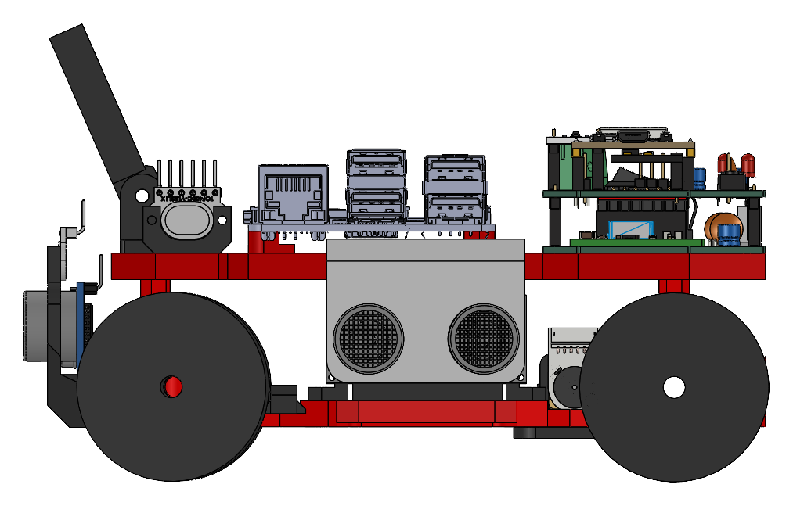
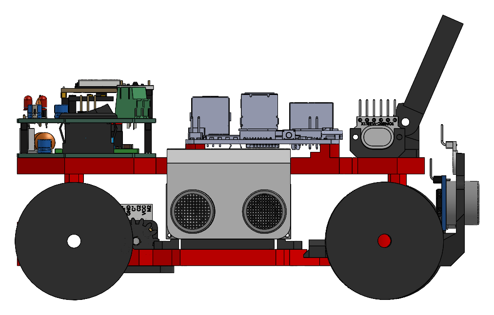
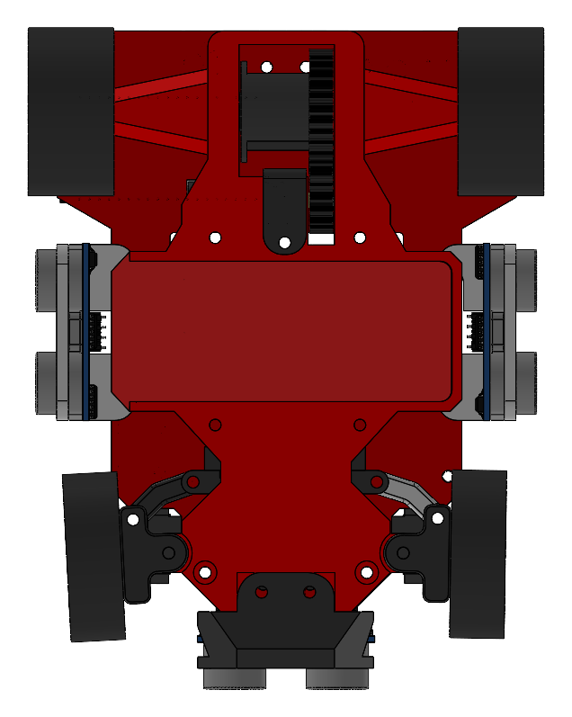

# v2 vehicle models (international final)

| Folder | Contents |
|---|---|
| [`stl/`](stl/) | Printed parts, ready to slice (PLA, 0.2 mm layers; gears and rack at 100 % infill) |
| [`cad/`](cad/) | SolidWorks source: every `.SLDPRT` + `Vehicle_V2.SLDASM` |
| [`step/`](step/) | One `.step` per printed part — opens in any CAD without SolidWorks (the full assembly is `cad/Vehicle_V2.SLDASM`) |
| [`renders/`](renders/) | Front, back, left, right, top, bottom + isometric |

Purchased parts (Raspberry Pi 5, VL53L1X/TOF400C, N20 motor, battery, PCBs RevB_1/RevB_2) are only in the STEP assembly, not in `stl/`.

The v1 (national final) models are in [`../CAD`](../CAD), [`../STL`](../STL) and [`../renders`](../renders).

## Printed parts

| Part | Qty | File |
|---|---:|---|
| BaseChasisMain_V2 | 1 | [`BaseChasisMain_V2.stl`](stl/BaseChasisMain_V2.stl) |
| TapaBaseChasis | 1 | [`TapaBaseChasis.stl`](stl/TapaBaseChasis.stl) |
| TapaChasis_V2 | 1 | [`TapaChasis_V2.stl`](stl/TapaChasis_V2.stl) |
| SteeringKnuckle | 2 | [`SteeringKnuckle.stl`](stl/SteeringKnuckle.stl) |
| NewCremallera_V2 (rack) | 1 | [`NewCremallera_V2.stl`](stl/NewCremallera_V2.stl) |
| NewLinkajeL_V2 / NewLinkajeR_V2 (tie rods) | 1 + 1 | [`L`](stl/NewLinkajeL_V2.stl) · [`R`](stl/NewLinkajeR_V2.stl) |
| Pinion.15_V2 | 1 | [`Pinion_V2.stl`](stl/Pinion_V2.stl) |
| Differential_V2 | 1 | [`Differential_V2.stl`](stl/Differential_V2.stl) |
| DCsupport_V2 (motor mount) | 1 | [`DCsupport_V2.stl`](stl/DCsupport_V2.stl) |
| BatterySupport | 2 | [`BatterySupport.stl`](stl/BatterySupport.stl) |
| ToFSupport | 1 | [`ToFSupport.stl`](stl/ToFSupport.stl) |
| ToFBack | 1 | [`ToFBack.stl`](stl/ToFBack.stl) |
| CameraBase | 1 | [`CameraBase.stl`](stl/CameraBase.stl) |
| CameraFrnt | 1 | [`CameraFrnt.stl`](stl/CameraFrnt.stl) |
| RuedaEnfrente (front wheel) | 2 | [`RuedaEnfrente.stl`](stl/RuedaEnfrente.stl) |
| RuedaAtras (rear wheel) | 2 | [`RuedaAtras.stl`](stl/RuedaAtras.stl) |
| UltrasonicSupportFront | 1 | [`UltrasonicSupportFront.stl`](stl/UltrasonicSupportFront.stl) |
| UltrasonicSupportHalf_V2 | 1 | [`UltrasonicSupportHalf_V2.stl`](stl/UltrasonicSupportHalf_V2.stl) |
| UltrasonicSupport_V2 | 1 | [`UltrasonicSupport_V2.stl`](stl/UltrasonicSupport_V2.stl) |

## Renders

| Front | Back | Left | Right |
|:---:|:---:|:---:|:---:|
|  |  |  |  |

| Top | Bottom | Isometric |
|:---:|:---:|:---:|
|  |  |  |
