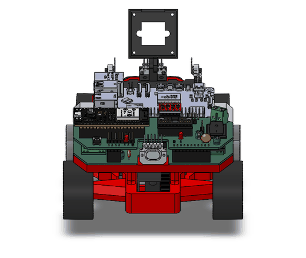
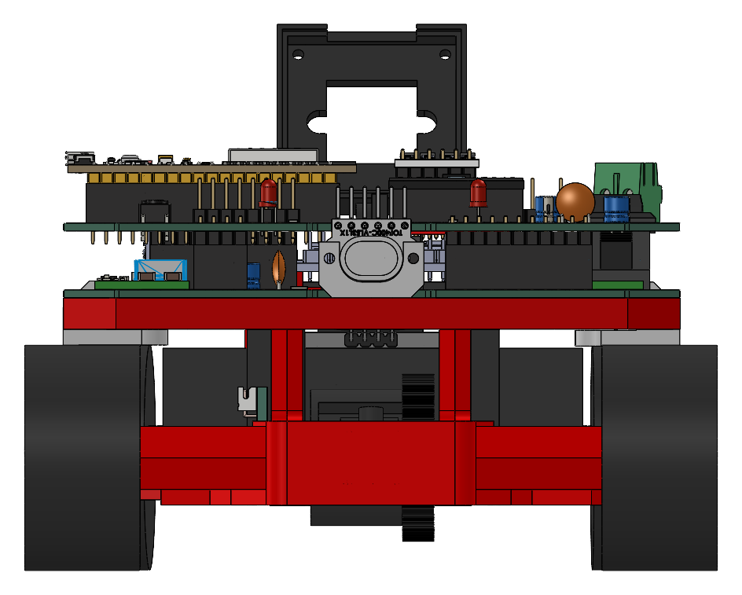
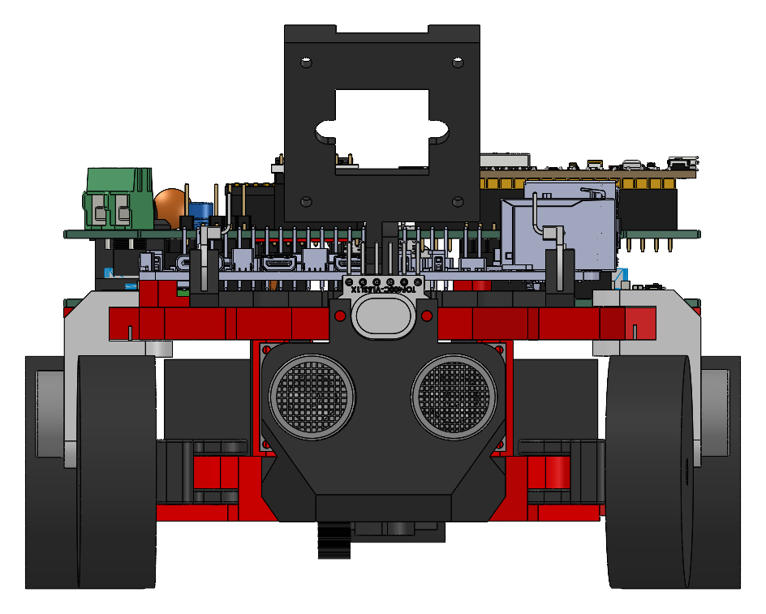
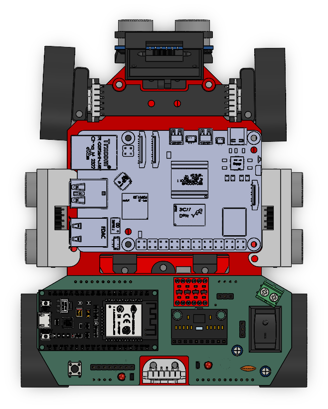
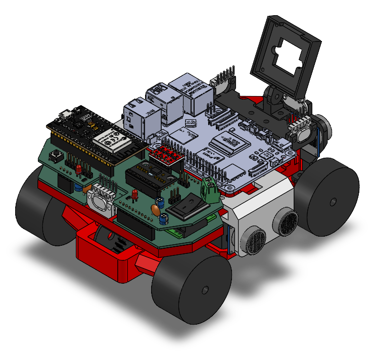
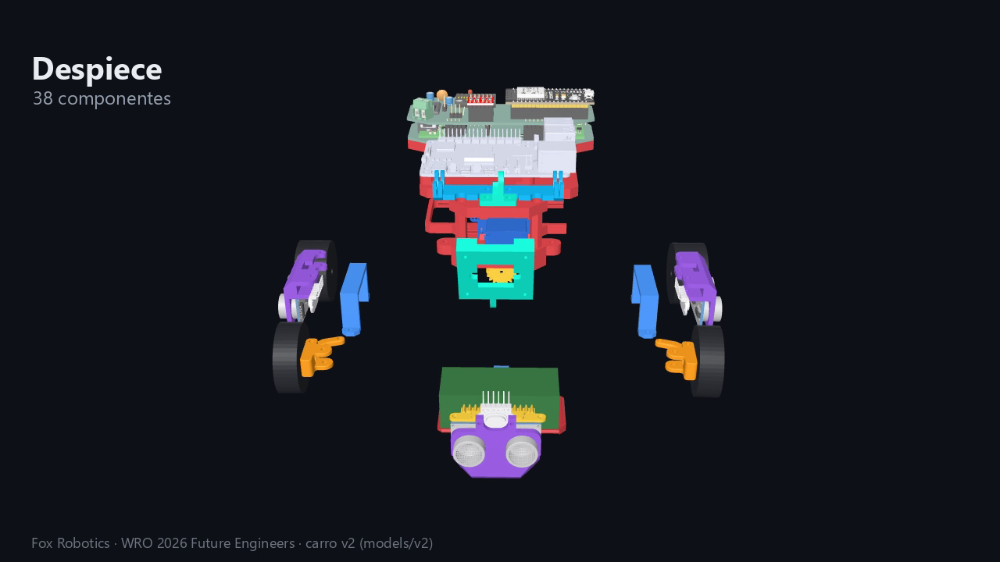

# v2 vehicle models (international final)

| Folder | Contents |
|---|---|
| [`stl/`](stl/) | Printed parts, ready to slice (PLA, 0.2 mm layers; gears and rack at 100 % infill) |
| [`cad/`](cad/) | SolidWorks source: every `.SLDPRT` + `Vehicle_V2.SLDASM` |
| [`step/`](step/) | One `.step` per printed part — opens in any CAD without SolidWorks (the full assembly is `cad/Vehicle_V2.SLDASM`) |
| [`renders/`](renders/) | Front, back, left, right, top, bottom, isometric + `turntable.gif` + assembly video `armado.mp4` |

Purchased parts (Raspberry Pi 5, VL53L1X/TOF400C, N20 motor, battery, PCBs RevB_1/RevB_2) are only in the STEP assembly, not in `stl/`.

The v1 (national final) models are in [`../CAD`](../CAD), [`../STL`](../STL) and [`../renders`](../renders).

## Printed parts

| Part | Qty | File |
|---|---:|---|
| BaseChasisMain_V2 | 1 | [`BaseChasisMain_V2.stl`](stl/BaseChasisMain_V2.stl) |
| TapaBaseChasis | 1 | [`TapaBaseChasis.stl`](stl/TapaBaseChasis.stl) |
| TapaChasis_V2 | 1 | [`TapaChasis_V2.stl`](stl/TapaChasis_V2.stl) |
| SteeringKnuckle | 2 | [`SteeringKnuckle.stl`](stl/SteeringKnuckle.stl) |
| NewCremallera_V2 (rack) | 1 | [`NewCremallera_V2.stl`](stl/NewCremallera_V2.stl) |
| NewLinkajeL_V2 / NewLinkajeR_V2 (tie rods) | 1 + 1 | [`L`](stl/NewLinkajeL_V2.stl) · [`R`](stl/NewLinkajeR_V2.stl) |
| Pinion.15_V2 | 1 | [`Pinion_V2.stl`](stl/Pinion_V2.stl) |
| Differential_V2 | 1 | [`Differential_V2.stl`](stl/Differential_V2.stl) |
| DCsupport_V2 (motor mount) | 1 | [`DCsupport_V2.stl`](stl/DCsupport_V2.stl) |
| BatterySupport | 2 | [`BatterySupport.stl`](stl/BatterySupport.stl) |
| ToFSupport | 1 | [`ToFSupport.stl`](stl/ToFSupport.stl) |
| ToFBack | 1 | [`ToFBack.stl`](stl/ToFBack.stl) |
| CameraBase | 1 | [`CameraBase.stl`](stl/CameraBase.stl) |
| CameraFrnt | 1 | [`CameraFrnt.stl`](stl/CameraFrnt.stl) |
| RuedaEnfrente (front wheel) | 2 | [`RuedaEnfrente.stl`](stl/RuedaEnfrente.stl) |
| RuedaAtras (rear wheel) | 2 | [`RuedaAtras.stl`](stl/RuedaAtras.stl) |
| UltrasonicSupportFront | 1 | [`UltrasonicSupportFront.stl`](stl/UltrasonicSupportFront.stl) |
| UltrasonicSupportHalf_V2 | 1 | [`UltrasonicSupportHalf_V2.stl`](stl/UltrasonicSupportHalf_V2.stl) |
| UltrasonicSupport_V2 | 1 | [`UltrasonicSupport_V2.stl`](stl/UltrasonicSupport_V2.stl) |

> **Ultrasonic supports.** `UltrasonicSupportFront`, `UltrasonicSupportHalf_V2` and `UltrasonicSupport_V2` hold three HC-SR04. The v2 car drives on its four ToF sensors; the ultrasonics stay mounted as a cross-check of the ToF readings (see the main README, §6.4 "Ultrasonic cross-check").

## Renders

<p align="center"></p>

| Front | Back | Left | Right |
|:---:|:---:|:---:|:---:|
|  |  |  |  |

| Top | Bottom | Isometric |
|:---:|:---:|:---:|
|  |  |  |

## Assembly video

https://github.com/user-attachments/assets/03e605ff-0109-4d8e-a63a-2a929a3fefe4

<p align="center"><a href="renders/armado.mp4"></a></p>

[`renders/armado.mp4`](renders/armado.mp4) (42 s, 1280×720): the assembled car turns, explodes, and is built back step by step, with the step name on screen. Each step ends with its M3×12 screws (28 in total) going in along their holes.

| Step | Parts |
|---:|---|
| 1 | Chassis base `BaseChasisMain_V2` |
| 2 | Steering: knuckles, rack, tie rods, SG90 servo and `ServoGearDirection_V2` |
| 3 | LEGO axles (4 studs, 32 mm) in the knuckles, front wheels |
| 4 | Drivetrain: motor mount, N20 motor, 15T pinion, differential |
| 5 | One LEGO axle per rear wheel (8 studs, 64 mm) into each side of the differential, rear wheels |
| 6 | Battery supports, battery in the center tunnel, bottom cover |
| 7 | Ultrasonic supports and 3 HC-SR04 |
| 8 | Top plate `TapaChasis_V2` |
| 9 | ToF support and 4 TOF400C (left, right, front, rear) |
| 10 | Raspberry Pi 5 |
| 11 | PCB RevB stack (power board + ESP32 board) |
| 12 | Camera base and front mount |

The printed parts get one color per subsystem (the CAD leaves them gray); bought boards keep their own colors. Three things are not in `Vehicle_V2.SLDASM`, so the scripts add them:
- **SG90 servo and its gear:** lying on the rack, shaft pointing back, tabs on the two chassis posts, gear on the rack teeth (which face up).
- **LEGO axles:** one 8-stud axle per rear wheel into each side of the differential, and a 4-stud axle per knuckle, centered on the wheels.
- **28 M3×12 screws:** [`tools/agujeros_fc.py`](tools/agujeros_fc.py) (run in FreeCAD) lists the M3 holes of every printed part from its STEP. [`tools/tornillos.py`](tools/tornillos.py) moves them into the assembly with each part's transform from the `.glb`, and holes that line up across two or more parts become one screw, written to [`tools/tornillos.json`](tools/tornillos.json). Vertical screws go head up; horizontal ones go in from the part mounted last. Holes in a single part are skipped because it is not known what they hold. The SG90's own screws come with its model.

To regenerate it (about 2 min on a laptop GPU), export the assembly from SolidWorks to binary glTF (`Vehicle_V2.glb`) and convert the SG90 STEP to STL, then:

```
pip install trimesh pyrender imageio imageio-ffmpeg pillow rtree
freecadcmd models/v2/tools/agujeros_fc.py                 # only if a STEP changed
python models/v2/tools/tornillos.py Vehicle_V2.glb        # only if a part or its position changed
python models/v2/tools/armado.py Vehicle_V2.glb models/v2/renders/armado.mp4 --servo=sg90.stl --gear=ServoGearDirection_V2.STL
```

`--fast` renders 4× faster for a quick check. Step order, arrival directions and colors are the `STEPS` and `COLOR` tables at the top of [`tools/armado.py`](tools/armado.py).
