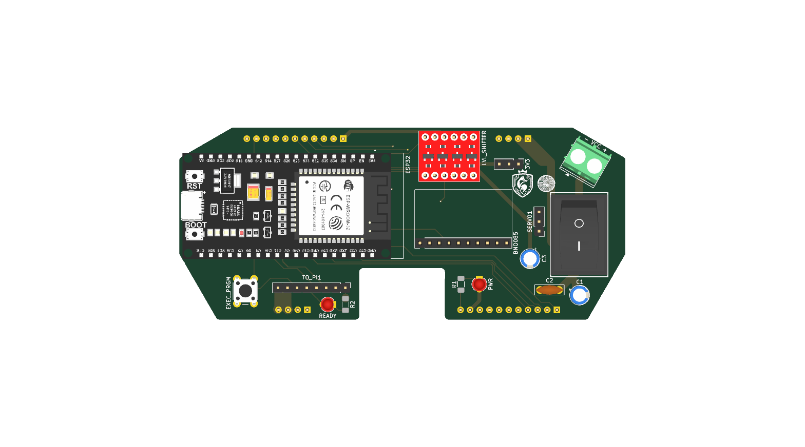
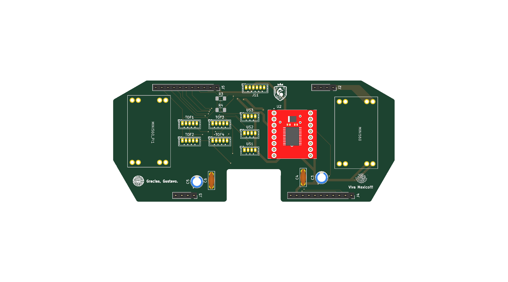
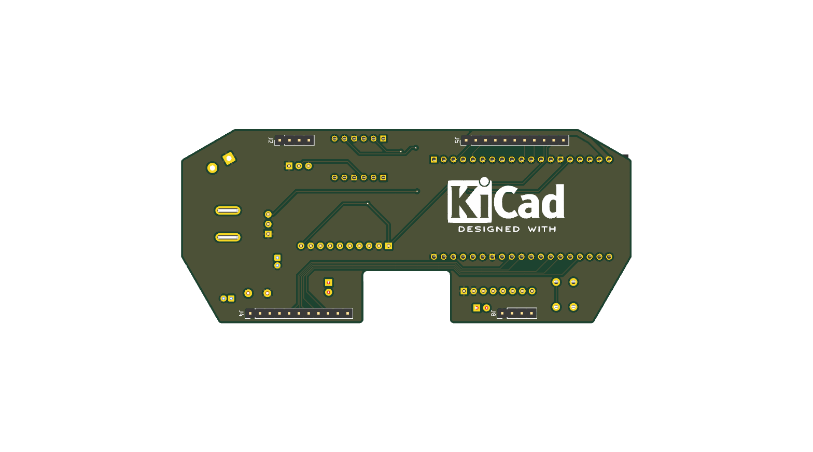
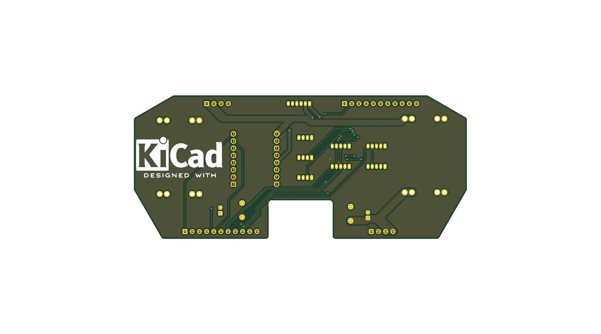

# Electromechanical Diagrams

## v2 — International Final (current car)

The v2 electronics are two stacked boards designed in KiCad: **RevB_1** (logic) on top of **RevB_2** (power). Walk-through, pin map and power tree: main [README §6](../README.md#6-power-and-sensor-architecture).

| | Logic board — RevB_1 | Power board — RevB_2 |
|---|---|---|
| Schematic (PDF) | [WRO_RevB_1_schematic.pdf](../electrical/export/WRO_RevB_1_schematic.pdf) | [WRO_RevB_2_schematic.pdf](../electrical/export/WRO_RevB_2_schematic.pdf) |
| Schematic (SVG) | [WRO_RevB_1.svg](../electrical/export/WRO_RevB_1.svg) | [WRO_RevB_2.svg](../electrical/export/WRO_RevB_2.svg) |
| Top render |  |  |
| Bottom render |  |  |
| KiCad project | [`electrical/WRO_RevB_1/`](../electrical/WRO_RevB_1/) | [`electrical/WRO_RevB_2/`](../electrical/WRO_RevB_2/) |

## v1 — Mexico National Final (archived)

The files in this folder are the v1 single board, kept unchanged for the [v1 document](../docs/v1-national/README.md).

| File | Description |
|---|---|
| `schematic.png` | v1 KiCad schematic (ESP32, MINI560 buck, RDB-14450 driver, BOB-12009 level shifter, MPU-6050, ultrasonic + servo + Pi headers, status LEDs) |
| `pcb_render.png` | 3D render of the populated v1 PCB |

Board outline and dimensions: [`../electrical/PCB_dimensions.png`](../electrical/PCB_dimensions.png). KiCad project: [`../electrical/WRO_RevA/`](../electrical/WRO_RevA/).
